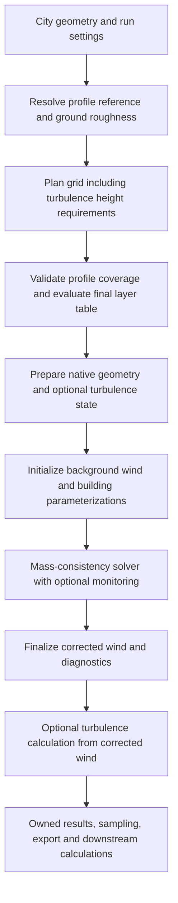

# Unified solver, turbulence and wind-profile integration plan

- Date: 2026-10-31
- Reviewed source revision: `3ae4157ca2ce9dcca90a113a71b8f7651d873b37`
- Status: analysis and proposed implementation plan; implementation has not started.
- Planning revision: incorporates both Claude-plan reviews, permits justified
  API/numerical changes, and prioritizes simple functions and existing types.

This document records the review of the updated solver, turbulence calculations,
and advanced wind profiles as one system. It explains the integration gaps,
why they matter, how to address them, and what evidence is needed before each
change is considered complete. Creating this document does not implement the
recommendations or extend the numerical or physical qualification of the tool.

## 1. Objective and recommendation

The three features should work through one coherent request, execution, and
result contract. A user should be able to choose a background profile, solver
controls, and turbulence settings and understand:

- The effective grid and profile that will be used.
- Whether the requested solver policy is eligible and which method will run.
- Why execution stopped and which outputs have numerical qualification.
- Which references normalize wind and which references belong to turbulence.
- How sampling, datasets, exports, and comfort calculations preserve that
  information.

The current numerical architecture is a useful starting point. Consolidate
configuration, domain requirements, assessment records, and downstream
integration around the clearest supported design. Existing API shapes,
defaults, metadata keys, and numerical results are baselines to evaluate,
not requirements to reproduce indefinitely. Changes to physical models or
expansion of adaptive acceptance still need evidence for their specific claims.

Completion of the integration does **not** require every combination to become
qualified. It requires supported execution, clear limitations, consistent
outputs, and predictable behavior for every exposed combination.

### Revised decision policy

The user explicitly accepts breaking the current API and changing existing
results when this produces better results and/or cleaner code. This supersedes
the earlier recommendation to make the first release strictly additive and
Python-only. The current task remains analysis and planning; this document
does not authorize or implement source changes.

- Prefer one canonical profile, request, validation, and assessment contract.
  Remove redundant legacy paths and aliases when they only preserve accidental
  differences. Retain convenience wrappers only when they remain useful.
- Reuse the existing specs, preparation objects, result classes, dictionaries,
  and tuples. Add a type only when it removes concrete complexity; naming a
  responsibility does not require creating a class for it.
- Unify direct and dataset defaults where the same setting has the same
  purpose. Select values using accuracy, latency, and memory measurements;
  do not preserve two values solely because they are historical defaults.
- Native changes are in scope. The policy hash is a release and qualification
  dependency, not a reason to retain duplicate numerical rules permanently.
- A numerical change can be worthwhile for a simpler implementation even when
  it does not improve accuracy. Measure its effects and establish acceptable
  accuracy and cost; do not describe different results as improved without
  evidence. Reject unbounded or unexplained regressions.
- Use exact comparisons for changes intended to preserve arithmetic. For
  intentional numerical changes, specify the intended behavior and accuracy
  criteria before implementation, compare against independent references,
  and report the differences from the old implementation.
- Document API replacements, changed defaults and numerical conventions, and
  invalidate affected caches. Migration guidance is required; compatibility
  shims, unchanged cache keys, and indefinite dual implementations are not.
- Keep termination, convergence, numerical acceptance, field validity, and
  physical validation distinct. Permission to change results does not establish
  qualification for the changed algorithm or its new scope.

### Incorporation of the other plan

Adopt the concrete suggestions in [Claude's plan](CLAUDE_FEATURE_MERGE_PLAN.md)
for one solver spec replacing scattered settings, self-contained profile
roughness, `Turbulence | None`, a shared profile-record builder, profile rotation,
reference direction, fixture consolidation, and an integrated guide/example.
Use the inferred-versus-fixed dataset-top distinction with one shared planning
order. Reconsider validation and comfort log-law conventions on their merits.

The latest review adds explicit solver-option rules, one authoritative execution
record, mean-only comfort provenance, a corrected qualification workflow, and
separate numerical/metadata/performance checks. It removes the five proposed
private record types and does not require a new `DirectionalFields` class or
provenance fields on `WindSample`.

## 2. Review scope and evidence

The review covered the public Python run/preview API, profile evaluation,
domain preparation, native runner and solver controls, turbulence calculation,
sampling, DTCC export, datasets, comfort inputs, and relevant tests.

The following existing tests were run against the installed OpenMP extension,
with two OpenMP threads, bytecode generation disabled, and pytest's cache
provider disabled:

```sh
PYTHONDONTWRITEBYTECODE=1 OMP_NUM_THREADS=2 .venv/bin/python -B -m pytest \
  tests/test_profiles.py tests/test_solver_control.py \
  tests/test_turbulence.py tests/test_turbulence_domain.py \
  tests/test_monitor.py -q -p no:cacheprovider

PYTHONDONTWRITEBYTECODE=1 OMP_NUM_THREADS=2 .venv/bin/python -B -m pytest \
  tests/test_adaptive_control.py tests/test_datasets.py tests/test_comfort.py \
  -q -p no:cacheprovider
```

Results were respectively **217 passed, 8 skipped** and **161 passed**:
**378 passed, 8 skipped in total**. The native extension was not rebuilt for
this review. These results are focused integration evidence, not a replacement
for fresh-build release checks, serial/OpenMP parity, sanitizer checks, or
physical validation. Skipped checks are not counted as passes.

Additional in-memory probes used the existing one-building fixture, an explicit
grid, eight maximum iterations, and a measured turning profile with heights
`[1, 10, 40]`, speeds `[3, 5, 7]`, directions `[180, 270, 330]`, and a 10 m
reference. For both `height` and `wall_distance` turbulence:

- Legacy, bounded, and unsupported-adaptive runs returned identical wind and
  stress arrays at the same completed work, comparing NaNs as equal.
- The adaptive request reported `unqualified_inflow_profile` on the installed
  build and used the fallback method.
- The bounded run stopped at the iteration limit with `converged=False`, while
  returning turbulence for 20,116 computed cells.

A separate automatic-grid preview with `UniformProfile(5, 270)` reproduced a
metadata inconsistency: the reported `flat_profile_exact_K` at 1.5 m was about
`0.6007619318`; the selected uniform profile's ratio is exactly `1.0`.

During the second plan review, an in-memory planning probe compared the two
orders proposed for automatic domain growth. With four 15 m buildings, 2 m
horizontal resolution, default `VerticalGrid.auto()` settings, and turbulence
reference height 45 m:

| Planning order | Physical layers | Effective top |
| --- | --- | --- |
| Generate at the 35 m wind-only top, then extend the final layer | 38 | 51.051788 m |
| Raise the initial target to 51 m, generate, then extend | 35 | 59.644409 m |

Nine common face positions differed; the first difference was face 27, at
28.980581 m versus 29.255423 m. The probe used `generate_auto_layers`,
`effective_faces`, and `extend_turbulence_faces`; it did not run the wind solver.
It demonstrates why sharing a top-height formula alone does not unify domain
planning. These are observations of existing functions, not implemented changes.

These probes were not committed as tests or saved as a benchmark campaign.
They should become reproducible regression cases in the first implementation
stage. The review made no code changes. The pre-existing untracked `data/`
directory is outside this plan's implementation scope.

Relevant prior work remains authoritative for its declared scope:

- [Wind-profile plan](WIND_PROFILES.md) and
  [current verification](docs/wind-profiles-verification.md).
- [Solver-control roadmap](SOLVER_CONTROL_REFACTOR.md),
  [S7 qualification](docs/solver-control-s7.md), and
  [S9 closure](docs/solver-control-s9.md).
- [Turbulence plan](QES_TURBULENCE.md) and
  [turbulence benchmark](docs/turbulence-benchmark.md).
- [Vertical-grid roadmap](DYNAMIC_VERTICAL_GRID.md) and
  [comfort integration guidance](docs/wind-comfort.md).

Historical plans contain descriptions of earlier implementations. Use current
source and the current verification reports when resolving discrepancies.

## 3. How the features currently interact



The main orchestration is in [wind.py](src/dtcc_qes/wind.py),
[_city.py](src/dtcc_qes/_city.py), and
[wind_runner.cpp](src/qes_core/dtcc/wind_runner.cpp).

Advanced profiles are evaluated in Python float64 at the final float32 physical
cell-centre heights. Native code receives owned u/v layer arrays, validates
and narrows them, initializes the background field, applies building
parameterizations, and runs the same mass-consistency solver. The native
profile kinds remain `Log` and `LayerTable`.

Turbulence runs after wind finalization. It uses corrected wind to calculate
friction velocity, derivatives, stresses, TKE, and dissipation-related output.
It does not update the wind solution through a coupled turbulence/mean-flow
iteration. Its geometry-dependent state is prepared before the solve.

Requesting turbulence nevertheless affects earlier stages in two ways:

1. It can enlarge an automatic domain to provide reference-height margins.
   The changed grid can change the wind field and profile coverage.
2. It excludes the run from the existing adaptive pedestrian acceptance policy,
   changing the effective method when an otherwise eligible adaptive request
   is made.

Fixed-grid, fixed-completed-work comparisons are therefore necessary when
isolating the numerical effect of enabling turbulence.

### Existing design decisions to retain or evaluate

- One advanced-profile native path, with no duplicate native measured or
  power-law evaluator.
- One canonical log-profile specification. Evaluate retaining native analytic
  evaluation versus using common profile sampling; historical bitwise output
  alone does not decide this choice.
- Shared geometry/domain preparation between preview and execution.
- Owned native inputs and returned arrays, with transactional validation of
  profile tables.
- The separation of immutable geometry/operator state from per-condition wind.
- Conservative interpolation of velocity and stress components, including
  invalid-contributor evidence for stress-derived statistics.
- Distinct legacy convergence and adaptive acceptance semantics.
- QES-free binding headers and the in-memory, no-file-I/O native architecture.

## 4. Findings and proposed resolutions

### F1. Adaptive acceptance does not compose with advanced profiles or turbulence

**Observed behavior.**
[pedestrian_scope](src/qes_core/dtcc/pedestrian_policy.cpp) rejects layer-table
inflow with `unqualified_inflow_profile` and enabled turbulence with
`turbulence_outside_assessment_scope`. Build, precision, grid, geometry, and
observable restrictions apply as well. The first failed check determines the
reported reason; another build can report `unqualified_build` first.

| Combination | Execution supported | Existing adaptive acceptance |
| --- | --- | --- |
| Log profile, wind only | Yes | Only within the qualified scope |
| Advanced profile, wind only | Yes | Unavailable |
| Log profile with turbulence | Yes | Unavailable |
| Advanced profile with turbulence | Yes | Unavailable |

The controller preserves the requested adaptive mode in its record but disables
the qualified adaptive algorithm for unsupported configurations. Such runs use
the bounded/legacy-tolerance path and relaxation `1.78f`; eligible adaptive runs
use `1.90f`. See [solver_control.cpp](src/qes_core/dtcc/solver_control.cpp) and
[wind_runner.cpp](src/qes_core/dtcc/wind_runner.cpp).

**Why address it.** A user can add turbulence or change profile family and
unexpectedly lose adaptive stopping. The current restriction is defensible,
but its consequences are difficult to discover before native preparation and
execution. A single acceptance flag also cannot express a future situation
where selected mean-wind outputs qualify but turbulence does not.

**How to address it.**

1. Introduce a structured eligibility result with requested mode, anticipated
   effective mode, supported scope, and an ordered list of exclusion reasons.
   Define a deterministic primary reason and stable reason codes in the new
   schema; retaining the old ordering is optional.
2. Evaluate input-known restrictions before expensive native preparation.
   Evaluate geometry/grid restrictions after domain planning. Recheck
   execution-dependent restrictions, including actual thread count, at runtime.
3. Keep the authoritative eligibility rules native where practical; expose a
   QES-free query over lightweight inputs rather than maintaining a second
   Python copy of the policy. A preview must describe provisional eligibility
   when runtime facts are not yet known.
   Keep pending runtime checks explicit. The final result must use runtime
   exclusions and the actual effective method, not copy the preview verdict.
4. Represent qualification per output scope. Initially this is a faithful
   description of current behavior, not an expanded acceptance policy.
5. Consider allowing qualified mean-wind assessment with optional turbulence
   only in a later, separately verified policy revision. Compare the same grid,
   completed iterates, wind outputs, and assessment decisions with turbulence
   enabled and disabled. Turbulence output remains separately unqualified.

Do not remove the existing guards merely because the features execute together.
Advanced-profile acceptance requires calibration and held-out verification for
those profiles; turbulence acceptance needs turbulence-specific evidence.

### F2. Domain planning couples turbulence to profile coverage and wind numerics

**Observed behavior.** [_city.py](src/dtcc_qes/_city.py) extends eligible
automatic domains to satisfy turbulence reference heights. Explicit bounds or
faces are checked and rejected when insufficient. Profile tables are correctly
evaluated after this process in [wind.py](src/dtcc_qes/wind.py).

**Why address it.** Enabling turbulence can introduce new upper layers outside
a measured profile's permitted range. An otherwise valid profile with
`above="error"` can therefore fail, while `above="constant"` can add more
extrapolated layers. The same change may increase solve cost and alter the
wind field. These consequences belong in one preparation explanation.

**How to address it.** Preserve the existing ordering and use the existing
domain metadata to record the original top, effective top, added
layers, regeneration status, final centres, profile coverage, and tail counts.
Associate each domain requirement with its source: roof clearance, profile
reference, turbulence reference plane, or rotation requirement. Coverage errors
should name the requested height and, when applicable, the turbulence-driven
extension that introduced it. Never silently change the user's tail policy or
expand explicit bounds.

Comparison tools and examples should explicitly freeze a common grid when
isolating the effect of turbulence on/off. Evaluate domain-default changes
separately so their effects are distinguishable from closure changes.

### F3. Automatic-grid profile diagnostics remain logarithmic

**Observed behavior.** The `pedestrian_sampling` metadata in
[_city.py](src/dtcc_qes/_city.py) calculates `flat_profile_exact_K`,
`flat_profile_interpolated_K`, and `flat_profile_bias_K` using a log formula,
without knowing the selected advanced profile. The uniform-profile probe in
section 2 confirms that these values do not describe that profile.

**Why address it.** Grid diagnostics can mislead users evaluating pedestrian
sampling for a measured, turning, uniform, or power-law background. The issue
is metadata semantics; the review did not demonstrate a corresponding
incorrect solved field.

**How to address it.** Keep geometric support calculation in domain planning,
then calculate profile-dependent diagnostics after the condition and final
grid have been resolved. Evaluate u/v at the target and its supporting centres,
interpolate components, and only then calculate magnitudes and normalized
ratios. For turning profiles also expose vector interpolation error; a small
speed error alone can hide a directional error.

Replace the misleading fields with selected-profile diagnostics in the revised
metadata schema. Keep a separate logarithmic benchmark only if it remains useful
for grid studies; retaining the old keys is not a requirement.
For a calm reference, normalized values should be unavailable with a reason;
use JSON-safe nulls in metadata and retain dimensional vector errors. Profile
evaluation errors must continue to respect declared coverage policies.

### F4. Profile and turbulence references are distinct but scattered

**Observed behavior.** The inflow reference controls normalization in solver
monitors and `WindResult.speedup`. Turbulence derives another reference using
building morphology or configured roughness. With buildings its reference
height is three times mean building height, roughness is one tenth of that
mean, and displacement height is seven tenths of that mean. Its reference
speed comes from the solved field. Building directions use roof-level wind;
turbulence stress rotation samples near 15 m, with a fallback when needed.

These choices are visible in [profiles.py](src/dtcc_qes/profiles.py),
[TURBGeneralData.cpp](src/qes_core/winds/TURBGeneralData.cpp), and
[turbulence.py](src/dtcc_qes/turbulence.py).

**Why address it.** Identically named concepts such as reference speed and
roughness can be mistaken for one shared quantity. With arbitrary shear,
turning, or jets, a morphometric log-law conversion is not automatically a
physically consistent description of the supplied profile. The implementation
already records caveats; the integration should make their basis inspectable.

**How to address it.** Use the existing profile, model and turbulence metadata
to name inflow, ground, building-parameterization and turbulence references
separately. Add missing declared/effective values, reference origins, purposes,
direction conventions and model versions there. Generate consumer summaries
from these records with a shared function; do not add a parallel model-context
object containing copies of the same references.

Do not force these references to be numerically equal. Changes to the
friction-velocity conversion, 15 m rotation convention, or wake orientation are
allowed when justified, but each changes model behavior and needs a versioned
model study. Any fitted log law must be explicit. Code consolidation alone
does not establish that a shared physical reference is appropriate.

### F5. Turbulence validity does not describe parent-solve quality

**Observed behavior.** [wind_runner.cpp](src/qes_core/dtcc/wind_runner.cpp)
calculates turbulence after finalization even when the returned wind has not
met legacy tolerance. Turbulence masks describe computed coverage, capping,
and covariance validity. They do not describe convergence or numerical error
in the mean wind from which gradients and stresses were calculated.

**Why address it.** Users can mistake a computed, finite, covariance-valid
tensor for a numerically qualified turbulence prediction. That distinction
becomes especially important with bounded runs. Pedestrian mean-wind
stability alone also does not establish stability of turbulence gradients or
the reference plane used by the turbulence closure.

**How to address it.** Store the parent execution record once, including completed
iterations, termination reason, legacy convergence, requested mode, effective
method, assessment status/reason, runtime exclusions, and assessed output scope.
Generate turbulence and export provenance from it. Keep raw fields inspectable.
Use the common solver outcome policy specified in section 6; incomplete runs
must never be silently classified as successful assessed outputs.

Separate these concepts in the result schema:

| Concept | Meaning |
| --- | --- |
| Execution status | Work completed, stopped at a limit, or failed |
| Legacy convergence | The multiplier-change tolerance was satisfied |
| Numerical assessment | A named policy assessed a specific output scope |
| Field validity | Coverage, finite values, covariance validity, contributor validity |
| Model qualification | Evidence concerning physical applicability and validation |

Use explicit `not_requested`, `not_assessed`, `accepted`, and `unaccepted`
states where appropriate; do not manufacture an acceptance result for a
legacy or bounded solve. An unsupported adaptive request is `not_assessed`;
an eligible request that fails acceptance is `unaccepted`. Store this in the
solver execution metadata and make `result.qualification` assemble a view from
that record and the existing feature metadata. Do not maintain independently
updated copies in solver, qualification, and turbulence dictionaries. Exported
snapshots should all come from the same helper. Avoid an exclusive `wind_basis`
enum: accepted results can be unconverged under the legacy test, and a deadline
can coincide with legacy convergence. Assessments describe original outputs;
editing arrays does not requalify them.

### F6. Timing and resource expectations need a unified explanation

**Observed behavior.** `max_solve_seconds` is a cooperative native solve budget.
Preparation and required output/turbulence work have separate timing scopes.
Turbulence allocation and domain growth can also increase resource use before
the timed solve. See [solver_control.py](src/dtcc_qes/solver_control.py) and
[wind_runner.cpp](src/qes_core/dtcc/wind_runner.cpp).

**Why address it.** Adding turbulence can substantially change total latency
without changing the requested solve budget. `max_cells` limits cell count,
not total peak memory. A unified workflow should make those distinctions
visible without implying a hard wall-clock or memory guarantee.

**How to address it.** Preserve the existing budget contract. Record the public
call total with one monotonic timer pair and explain the existing native timing
scopes. Reuse phase measurements where available; additional instrumentation
should answer a concrete diagnostic question. Do not add overlapping timers
to estimate a total or manufacture missing phase values. Memory estimates and
strict end-to-end cancellation are separate work, not requirements for this
integration.

### F7. Dataset support and defaults diverge from direct execution

**Observed behavior.** [QESWindArgs](src/dtcc_qes/datasets.py) accepts profiles
and solver controls but has no turbulence argument. Dataset slices currently
export mean wind and related validity fields, not turbulence. Direct
`WindResult.to_dtcc()` already supports selected turbulence fields.

| Setting | Direct `wind.run()` | Dataset |
| --- | --- | --- |
| Tolerance | `1e-5` | `1e-4` |
| Maximum iterations | 500 | 1,000 |
| Maximum cells | 20,000,000 | 200,000,000 |

The dataset turbulence gap was explicitly deferred in the previous turbulence
plan. It is an unfinished integration item rather than evidence that its
authors intended all three features to be available through this entry point.

**Why address it.** Users cannot access the full combination through datasets,
and moving between entry points can change effective execution settings.
New turbulence choices must also participate in cache identity; otherwise
different requested products could be confused.

**How to address it.** Use `Turbulence | None` directly and its serialized mapping
or null in datasets. Add serialization to the existing specification instead
of introducing a separate request type or bool shorthand. Include normalized
settings and relevant implementation/schema identity
in dataset request provenance and cache identity. Inspect the actual DTCC cache
contract before choosing identity fields; do not assume package version alone
invalidates changed numerical implementations.

Use a shared resolver for common options while keeping dataset acquisition and
geometry conditioning in their current layer. Define one shared set of solver
defaults, selected using representative accuracy/cost measurements. Any
entry-point-specific setting must have an explicit operational reason. Record
effective values and document changes from both previous default sets.
The existing 20M/200M `max_cells` limits may remain entry-point-specific capacity
limits if justified and documented; they are not different solver tolerances.

The dataset adapter converts four-coordinate bounds into a derived
six-coordinate box in [_dataset_city.py](src/dtcc_qes/_dataset_city.py).
`prepare_domain` currently treats any supplied bounds as explicit. Carry
whether the top was user-fixed or inferred in the shared domain request.
Allow an inferred top to grow for turbulence, including automatic-grid
regeneration; keep user-fixed tops and explicit faces check-only. Do not try
to repair this merely by increasing a top estimate before grid generation.

Apply the complete order in one function: determine the wind-only target,
generate layers, handle a genuinely infeasible initial fit, and apply the
turbulence margin/extension. The dataset adapter supplies conditioned geometry,
horizontal bounds, and whether its top is fixed or inferred; it must not
pre-raise the inferred top independently. If the order is deliberately changed,
change both entry points together. Test final faces, centres, profile support,
and results on identical conditioned geometry, not just equal estimated tops.

Extend field and slice products with a documented turbulence field set and
units. For vertical interpolation, interpolate stress components and project
along sampled mean velocity afterward; never interpolate already-derived
standard deviations or intensities as a shortcut. Export nonuniform results
only through a representation that actually preserves their coordinates;
lifting the existing restriction needs such a representation.

### F8. Sampling and comfort lose useful run context

**Observed behavior.** [WindSample](src/dtcc_qes/result.py) carries arrays,
coordinates, height, and validity, but not the inflow reference or parent solver
assessment. [comfort.assess](src/dtcc_qes/comfort.py) accepts arrays with
separately supplied reference speeds, directions, height, and optional GEM
provenance. This generic API is useful, but callers must manually reconnect
information already present in wind results.

**Why address it.** Manual assembly can mix reference conventions, sampling
heights, grids, or numerical statuses. A dataset/comfort result may otherwise
lose the reason an upstream solve was unassessed or why turbulence statistics
were masked.

**How to address it.** Add a small adapter accepting whole wind results, sampling
them and returning the existing `ComfortResult` or ordinary prepared arguments
for `comfort.assess`. Start without a `DirectionalFields` class or changes to
`WindSample`. Check coordinate alignment, CRS/origin, actual sampled height and
method, positive reference speeds, and declared field directions.

Carry per-direction profile and assessment provenance into the final comfort
result for both mean-only and GEM calculations. Current `gem_metadata` requires
GEM fields, so it cannot be the only route. A copied metadata entry assembled
by the adapter is sufficient; do not introduce a provenance type for this.
Keep any prepared arrays and metadata independent of subsequent edits to the
source results. Reference speeds may differ between directions.

Do not require identical reference speeds across directions: the existing
comfort API supports one reference per field. For turning profiles, use an
explicit declared reference direction or require the caller to provide field
direction; never infer a sector from local pedestrian wind. Climate exposure
conversion remains an explicit caller responsibility.

Add `WindResult.reference_direction` and a profile `with_direction(direction)`
operation. Rotate all measured vectors by the offset between the current and
requested reference directions, retaining relative turning, amplitudes, tails,
and metadata. Reject absolute-direction assignment when the reference is calm.
Test speed/direction and u/v encodings, wraparound, inverse rotations, and
serialization. This convenience does not require a public prepared-run or
multi-direction solver API.

Preserve NaNs and invalid-contributor evidence. Require an explicit peak factor
when building GEM, preserve averaging-time assumptions and model limitations,
and never convert a mean-wind acceptance flag into gust qualification. Keep
`comfort.py` independent of the native solver and DTCC model imports.

### F9. Exposure transfer and inflow use different log-law conventions

**Observed behavior.** `comfort.log_law_transfer` uses `log(z/z0)` while
`LogProfile` and native log inflow use `log(1 + z/z0)`. In the existing comfort
test's 10 m transfer from roughness 0.03 m to 0.5 m with a 60 m blending height,
switching both factors to the shifted form changes the multiplier from about
0.818744 to 0.830265, an increase of 1.41%. This was checked arithmetically
during the plan comparison; no source or expected test values were changed.

**Why address it.** A QES workflow should make its climate and inflow conventions
explicit. The difference is no longer a reason to reject the proposal on
compatibility grounds, but matching formula names does not establish a better
exposure model, especially for measured or power-law profiles.

**How to address it.** Specify source and target reference conventions, including
height, roughness, displacement assumptions, and whether each logarithmic law
is shifted. Make QES-facing conversion consistent with the selected target
inflow convention. Where a generic conversion needs both log formulations,
retain them as explicit model choices rather than hidden legacy behavior.
Changing the default is allowed after the intended convention is chosen.

Test analytic identity and reciprocal transfers under matching assumptions,
valid domains, roughness extremes, and downstream mean/GEM classifications
using representative climates. Quantify classification changes rather than
only replacing expected numerical constants. Preserve the generic comfort
calculation's solver independence; choose a dependency-light location for shared
mathematics if sharing actually removes meaningful duplication. Do not apply
a log-law climate conversion automatically to arbitrary non-log profiles.

## 5. Duplication and consolidation boundaries

| Area | Current locations | Proposed treatment |
| --- | --- | --- |
| Turbulence reference-height arithmetic | `_turbulence_domain.py`, `dtcc/turbulence.cpp`, `winds/TURBGeneralData.cpp` | One authoritative numerical helper; retain arithmetic for an equivalence-only change or validate a deliberate replacement |
| Turbulence margin and suggested tail | `_turbulence_domain.py`, `dtcc/turbulence.cpp` | Share coordinate-only margin analysis and structured extension results |
| Request conflicts and solver restrictions | `wind.py`, `datasets.py`, specification validators | One semantic request resolver, with serializers and public validation delegating to it |
| Profile request schema | Dataclasses in `profiles.py`, typed payloads in `datasets.py` | Keep explicit API schema, but share conversion and test schema/runtime parity |
| Profile result records | Log record in `wind.run`, advanced record in `profiles._layer_record`, later metadata patch-ups | One builder for all profile kinds and both preview/run contexts |
| Sampling support and validity | `result.py`, `dtcc/monitor.cpp`, dataset slicing | One documented contract with cross-language parity fixtures; reuse Python sampling in exports |
| Stress validity | `api/stress_validity.h`, `result.py` | Shared constants and numerical contract; retain float64-capable Python revalidation |
| Derived-statistic work | `result.py` export and properties | Reuse classification and projection within one operation |
| Scalar validation | `_city.py`, `profiles.py`, `solver_control.py`, `comfort.py`, grid validators | Define consistent accepted scalar types, then share primitives; retain domain-specific range and native-representation checks |
| Test setup | Repeated cities, specification builders, synthetic results and tool loading | Shared fixtures/builders; keep independent numerical oracles independent of production calculations |

For scalar inputs, prefer finite Python/NumPy real scalars, reject booleans,
strings and arrays, and handle conversion explicitly at data-ingestion boundaries.
Signed coordinates and velocities still differ from nonnegative speeds and
positive lengths. Apply float32 representability checks only where the effective
native operand requires them. This deliberately changes some accepted inputs;
test the new contract instead of reproducing every old coercion and message.

### Domain-rule consolidation

The most valuable numerical consolidation is the turbulence domain rule.
Introduce a small, coordinate-only helper in the owned native core, independent
of solver allocation. Expose a QES-free result through the bridge for Python
planning. It should return the reference height, required support/margin,
extension feasibility, sufficient constant tail, and structured limit reason.

The runtime turbulence model and native runner should use the same underlying
reference calculation. Python should format preparation errors from structured
results rather than maintain a parallel numerical algorithm. Independent
boundary checks remain useful; repeated checks should call shared rules.

Keep physical faces distinct from native ghost faces, and solver thicknesses
distinct from accumulated face differences. Cell/index limits and progress
checks remain correctness requirements. Use the existing sorted float32
calculation as the comparison baseline. A deterministic wider-precision
replacement is permissible, but test boundary classifications, resulting faces,
references, wind and stresses before selecting it. Mathematical equivalence
alone does not establish identical discretized behavior or improved accuracy.

### Sampling and covariance boundaries

Native monitoring needs to sample evolving solver state without materializing
the entire Python result. Python sampling must also handle editable arrays and
float64 interpolants. Sharing one execution implementation across that boundary
could increase cost or change precision. Prefer a shared contract and direct
parity tests before attempting a structural merger.

Similarly, native covariance classification cannot simply replace Python
revalidation: users may edit arrays, and interpolated tensors are float64.
Within `to_dtcc()` or an explicit statistics operation, reuse the complete
`(valid, tolerance)` pair from `_stress_validity` when computing standard
deviation and intensity. `_streamwise_std` needs the tolerance to classify
roundoff-sized negative projected variances; passing a boolean mask alone is
insufficient. Use an ordinary tuple/private argument, not a new result type.
Do not cache these indefinitely on mutable results. Keep contributor validity
separate from the validity of the interpolated tensor.

The reference-only `QES-Public` tree and frozen study source snapshots are not
duplicate production implementations to delete or refactor.

Current benchmark drivers may be updated to use shared preparation while
retaining phase-specific instrumentation. Preserve archived source snapshots
and reports, version changed metrics, and produce new evidence. Historical
tools do not impose permanent private-API compatibility on the current package.

## 6. Simple implementation structure

Use existing feature specs and result classes, with small shared functions.
There is no need for new request, preparation, execution, model-context, or
output-context classes. The existing domain object and metadata dictionaries
already carry most of the required information.

| Responsibility | Implementation home |
| --- | --- |
| Inflow and roughness | Existing profile classes and one condition resolver |
| Solver settings and outcome policy | Extend/rename `SolverControl` to `Solver`, replacing the scattered kwargs |
| Optional turbulence | Existing `Turbulence` class or `None` |
| Geometry, domain planning and profile support | Existing preparation functions and domain object |
| Execution/assessment | One stored solver metadata record; qualification is a derived view |
| Comfort assembly | Small adapter using `WindResult.sample` and existing comfort calculations |

Resolve common settings once and use the same helpers in preview/run and
dataset adapters. Keep geometry fetching outside these helpers. Preserve
omitted-versus-explicit information where it affects conflicts, and keep native
allocation out of validation and preview.

### One solver specification and explicit outcome rules

`Solver` replaces the current `SolverControl` rather than coexisting with it.
It owns tolerance, iteration limit, precision, optional budget, monitor, policy,
checkpoint/residual intervals, and one `raise_on_failure` option. Keep specs
immutable and give all entry points the same defaults. Do not add a second
wrapper around this spec or a mode class; derive the mode from its settings.

For the initial implementation, retain the combinations the native controller
can execute and validate them before geometry acquisition:

| Policy | Budget | Monitor | Result |
| --- | --- | --- | --- |
| None | None | None | Legacy tolerance/iteration-limited solve |
| None | Positive finite seconds | Provided | Bounded solve |
| Supported policy | Positive finite seconds | Provided | Adaptive request, subject to eligibility |
| Any other combination | Any | Any | Input error with the missing/conflicting setting |

Reject unknown policies and non-default control-only options in legacy mode.
Check policy-specific cadence/history requirements. Monitoring without a budget
or adaptive execution without a deadline can be future extensions; do not
simulate an absent deadline with an arbitrary huge number.

When `raise_on_failure=False`, return available finite partial results with
their actual status. With it enabled, a legacy or bounded iteration-limited
solve that misses tolerance raises the existing convergence error, a bounded
`time_limit` raises the budget error, and an adaptive result that is
`unaccepted` or `not_assessed` raises the existing
unaccepted-result error. A bounded deadline remains a budget failure even if
legacy convergence occurred at the same point; retain both facts in its record.
Extend the budget error's documented record semantics to cover completed work
when necessary. Invalid input, zero-work budget exhaustion, and numerical
failure remain errors regardless of this flag. No new exception family is
needed. Test these precedence rules directly with the native test clock.

### Self-contained profiles and shared metadata

Make profile objects the canonical inflow specification. Scalar convenience
calls, if retained, should construct that specification and enter the same
resolver. Remove their independent metadata and validation paths. One shared
profile record should describe supplied inputs; a grid-only preview must report
unknown speed/direction rather than treat placeholder zeros as a calm request.

Put `roughness_length` on every profile so `evaluate`, `reference_at`, lower
tails, rotation, scaling and serialization all use the same stored setting.
Remove the parallel run-level override and update every dependent method in
the same change. Version the profile payload and give old payloads a clear
migration message. Inflow/ground roughness and the turbulence model's derived
morphometric roughness remain separately named physical quantities.

Choose the native evaluation strategy on accuracy and simplicity. An analytic
log evaluator may remain useful at off-grid heights; a common sampled profile
path may simplify implementation. Compare the alternatives at physical centres,
roof-level supports and references, including roughness extremes and grid
refinement. If a common path is adequate, remove the old branch even if fields
change. Do not retain it solely to reproduce historical bits. Avoid redundant
bulk evaluations, and resolve measured lower-tail roughness consistently.

If native profiles share one storage format, separate their declared family and
evaluation revision from that format when checking policy scope. The current
policy tests the native log/table distinction. A table generated from a log
specification would need explicit evidence for the new evaluation path; a
non-log table must never become eligible merely because it has log-like
reference scalars.

Use one canonical naming and serialization scheme for profile kind, solver
settings, turbulence, and assessment. Remove redundant aliases and obsolete
metadata when justified; provide a concise old-to-new API map. A shared internal
description does not imply a public reusable prepared model; the previous
[S8a study](docs/solver-control-s8a.md) deferred that API on measured benefit.
Benchmark any proposed reuse API separately.

## 7. Implementation stages and acceptance gates

All checkboxes below describe future work. Each stage should be reviewable on
its own and should state whether it changes numerical behavior, metadata, API,
or qualification.

Implement characterization first. Request/metadata work and the native domain
helper can then proceed in separate reviewable changes, followed by downstream
integration and release validation. A Python-only interim release is optional;
preserving the native policy hash is not a condition for finishing the design.
Keep arithmetic-preserving cleanup separate from intentional numerical changes
where practical so each result difference has an identifiable cause.
Migrate affected examples, tests and live tools in the same change as each
breaking API revision. Do not postpone all caller updates to the final cleanup
stage. Archived evidence and its bundled sources remain untouched.

### Stage A — Capture the combined contract

**Why:** individual feature suites do not fully define behavior at their
intersections. Refactoring without explicit combined invariants risks changing
fallbacks, profile coverage, or returned stress without noticing.

**How:** add focused combined-feature tests using small, deterministic fixtures.
Convert the review probes into maintained cases. Use fixed completed work for
field comparisons; use the native test clock for deadline semantics rather
than fragile wall-clock thresholds. Separate numerical comparisons from schema
and timing checks as described in section 8. Reuse existing comparison helpers
and fixtures before creating another general benchmark tool.

- [ ] Record baseline wind, stress, masks, coordinates, reference metadata,
      termination, and acceptance behavior for representative combinations.
- [ ] Distinguish correctness invariants from historical behavior that may
      change. Specify independent references and accuracy/cost criteria for
      each planned numerical change before adjusting expected outputs.
- [ ] Assert turbulence on/off leaves wind unchanged on an identical grid
      with identical completed work and effective solver method.
- [ ] Assert bounded controls preserve the corresponding completed-work wind
      and turbulence outputs.
- [ ] Assert unsupported adaptive requests are reported according to the
      chosen outcome policy and never inherit qualification from log-profile
      reference scalars.
- [ ] Add regression cases for automatic-grid profile diagnostics and
      turbulence-driven measured-profile coverage failure.
- [ ] Capture the generate-then-extend versus pre-raised-top probe and assert
      one planning order across direct and dataset workflows after integration.
- [ ] Record the source/build identity with each baseline. Compare deterministic
      values exactly where promised; validate timings and changed metadata
      separately rather than treating them as bitwise-stable outputs.

**Gate:** current behavior is characterized and target contracts are explicit.
Historical tolerances and references remain archived. New expected values and
tolerances must follow the new specification and independent evidence rather
than being adjusted merely to make changed outputs pass.

### Stage B — Resolve requests consistently and correct profile diagnostics

**Why:** the same logical request should have the same meaning in direct,
preview, and dataset paths. Separate defaults and validators currently obscure
that meaning and add maintenance work.

**How:** factor shared resolution into small functions in the existing modules;
extract a private module only if it simplifies their dependencies. Delegate
dataset validation to those functions after schema parsing. Keep geometry fetching
outside the resolver. Attach profile-dependent sampling diagnostics after final
grid planning. Define canonical serializers alongside the specifications and
one profile-record builder. Select one shared set of solver defaults using the
baseline cases, then expose effective values in every result.

- [ ] Make the profile specification authoritative; remove duplicate scalar
      validation and metadata paths. Retain scalar shorthand only if useful.
- [ ] Define one scalar-type contract, clear argument conflicts, and explicit
      reference/roughness semantics, including calm references.
- [ ] Consolidate solver settings into the replacement `Solver` spec; test the
      option combinations and failure precedence in section 6.
- [ ] Move roughness into each profile and update evaluation, references,
      scaling, rotation and serialization together, including measured tails.
- [ ] Verify new-schema JSON round trips, strict payload validation, and early
      failure before city fetching for input-known errors; document replacements.
- [ ] Adopt common solver defaults and measure differences from both previous
      default sets. Record any justified operational overrides.
- [ ] Replace misleading grid diagnostics with selected-profile component and
      speed diagnostics. Represent unknown preview references explicitly.
- [ ] Select and validate analytic versus common sampled log evaluation;
      remove special handling that has no accuracy or performance benefit.
- [ ] Avoid extra bulk layer-table evaluation or native allocation in preview.

**Likely files:** `wind.py`, `profiles.py`, `solver_control.py`, `_city.py`,
`turbulence.py`, `datasets.py`, and `vertical_grid.py`. A changed
native log representation also affects bindings, profile consumers, and policy
scope; include those files and the corresponding native validation explicitly.

**Gate:** equal resolved settings produce equal results across adapters;
equivalent retained input spellings enter the same path; uniform-profile
diagnostics report a ratio of one. Any changed defaults or log evaluation
meet the specified accuracy/cost criteria, with numerical differences reported.

### Stage C — Consolidate turbulence domain requirements

**Why:** reference-height and margin arithmetic must not drift between preview,
native checks, and actual turbulence construction.

**How:** implement the coordinate-only helper described in section 5, route
existing consumers through it, and define its precision, indexing, and error
contract. Begin with shared existing arithmetic to isolate structural changes;
evaluate a simpler or more robust numerical formulation as a separate change
if warranted. Include the origin of domain limits in the shared request.
Keep the full generation/extension order shared between entry points; the
dataset adapter must not pre-apply the turbulence requirement.

- [ ] Compare old and shared reference calculations over empty domains,
      reordered buildings, heterogeneous heights, and rounding boundaries.
- [ ] Compare margin/extension results on uniform and stretched grids,
      exact-face references, thin layers, and insufficient explicit domains.
- [ ] Enforce cell/index limits and reject operations that overflow or cannot
      advance effective coordinates under the chosen arithmetic contract.
- [ ] Distinguish inferred dataset tops from user-fixed tops; test extension,
      automatic-grid regeneration, measured-profile coverage errors, and limits.
- [ ] Confirm preview/run equality. Use exact baseline comparisons for unchanged
      arithmetic and independently justified tolerances for deliberate changes.
- [ ] Compare direct and dataset final faces, centres, reference heights and
      profile tables on the same conditioned geometry, then compare wind/stress.
- [ ] Run affected native checks, sanitizers, and policy parity checks.

**Likely files:** `_turbulence_domain.py`, `_city.py`, `src/cpp/bindings.cpp`,
QES-free API headers, `dtcc/turbulence.cpp`, and `winds/TURBGeneralData.cpp`.

**Gate:** one authoritative domain rule drives planning and runtime. Every
change in faces, reference values, accepted domains, wind or turbulence has a
documented cause and meets the target contract. User-fixed boundaries and
native safety limits remain respected; qualification evidence matches the
implementation being released.

### Stage D — Add eligibility and per-output execution context

**Why:** users need to know which method runs and what its assessment means,
including when downstream turbulence is calculated from a limited solve.

**How:** expose lightweight policy eligibility, store execution facts once in
solver metadata, and derive qualification/provenance views using small functions.
Keep the existing profile and turbulence reference records. Add no assessment
class or sample fields. Define the preflight API explicitly: a
geometry preview and a solver eligibility assessment have different required
inputs even if exposed through one convenient entry point.

- [ ] Report all input-known exclusion reasons and distinguish pending
      runtime checks from confirmed eligibility.
- [ ] Replace provisional exclusions with runtime facts in completed results,
      including the actual thread team. Check first-reason parity where the
      existing ordering is retained, and report dependent checks as pending
      when their prerequisites are unavailable.
- [ ] Record requested and effective mode/method consistently in direct and
      dataset results.
- [ ] Derive turbulence and exported parent-solve provenance from the single
      execution record; test consistency of every public view.
- [ ] Separate execution status, numerical scope, masks, and physical limits.
- [ ] Clarify timing inclusion rules and record public-call total separately.
- [ ] Define consistent partial-result, warning, and exception behavior across
      direct and dataset APIs. Replace conflicting flags if needed.
- [ ] Test simultaneous states such as accepted-but-not-legacy-converged and
      time-limited-but-legacy-converged; avoid an exclusive summary enum.
- [ ] Distinguish `not_requested`, `not_assessed`, `accepted`, and `unaccepted`
      without inferring acceptance from convergence or finite fields.

**Likely files:** `solver_control.py`, `result.py`, `wind.py`, `turbulence.py`,
`dtcc/pedestrian_policy.*`, `dtcc/solver_control.*`, `dtcc/api/*`, and bindings.

**Gate:** consumers can explain an unsupported combination before solving and
its actual outcome afterward, without broadening any acceptance claim.

### Stage E — Complete dataset, export, and comfort integration

**Why:** a unified numerical pipeline is insufficient if a major entry point
cannot request turbulence or downstream products lose its context.

**How:** add serialized `Turbulence | None` settings and canonical identity,
extend products, and implement a small result-to-comfort function using the
existing comfort result. Reuse `WindResult.sample`
for vertical sampling. Specify x/y slice behavior separately; retain nearest
sampling where appropriate rather than claiming unsupported interpolation.
Add profile rotation and reference-direction access. Implement the exposure
conversion convention selected through F9 and document its physical assumptions.

- [ ] Support `Turbulence`/`None` directly and a serialized spec/null in datasets,
      with canonical JSON normalization and strict validation.
- [ ] Verify cache identity separates off/on and the two mixing-length methods,
      profiles/tails, solver controls, and relevant implementation revisions.
- [ ] Invalidate cached outputs affected by changed defaults, preparation,
      metadata or numerics. Do not require unchanged legacy cache keys.
- [ ] Verify cache hits preserve stored execution/assessment provenance;
      time-budgeted output must not be presented as deterministic work.
- [ ] Export a consistent documented set of raw/derived turbulence fields,
      units, coverage, capping, and validity where the product supports them.
- [ ] Preserve stress-component interpolation and contributor validity in
      slices; do not infer validity from finite derived values alone.
- [ ] Carry profile references and parent assessments to comfort input assembly.
- [ ] Preserve per-direction provenance in final mean-only and GEM comfort
      results. Do not restrict it to `gem_metadata` or add a new wrapper type.
- [ ] Test profile rotation and reference directions across all input encodings,
      preserving relative turning and rejecting undefined calm directions.
- [ ] Validate the selected exposure-conversion formulas analytically and
      measure effects on comfort classifications; record source/target laws.
- [ ] Validate alignment, sample height, normalization, and GEM assumptions
      without adding native dependencies to the generic comfort module.

**Gate:** direct and dataset workflows return equivalent arrays and metadata
semantics under the same conditioned geometry and resolved settings; acquisition
provenance and timings may differ. Invalid samples remain unassessed
in comfort; no fallback replaces NaNs with zeros.

### Stage F — Remove redundant work and publish the integrated contract

**Why:** once semantics are shared, repeated statistics and metadata assembly
can be removed without confusing optimization with scientific model changes.

**How:** reuse covariance classification/projection within exports and explicit
statistics operations, passing both validity and tolerance; avoid persistent
caching of editable arrays. Update
documentation and a combined example to show profile selection, preview,
bounded execution, turbulence sampling, and assessment inspection. Consolidate
test setup and modernize current benchmark drivers where useful without
rewriting historical evidence.

- [ ] Check costs on a wind-only solve, a combined-feature solve, and a
      turbulence export. Reuse existing timing tools, repeat runs consistently,
      and count expensive profile/eigensolver operations where relevant.
- [ ] Check that wind-only calls do not allocate turbulence arrays and
      controls-disabled calls do not allocate monitor histories.
- [ ] Compare performance at equal grids, completed work, and output sets.
      Declare review budgets before measuring and report regressions honestly.
      Broaden measurement only for unexplained regressions or allocation changes;
      a new performance framework or memory estimator is not required.
- [ ] Document capability combinations, defaults, reference meanings, timing,
      and qualification boundaries in one user-facing guide.
- [ ] Rewrite stale README option/status tables, give solver controls their
      own example, and cross-link the feature guides and historical reports.
- [ ] Replace repeated city/settings/result fixtures and imports between test
      modules with shared builders; retain independent numerical oracles.
- [ ] Publish an API replacement map and examples using the new canonical
      contract. Remove obsolete aliases and private-signature workarounds.
- [ ] Run fresh serial/OpenMP and relevant sanitizer/release checks.
- [ ] Adapt the candidate validation workflow in section 8; verify the tools
      actually load the candidate source and exercise adaptive acceptance.
- [ ] Retain historical evidence and publish new evidence separately.

**Gate:** the integrated release has a reproducible combined-feature suite,
clear API/numerical change notes, and measured costs. It does not claim to resolve
previously deferred performance or physical-validation work without evidence.

### Stage G — Separate qualification extension

**Why:** API consistency cannot establish numerical or physical validity for
new output scopes.

**How:** start with a narrow question: can eligible mean-wind acceptance remain
valid with optional turbulence on the same grid? Verify preparation does not
introduce unexplained mean-field or decision changes. If the solver method or
profile discretization has changed, establish fresh reference errors and false
acceptance rates rather than assuming the old policy calibration transfers.
Only then consider a versioned policy that assesses mean wind while explicitly
leaving turbulence unassessed.

For advanced profiles, define calibration and held-out cases spanning shear,
turning, jets, calm reference/support cases, grid choices, and geometry. Use
accepted references and evaluate false acceptance, not merely successful
execution. For turbulence, define output-specific error/stability measures
covering stresses, derivatives, cap transitions, covariance-validity changes,
and the turbulence reference plane. Do not infer these from pedestrian speed
stability alone.

- [ ] Publish separate scope and acceptance criteria before calibration.
- [ ] Preserve the frozen `pedestrian-v1` evidence and source snapshots; the
      current implementation may supersede that policy with a qualified version.
- [ ] Version any expanded policy and record unsupported cases explicitly.
- [ ] Keep physical/gust validation separate from numerical qualification.

**Gate:** a new policy can be proposed only after its own evidence passes.
This stage is not required to finish the software integration in A–F.

## 8. Validation and qualification

Use representative pairwise coverage plus explicit high-risk combinations,
rather than running every possible Cartesian product in each small test suite.
Reserve broad campaigns for release qualification.

| Dimension | Required representative cases |
| --- | --- |
| Profile | Legacy scalar baseline and any retained shorthand; explicit log, uniform, power law, measured fixed direction, turning, jet, calm reference |
| Turbulence | Off, height, wall distance |
| Solver | Legacy, bounded, eligible adaptive baseline, unsupported adaptive fallback |
| Grid | Uniform, explicit equal layers, stretched layers, automatic, turbulence-expanded |
| Geometry | Empty, one building, qualified policy fixture, heterogeneous building heights |
| Precision/backend | Float32/float64 execution; fresh serial/OpenMP; qualification claims restricted to evidence for the actual implementation |
| Stop | Legacy tolerance, fixed iteration cap, budget before first sweep, budget after completed work, adaptive acceptance/failure |
| Consumer | Full result, linear/nearest sample, field export, z/x/y dataset slices, comfort input adapter |
| Intentional change | Shared defaults, scalar contract, log evaluation, domain arithmetic, exposure conversion, output schema and cache revision |

Required invariants include:

1. Equivalent retained input spellings resolve to the same profile and settings.
   Historical log results are a baseline, not a required numerical path.
2. Controls do not change fields at identical completed work and method.
3. Turbulence consumes the finalized wind; enabling it on a fixed grid does not
   independently change the mean field at identical work/method.
4. Preview and execution agree on effective faces, centres, profile table,
   coverage, and domain extensions when supplied the same relevant inputs.
   Missing preview speed/direction are unknown, not a zero-speed condition.
5. Unsupported configurations never inherit numerical acceptance.
6. Sampled monitor/result velocities agree under matching support semantics.
7. Stresses are interpolated before projection; invalid contributors remain
   disqualifying even if the interpolated tensor itself is valid.
8. Profile reference normalization remains consistent in monitors, results,
   dataset speedup, and comfort assembly, including calm-reference handling.
9. Failed requests and repeated native solves do not leak condition state;
   include alternating log/table profiles with turbulence enabled.
10. Metadata serializes without nonstandard NaNs, records requested versus
    effective settings, and identifies changed schema/numerical conventions.
11. Dataset tests compare the same conditioned geometry; source acquisition or
    footprint cleaning differences must not be mistaken for solver differences.
12. Amplitude-scaling studies use fixed grids and check every run's stopping
    status, not just the baseline. Expected stress/TKE and dissipation scaling
    is evidence to measure within declared tolerances, not an exact invariant
    for arbitrary prematurely terminated runs.
13. Breaking changes update consumers and cache identity together. Tests of
    shared new defaults compare equivalent conditioned geometry and work;
    separate studies quantify the effects of changing the defaults themselves.
14. Independent accuracy checks support each intentional numerical change.
    A difference from historical output is neither automatically a failure nor
    evidence of improvement. Expected-array updates alone are insufficient.
15. Mean-only and GEM comfort results both retain their per-direction run
    references and assessments. Sampling and adapters preserve invalid-source
    evidence even when an interpolated tensor has finite valid eigenvalues.

### Numerical, metadata, and cost checks

Compare arrays, coordinates, masks, completed iterations, and deterministic
assessment decisions separately from metadata schema changes and timings.
Use an explicit list of intentional metadata differences, including renamed
fields and implementation revisions. Never ignore all metadata to make a
comparison pass. Validate timer finiteness, nonnegativity and documented scope;
do not compare `public_call_seconds` or wall-clock histories bitwise.

Bounded field comparisons need enough budget to complete the intended fixed
work and must assert that no deadline interrupted that work. Deterministic
deadline tests use the existing native test clock. Turbulence on/off parity
also requires the same effective solver method; enabling turbulence can disable
adaptive eligibility and change relaxation even on an identical grid.

Keep cost checks proportional: use the three Stage F cases, consistent warm-up
and repetition, and the same grids/work/output sets. Report timing variability
and investigate clear regressions. Bitwise-equal fields do not establish equal
runtime or memory use. Retain phase-specific benchmark measurements where they
remain useful; switching a driver to `run()` must not silently relabel public
call time as native solve time.

### Requalifying the native candidate

The current tools have different scopes:

| Tool | Actual role and required handling |
| --- | --- |
| [compare_native_builds.py](tools/compare_native_builds.py) | Public/native field comparisons currently have no adaptive controls. Migrate its API calls and compare stable numerical data separately from changed schemas/timings. Do not treat it as adaptive qualification. |
| [check_wind_profile_policy.py](tools/check_wind_profile_policy.py) | Reruns frozen S7 policy workers against specified builds and checks fields, diagnostics and decisions while allowing a declared identity change. Reuse/adapt this comparison logic. |
| [validate_solver_release.py](tools/validate_solver_release.py) | Historical S9 verifier: reconstructs S8a sources, rejects runtime changes, and checks historical identity/outputs. Its current invocation cannot validate this new release. |
| [verify_wind_profiles.py](tools/verify_wind_profiles.py) | Profile-specific verification; migrate it with the API and retain its stated numerical scope. |

Adapt a live validation entry point to accept an explicit candidate source
snapshot and expected identity. Preserve the historical verifier mode and
archives where needed; do not loosen old evidence checks globally or pretend
the existing S9 command validates arbitrary new source.

1. Freeze the candidate sources and build configuration in a fresh validation
   directory. Record source, compiler/arithmetic, dependency and package
   identities. Verify the tests import this candidate rather than an installed
   editable extension or archived runtime.
2. Run native correctness/sanitizer checks and non-adaptive numerical comparisons
   against the selected baseline. Account explicitly for intentional model,
   default, metadata and schema changes.
3. Enable the candidate identity only in the isolated qualification build's
   excluded `pedestrian_qualification.h`, then rebuild. This makes it possible
   to test the candidate adaptive algorithm rather than the unsupported-build
   fallback. Retain the production identity check and mark the candidate as
   under evaluation; this step does not itself establish qualification.
4. Execute the frozen S7 adaptive worker matrix on fresh serial/OpenMP builds
   using the existing policy checker logic and migrated API adapters. Check
   fields, diagnostics, acceptance/rejection, method, assessed scope and relevant
   histories; allow only declared provenance/schema differences. Include
   unsupported configurations and actual-thread checks, not only accepted cases.
5. For arithmetic-preserving changes require the promised exact numerical and
   decision parity. For intentional changes generate fresh reference-error
   and false-acceptance evidence for the affected scope; parity of unrelated
   default solves cannot substitute for that evidence. A turbulence version
   bump also needs correctness evidence, not merely recorded field differences.
6. Only after the required checks pass, publish the qualified candidate identity
   and its evidence together. Rebuild and run release smoke/package checks on
   that exact implementation. If qualification fails, keep it explicitly
   unqualified and do not claim delivery of the previous qualified capability.

This restores existing supported scope for a changed implementation. Expanding
acceptance to advanced profiles or turbulence remains Stage G. Do not update
the qualified hash in the production tree first and use restored acceptance
alone as evidence that the refactor is correct.

## 9. Change policy and release requirements

- Breaking API changes and changed results are explicitly acceptable when
  justified by better results and/or cleaner code. Do not keep redundant paths,
  defaults, aliases or exact error strings solely for backward compatibility.
- Give each change a concrete benefit: reduced duplicated logic, fewer ambiguous
  settings, improved numerical error, more robust domain planning, or measured
  cost reduction. Avoid unrelated rewrites without such a benefit.
- Record declared reference values and effective arithmetic separately when
  they differ. Normalization and profile tails must follow an explicit contract;
  changes to that contract require tests and release notes.
- Use versioned request/result schemas and numerical identities. Publish a
  concise API migration map and invalidate affected dataset caches. A clean
  break is acceptable; preserving old cache keys is not an acceptance gate.
- Keep turbulence opt-in unless a separate accuracy/cost justification supports
  a different default. Use shared mean-wind solver defaults across entry points.
- Native changes alter the source/arithmetic identity computed in
  [CMakeLists.txt](CMakeLists.txt). For unchanged arithmetic, rerun the relevant
  frozen parity and policy checks. For intentional changes, generate fresh
  qualification evidence covering the affected behavior and supported scope
  before asserting acceptance for the new identity. Never bypass the guard or
  merely replace the qualified hash to make a changed build appear qualified.
- Preserve published policy histories, their numerical tolerances, and archived
  sources. Current algorithms, tests and tools may evolve with new evidence.
- Keep numerical assessment and physical validation separate. Re-establish
  existing adaptive scope for the released implementation; broader-profile or
  turbulence acceptance requires its own evidence under Stage G. An interim
  unqualified build must state that limitation and is not full delivery of the
  updated solver's existing qualified capability.
- Retain correctness properties: explicit geometry constraints, finite effective
  operands, memory/index limits, sound sampling and validity, owned results,
  and truthful assessment. These follow from the tool's contract, not loyalty
  to historical implementation details.

## 10. Definition of done

Stages A–F are complete when all three features can be configured and executed
through supported direct and dataset workflows using one semantic request
contract; effective behavior and limitations are discoverable; and sampling,
export, and comfort assembly preserve references, validity, and assessment.

The release must also demonstrate correct selected-profile diagnostics,
consistent default/validation semantics, deterministic completed-work behavior,
fresh native/Python verification, and measured resource costs. Changes intended
to preserve arithmetic need parity evidence; deliberate numerical changes need
independent accuracy evidence and documented differences. All affected
consumers, examples, schemas and caches must use the new contract.

The implementation should achieve this primarily through shared functions and
the existing specs/results. It must include one domain-planning order, explicit
solver option/outcome rules, one execution record with consistent views,
mean-only and GEM provenance, and operation-local reuse of validity/tolerance.
Unnecessary request/context/adapter classes are not completion requirements.

Existing adaptive capability must have evidence valid for the released
implementation. Expanded qualification and physical-model studies remain
explicit follow-ups. Completion does not require the old API, redundant legacy
paths, or historical fields to remain available.

Stage G is complete only if a separately specified qualification extension
passes its own evidence gates. A coherent integration is useful and releasable
even while some combinations remain numerically unassessed.
