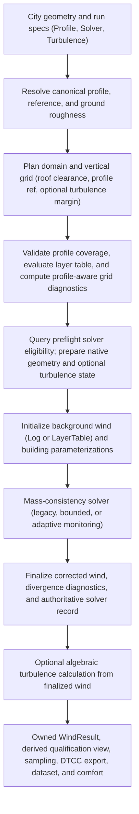

# Unified solver, turbulence, and wind-profile integration plan

- **Date:** 2026-10-31
- **Reviewed source revision:** `3ae4157ca2ce9dcca90a113a71b8f7651d873b37`
- **Status:** Phases 0–7 complete; Phases 8–9 pending. The user authorized preserving the footprint changes at `889c629` and first requalifying that revision in isolation. That prerequisite passed. Phase 1 implemented the unified specifications, public API, computed-top bounds and caller migration. Phase 2 resolves canonical profiles, builds one shared record for all four families, keeps Log native/analytic, validates its representability in the constructor, and removes condition/effective-condition metadata and fallbacks. Grid-only preview records unknown inflow without fabricating a calm profile. Phase 3 derives qualification from authoritative execution evidence, adds profile-aware grid diagnostics and height attribution, and reports nested timings without changing native computation. Requalification evidence: [head-requalification.json](docs/data/feature-merge/head-requalification.json). Baseline: [phase0.json](docs/data/feature-merge/phase0.json). Phase 1 checkpoints: [phase1a.json](docs/data/feature-merge/phase1a.json), [phase1b.json](docs/data/feature-merge/phase1b.json), [phase1c.json](docs/data/feature-merge/phase1c.json). Phase 2 verification: [phase2.json](docs/data/feature-merge/phase2.json). Phase 3 verification: [phase3.json](docs/data/feature-merge/phase3.json). Incorporates [COMBINED_FEATURE_PLAN_REVIEW.md](COMBINED_FEATURE_PLAN_REVIEW.md) and the final integration corrections in §9.
- **Lineage:** Synthesizes [CLAUDE_FEATURE_MERGE_PLAN.md](CLAUDE_FEATURE_MERGE_PLAN.md) (concrete API signatures, schemas, Python-first/native-last phase sequencing, and migration inventory) with [ASTRA_FEATURE_MERGE_PLAN.md](ASTRA_FEATURE_MERGE_PLAN.md) (5-way status separation, 4-state numerical assessment, failure precedence, explicit exposure-transfer laws, mean-only + GEM provenance, and isolated native candidate re-qualification).

---

## 1. Objective and core decisions

Three major capabilities—**solver controls** (`SolverControl` / `MonitorSpec`, bounded budgets, adaptive `pedestrian-v1`, `float64`), **algebraic turbulence** (`Turbulence`, `TurbulenceFields`, automatic domain growth, GEM screening), and **advanced wind profiles** (`LogProfile`, `MeasuredProfile`, `PowerLawProfile`, `UniformProfile`, native layer tables)—were developed on separate branches and merged sequentially. Each currently uses its own configuration style, maturity vocabulary, validation helpers, and partial downstream hooks.

The goal of this plan is to make them read, execute, and compose as **one coherent tool** across direct execution, grid preview, DTCC datasets, exports, and wind-comfort assessment.

### Core architectural decisions

1. **Breaking API and justified result changes are permitted** where they remove ambiguity, eliminate duplicated logic, or fix inconsistent physics/diagnostics. Compatibility shims, duplicate aliases, and stale cache keys are not retained; every intentional change gets an explicit pre-declared accuracy/behavior gate, a versioned schema or numerics identifier, and a migration table.
2. **One immutable specification per feature:**
   - **Inflow:** a self-contained profile object (`LogProfile`, `MeasuredProfile`, `PowerLawProfile`, `UniformProfile`) carrying `roughness_length` (`schema_version=2`), with `speed=` / `direction=` retained only as a keyword shorthand that constructs `LogProfile(speed, direction)`.
   - **Solver:** `Solver` replaces `SolverControl` and the five scattered solver kwargs (`tolerance`, `max_iterations`, `solver_precision`, `raise_on_nonconvergence`, `raise_on_unaccepted`).
   - **Turbulence:** `Turbulence | None` (removing the `bool` shorthand).
3. **Preserve native `ProfileKind::Log` during this integration:** Routing `LogProfile` through `ProfileKind::LayerTable` would perturb every adaptive-eligible wind field and require full scientific recalibration of `pedestrian-v1`. Native analytic log evaluation remains intact; unification of native profile storage is deferred to a future policy-recalibration study.
4. **Keep five outcome concepts strictly orthogonal:** execution status, legacy multiplier-change convergence, numerical assessment (`not_requested` | `not_assessed` | `accepted` | `unaccepted`), field/contributor validity masks, and physical model qualification. Never synthesize `"accepted"` for a legacy or bounded run, and never collapse `"not_assessed"` (scope exclusion, $\omega = 1.78$) into `"unaccepted"` (eligible assessment failure, $\omega = 1.90$). Native code reports both bounded runs and excluded adaptive runs as `accuracy_status="not_assessed"` (`api/control_types.h:28`, `solver_control.cpp:31`). The native record is kept verbatim, and the public view maps it explicitly (§4.3).
5. **Align exposure transfer explicitly on the QES target side without false identity assumptions:** `comfort.log_law_transfer` exposes explicit `from_law` and `to_law` choices (`"standard"` $\ln(z/z_0)$ vs. `"shifted"` $\ln((z+z_0)/z_0)$), defaulting to `"standard"` on the weather-station measurement side and `"shifted"` on the QES `LogProfile` target side. Analytic identity is checked within float64 roundoff when source/target laws, heights and roughness match; cross-law transfers are documented as convention conversions and never applied automatically to non-log profiles.
6. **Preserve per-direction provenance for both mean-only and GEM comfort:** Because `comfort.assess` requires `gem_fields` whenever `gem_metadata` is supplied (and rejects `gem_fields` for mean-only criteria such as `NEN8100`), upstream per-direction run provenance is stored in `ComfortResult.metadata["runs"]` independently of `metadata["gem"]`.
7. **Sequence all Python work (Phases 0–8) before native C++ edits (Phase 9):** `CMakeLists.txt:93-109` hashes every `.h`/`.cpp` file under `src/qes_core` and `src/cpp` (except `pedestrian_qualification.h`) plus both `CMakeLists.txt` files into `DTCC_QES_POLICY_REVISION`. Any C++ edit immediately disables adaptive acceptance (`unqualified_build`). Keeping Phases 0–8 Python-only preserves the qualified native build throughout API, dataset, comfort, test, and documentation integration; Phase 9 batches all C++ changes and runs isolated candidate re-qualification before updating `pedestrian_qualification.h`. Re-qualification follows the procedure the wind-profile merge already used (`docs/wind-profiles-verification.md:23-36`): rerun the 24 frozen S7 workers with `tools/check_wind_profile_policy.py`. It never uses `tools/validate_solver_release.py`, which requires the frozen S9 identity (`validate_solver_release.py:112`) and therefore fails by design after any native change.

---

## 2. Current system interaction and invariants



Main orchestration spans `src/dtcc_qes/wind.py`, `src/dtcc_qes/_city.py`, `src/dtcc_qes/datasets.py`, and `src/qes_core/dtcc/wind_runner.cpp`:

- **Profiles:** Non-log profiles evaluate in Python `float64` at the final `float32` physical cell-centre heights and pass owned `u`/`v` arrays (`ProfileKind::LayerTable`) to C++.
- **Turbulence:** Runs after wind finalization without mean-flow back-coupling, but affects upstream preparation in two ways:
  1. It can extend or regenerate an automatic vertical domain to satisfy the reference-height margin ($z_{\text{ref}} = 3\bar{H}$ with two physical layers above the sampled layer, and domain top $\ge 15\text{ m}$), altering the grid and profile coverage range.
  2. It excludes the run from `pedestrian-v1` adaptive acceptance (`turbulence_outside_assessment_scope`), switching an adaptive request to the fallback method ($\omega = 1.78$ instead of $1.90$).

### Existing design invariants to retain

- One native table path for non-log profiles (no duplicate C++ `Measured`/`PowerLaw` evaluators).
- Shared geometry and domain preparation between `preview_grid` and `run`, with zero native field allocation during `preview_grid` or input validation.
- Owned native inputs and returned NumPy arrays; releasing the `WindRunner` in `finally` so exception tracebacks never pin native solver memory.
- GIL-free native execution in `bindings.cpp:native_call` (no Python callbacks invoked from C++).
- QES-free public binding headers enforced via CMake `$<LINK_ONLY:qeswindscore>`.
- Conservative component-first interpolation of velocity and stress tensors, preserving invalid-contributor evidence (`_stress_contributors_valid`) even when an interpolated tensor happens to have non-negative eigenvalues.

---

## 3. Codebase findings and duplication inventory

### Feature-intersection gaps

| Combination / Area | Current behavior and gap |
| :--- | :--- |
| **Adaptive + non-log profile or turbulence** | Executes, but `pedestrian_scope` (`pedestrian_policy.cpp:18-21`) rejects `LayerTable` (`unqualified_inflow_profile`) and turbulence (`turbulence_outside_assessment_scope`). Users discover exclusions only after native preparation and solve; only the first failed check is reported (`unqualified_build` masks others on unpinned builds). `README.md:121-122` is ambiguous: it correctly says the policy does not qualify turbulence, but omits that runs with turbulence are excluded from adaptive acceptance entirely (`pedestrian_policy.cpp:21`). |
| **Turbulence + bounded / unconverged solve** | `wind_runner.cpp` computes turbulence even when the solve stops at `time_limit` or `iteration_limit` without meeting tolerance. Turbulence masks report computed cells and PSD covariance, giving no indication that the parent mean wind was unconverged or unassessed. |
| **Turbulence + measured profile (`above="error"`)** | Turbulence domain extension can push upper cell centres past the profile's highest measurement; the resulting coverage `ValueError` does not mention that turbulence raised the domain top. |
| **Auto-grid `pedestrian_sampling` diagnostics** | `_city.py:354-368` hardcodes $\ln(1 + z/z_0)$ regardless of profile. With `UniformProfile(5, 270)`, `flat_profile_exact_K` at $1.5\text{ m}$ reports $\approx 0.6008$ instead of `1.0`. |
| **Grid-only `preview_grid` inflow** | `wind.py:264-266` passes `speed=0, direction=0` placeholders when `profile=None`. Once log runs also emit `domain["profile"]`, a grid-only preview would misreport a calm log inflow unless unknown inflow is represented explicitly. |
| **Dataset (`qes_wind`) divergence** | `datasets.py` has no `turbulence` option and uses different solver defaults (`tolerance=1e-4`, `max_iterations=1000`, `max_cells=200M`) from `wind.run` (`1e-5`, `500`, `20M`). `_dataset_city.py:101` pre-computes a 6-coordinate `top` via `default_domain_top` without `turbulence_reference`, and `prepare_domain` treats any 6-tuple `bounds` as user-fixed (`check_only`). Pre-raising the target top before `generate_auto_layers` produces different layer counts and face heights than `prepare_domain`'s generate-then-extend order (e.g., 35 layers / $59.64\text{ m}$ vs. 38 layers / $51.05\text{ m}$ on four $15\text{ m}$ buildings). |
| **Scattered references** | Inflow reference (`speedup`, monitors), ground roughness (`roughness_length`), roof-level wake direction, $15\text{ m}$ stress-rotation wind, and morphometric turbulence reference ($z_{\text{ref}} = 3\bar{H}$, $z_0 = 0.1\bar{H}$, $d = 0.7\bar{H}$) are distinct physical quantities with overlapping names across `profiles.py`, `turbulence.py`, and `TURBGeneralData.cpp`. |
| **Comfort glue & exposure transfer** | Users write ~40 lines of manual sampling/GEM/provenance glue (`examples/wind_comfort.py`); profiles lack rotation (`with_direction`); `WindResult` lacks `reference_direction`; `comfort.assess` rejects `gem_metadata` on mean-only runs; `comfort.log_law_transfer` uses unshifted $\ln(z/z_0)$ on its target side while `LogProfile` uses $\ln((z+z_0)/z_0)$ (+1.41% difference on a $10\text{ m}$, $z_0 = 0.03 \to 0.5\text{ m}$ transfer). |
| **Timing visibility** | `max_solve_seconds` bounds only the cooperative native solve. Native code measures 13 phase timings (`control_bindings.h:136-137`) only when `SolverControl` is active, and nothing records total public-call wall time or Python city-preparation time. |
| **Python deadline test determinism** | `SolverController` accepts a C++ `MonotonicClock` (`solver_control.h:11`), and `WindRunner::solve` already takes a `native_test_clock` (`wind_runner.h:20-21`). But `bindings.cpp:205` does not pass one, so Python tests have no test-clock hook and rely on `1e-12` s budgets that abort before sweep 1 (`tests/test_solver_control.py:50`). |

### Code, schema, and test duplications to consolidate

1. **Dual profile-record builders:** Inline log dict in `wind.py:139-147` + post-hoc patches at `wind.py:216-221` vs. `profiles._layer_record` at `wind.py:293-295`, setting `native_reference_scalars` in two places. `metadata["condition"]` and `metadata["effective_condition"]` (`wind.py:193-194`) repeat the record's scalars; their only readers are the `WindResult.reference_speed` fallback (`result.py:216`) and `tests/test_profiles.py:139`.
2. **Split solver & roughness arguments:** Five solver kwargs on `wind.run` alongside `SolverControl` with manual conflict checks (`wind.py:125-132`); `roughness_length` means inflow $z_0$ for legacy calls, is forbidden with `LogProfile`, and means ground/tail $z_0$ for other profiles (`wind.py:305-319`).
3. **Triple turbulence reference/margin arithmetic:** `_turbulence_domain.py`, `src/qes_core/dtcc/turbulence.cpp:36-88`, and `src/qes_core/winds/TURBGeneralData.cpp:186-191`.
4. **Five scalar validators with divergent rules:** `_city.number`, `profiles._number`, `solver_control._number`/`_integer`, `comfort._number`, and `vertical_grid._AutoSettings.__post_init__`, plus duplicate `float32` log-ratio checks in `wind._validate_condition` and `LogProfile.__post_init__`.
5. **Inconsistent serialization & naming:** Profiles have `to_dict`/`profile_from_dict` (`schema_version=1`) and use `kind` in JSON vs. `type` in metadata; `SolverControl` has `from_dict` only (`datasets.py` uses `asdict`); `Turbulence` has neither; `VerticalGrid` has `to_metadata` only; `result.control` reads `metadata["solver_control"]`; caveats split across `turbulence_caveat` and `profile_caveat`; four maturity vocabularies (`experimental`, `"provisional"`/`"screening"`, `accepted`/`accuracy_status`, `policy_status`) and `"legacy"` vs. `"disabled"`.
6. **Redundant work in `to_dtcc()` and `_field_slice()`:** `WindResult.to_dtcc()` (`result.py:397-398`) runs the batched float64 eigensolver `_stress_validity` twice (once directly, once inside `self.streamwise_std`); `datasets._field_slice()` (`datasets.py:341-346`) reimplements `solid_mask` and `reference_speed`.
7. **Unchecked dataset payload mirror:** TypedDict schemas in `datasets.py:21-64` duplicate profile dataclass fields without a parity test.
8. **Test and tool duplication:** 2×2 tower city built in 5 places; `ONE_BUILDING` hardcoded in 3 extra places; native 3-block fixture duplicated; `TurbulenceSettings` built in 8 places; `SolverControl` fixtures duplicated in 3 places; toolchain/qualified-build gates copied in 3 files; analytic covariance and NPZ comparison oracles duplicated across test files; `spec_from_file_location` loader repeated in ~25 test files; cross-test-module imports (`test_comfort` $\to$ `test_turbulence` $\to$ `test_sampling`, `test_solver_control` $\to$ `test_condition_state`); `delta-K` p95 denominator mismatch in `tools/check_turbulence_domain.py:72-78`; and `tools/run_turbulence_benchmark.py:214-254` manually reassembling `wind.run` from private helpers.

---

## 4. Unified target contract

### 4.1 Public entry points and domain bounds

```python
wind.run(
    city,
    profile: LogProfile | MeasuredProfile | PowerLawProfile | UniformProfile | None = None,
    *,
    speed: float | None = None,
    direction: float | None = None,
    solver: Solver = Solver(),
    turbulence: Turbulence | None = None,
    resolution: float = 2.0,
    bounds: Bounds | tuple[float, float, float, float, float, float | None] | None = None,
    horizontal_padding: float = 20.0,
    vertical_clearance: float = 20.0,
    max_cells: int = 20_000_000,
    vertical_grid: VerticalGrid | None = None,
    terrain: Literal["flat"] | float | None = None,
    height_policy: Literal["measured", "allow_estimated"] = "measured",
) -> WindResult

wind.preview_grid(
    city,
    profile: LogProfile | MeasuredProfile | PowerLawProfile | UniformProfile | None = None,
    *,
    speed: float | None = None,
    direction: float | None = None,
    solver: Solver | None = None,      # added in Phase 9, together with GridPreview.eligibility
    turbulence: Turbulence | None = None,
    resolution: float = 2.0,
    bounds: Bounds | tuple[float, float, float, float, float, float | None] | None = None,
    horizontal_padding: float = 20.0,
    vertical_clearance: float = 20.0,
    max_cells: int = 20_000_000,
    vertical_grid: VerticalGrid | None = None,
    terrain: Literal["flat"] | float | None = None,
    height_policy: Literal["measured", "allow_estimated"] = "measured",
) -> GridPreview
```

- **Self-contained profiles (`schema_version=2`):**
  - `roughness_length: float = 0.1` lives on `LogProfile`, `UniformProfile`, `PowerLawProfile`, and `MeasuredProfile`. Run-level `roughness_length=` and `reference_height=` kwargs are removed.
  - `profile.evaluate(heights)`, `profile.reference`, `profile.scaled(factor)`, `profile.with_direction(direction)`, lower `"log"` tails on `MeasuredProfile`, native `ModelSettings.roughness_length`, and empty-city turbulence $z_{\text{ref}} = 100 z_0$ all use `profile.roughness_length`.
  - `reference_at(roughness_length)` (`profiles.py:100`) and the `roughness_length` parameters of `_Profile.evaluate` (`profiles.py:112`) and of the module-level `evaluate` (`profiles.py:355`, re-exported in `wind.__all__`) are removed. No caller can pass a roughness that disagrees with the profile.
  - Passing `speed=` and `direction=` (without `profile`) constructs `LogProfile(speed=speed, direction=direction)` and enters the exact same resolver. Combining `profile` with `speed` or `direction` raises `ValueError`.
  - `profile_from_dict` requires `schema_version=2`; `schema_version=1` payloads raise `ValueError` with an explicit migration message explaining that `roughness_length` moved onto the profile payload.
- **Grid-only preview:** Calling `preview_grid` with `profile=None, speed=None, direction=None` plans the domain with the default $10\text{ m}$ reference height and $0.1\text{ m}$ ground roughness, sets `preview.domain["profile"] = None` and `preview.domain["inflow"] = "unknown"`, and never fabricates a calm zero-speed profile.
  - Grid-only previews lose today's `reference_height=`/`roughness_length=` arguments (`wind.py:244`). To plan for another reference height or roughness, pass `LogProfile(speed=1, direction=0, reference_height=..., roughness_length=...)`. The speed does not affect the grid. This goes in the migration table.
- **Preview eligibility (Phase 9):** `preview_grid(..., solver=...)` returns `GridPreview.eligibility` as an ordinary dict containing `mode`, `policy`, `exclusions`, and `pending_runtime_checks`. It contains no execution, convergence, method actually used, or acceptance result: no solve has occurred. It is `None` when no solver is given. For legacy/bounded requests the lists are empty because no adaptive policy is requested. An adaptive eligibility request requires an explicit profile or complete speed/direction shorthand; otherwise raise `ValueError` explaining that grid-only preview remains available without `solver`. With known inflow, runtime thread-team verification remains pending. Before Phase 9, `preview_grid` has no `solver` parameter.
- **Fixed vs. computed domain top (`zmax=None`):**
  - `bounds=(xmin, ymin, zmin, xmax, ymax, None)` fixes horizontal bounds and flat-ground `zmin` while leaving the top inferred.
  - `prepare_domain` plans an inferred top using the exact same order as `bounds=None`: compute wind-only target top $\to$ generate uniform or automatic layers (with endpoint-fit regeneration when turbulence is enabled) $\to$ apply `extend_turbulence_faces`.
  - A numeric `zmax` in a 6-tuple `bounds` (or `Bounds`) and `VerticalGrid.from_faces(...)` remain user-fixed (`extension_policy="check_only"`).

### 4.2 `Solver` specification and failure precedence

```python
@dataclass(frozen=True)
class Solver:
    tolerance: float = 1e-5          # final shared default selected by Phase 5 measurement
    max_iterations: int = 500        # final shared default selected by Phase 5 measurement
    precision: Literal["float32", "float64"] = "float32"
    max_solve_seconds: float | None = None
    monitor: MonitorSpec | None = None
    policy: Literal["pedestrian-v1"] | None = None
    checkpoint_interval: int = 25
    residual_interval: int = 0
    raise_on_failure: bool = False
```

- **Option rules (validated before geometry extraction or data fetching):**

  | `policy` | `max_solve_seconds` | `monitor` | Derived `solver.mode` | Behavior |
  | :--- | :--- | :--- | :--- | :--- |
  | `None` | `None` | `None` | `"legacy"` | Tolerance / iteration-limited solve ($\omega = 1.78$). Non-default `checkpoint_interval != 25` or `residual_interval != 0` raises `ValueError`. |
  | `None` | Positive finite | `MonitorSpec` | `"bounded"` | Cooperative time-budgeted solve with monitoring ($\omega = 1.78$); `assessment="not_requested"`. |
  | `"pedestrian-v1"` | Positive finite | `MonitorSpec` | `"adaptive"` | Adaptive assessment request (`checkpoint_interval == 25`, `monitor.history_limit >= 5`, non-calm inflow); runs $\omega = 1.90$ if eligible, or falls back to $\omega = 1.78$ with `assessment="not_assessed"` if excluded. |
  | Any other mix | Any | Any | — | Raises `ValueError` naming the missing or conflicting setting. |

- **Exception and partial-result precedence:**
  1. **Always raise (regardless of `raise_on_failure`):**
     - invalid inputs (`TypeError`/`ValueError`);
     - budget expiry before any whole sweep (`BudgetExhaustedError`);
     - non-finite solver breakdown (`NumericalFailureError`).

     `BudgetExhaustedError` keeps today's single meaning: no field exists (`solver_control.py:172-176`, `solver_control.cpp:65`). It is never raised for a run that completed sweeps and so has a partial result.
  2. **When `raise_on_failure=False` (default):**
     - Return the available `WindResult`, including turbulence if requested. Field validity remains governed by masks and NaNs; a returned result does not promise that every turbulence cell is valid.
     - Warn for adaptive `unaccepted`/`not_assessed`, for legacy/bounded non-convergence, or for a completed-work deadline. An accepted adaptive run does not receive a non-convergence warning merely because its legacy tolerance is unmet. A bounded run meeting tolerance at its deadline may return normally while reporting the deadline.
     - Emit at most one consolidated solver-outcome warning per run. Include the consequence for requested turbulence in that warning. A preliminary exclusion warning is not repeated after solving; final metadata still records all outcomes. Independent profile/model caveats are not suppressed by this rule.
  3. **When `raise_on_failure=True`:**
     - **Adaptive, exclusion known before preparation** → raise `UnacceptedResultError` before native preparation and solve, so no budget is wasted. The error carries `diagnostics=None` and the known exclusions.
       - Phase 1 checks only what Python knows from the inputs: non-log profile (`unqualified_inflow_profile`), `precision="float64"` (`unqualified_precision`) and turbulence (`turbulence_outside_assessment_scope`). They are listed in native check order. That order is build (`pedestrian_policy.cpp:17`), inflow profile (18), thread team (19), precision (20) and turbulence (21). The message says that the remaining checks run during the solve.
       - Phase 9 extends this to every input and grid check, using the preflight query.
     - **Adaptive, finished run** with `assessment in ("unaccepted", "not_assessed")` → raise `UnacceptedResultError(diagnostics, solver_record)`.
     - **Legacy or bounded, `not legacy_converged`** → raise `ConvergenceError(diagnostics, solver_record)`, whether `termination_reason` is `iteration_limit` or `time_limit`. Its message already names the termination reason (`result.py:126`).
     - **Time-limited run with `legacy_converged=True`** → return normally. The native deadline check runs after the convergence update, so a field that meets the legacy tolerance can still carry `termination_reason="time_limit"`.
  4. **These rules use `solver.mode`, the mode the caller asked for.** An excluded adaptive run is still mode `"adaptive"`.

- **Exception classes:**
  - **`UnacceptedResultError(diagnostics, record, *, exclusions=())`.** A raise before the solve passes `diagnostics=None`, `record=None` and the known exclusions. Its message lists them and says that the remaining checks run during the solve.
    - Today's constructor formats `control['policy']`, `control['assessment_reason']` and `control['termination_reason']` (`solver_control.py:186-192`), so it cannot do this.
  - **`ConvergenceError(diagnostics, record=None)`.**
  - **Attribute rename.** Both classes expose `.record` instead of `.control` (`result.py:120-122`).
    - This matches `BudgetExhaustedError.record` and `NumericalFailureError.record`, and the removal of `result.control`.
    - The rename goes in the Phase 8 migration table.

### 4.3 Authoritative execution record and `result.qualification`

Store solver execution facts **once** in `result.metadata["solver"]`, exposed as `result.solver`. It replaces `metadata["solver_control"]` and `result.control`:

```python
result.metadata["solver"] == {
    "spec": {...},           # Solver.to_dict(), schema_version=1
    "record": None | {...},  # native control record, copied verbatim; None for legacy runs
    "environment": {...},    # precision, backend, sweep order, native build, source revision, shape; every mode
}
```

**The native record is kept verbatim.**
- `record` keeps the native key names and vocabulary unchanged: `mode`, `accuracy_status`, `termination_reason`, `method`, `policy_revision`, `assessment_reason`, the checkpoint and assessment histories, the monitor, and timings.
- Frozen evidence compares exactly these raw keys with frozen S7 rows (`validate_solver_release.py:194`, `check_wind_profile_policy.py:57-63`). Keeping them verbatim means no translation table is needed.
- Legacy runs have no native record. Their `termination_reason` comes from the diagnostics: `legacy_tolerance` if converged, otherwise `iteration_limit`. This is the same rule native code applies to controlled runs (`solver_control.h:69-70`).
- **Python adds nothing to `record`.**
  - Today `wind.py:224-227` inserts build and backend provenance into the record as `control["execution"]`. That moves to `environment`, which is emitted for every mode, legacy included.
  - The move also frees the name `execution` for `qualification`.
- **The native key `assessment` is a `PolicyEvidence` dict or `None`** (`control_bindings.h:114-139`).
  - It is not the four-state public string `qualification["solver"]["assessment"]`.
  - Never compare `record["assessment"]` with a status.
- **Legacy runs have no native `method` either.** Python supplies the 1.78 id from one constant.
  - A test checks that a bounded run's `record["method"]` equals that constant.
  - Phase 9 moves the id into `api/policy_types.h` and exposes it through `_qes`.
- **`SolveDiagnostics` is frozen evidence.**
  - `check_wind_profile_policy.py:56` compares `asdict(result.diagnostics)` with frozen S7 rows.
  - Derived state goes into `qualification`, never into new `SolveDiagnostics` fields.

**`result.qualification` is derived, never stored separately.**
- One shared helper assembles a fresh `result.qualification` dict from `metadata["solver"]`, the existing `result.diagnostics`, `metadata["profile"]`, `metadata["turbulence"]` and `metadata["domain"]["vertical_grid"]`. Do not persist `metadata["qualification"]` on the live result, or introduce a custom metadata mapping to synthesize it. Exports, datasets and comfort may store deep-copied qualification snapshots assembled at the output boundary. `wind_basis` is derived there too, never a second editable source of solver facts.
- It maps the native status to the public assessment explicitly:

  | Native `accuracy_status` | `solver.mode` | `qualification["solver"]["assessment"]` |
  | :--- | :--- | :--- |
  | — (no record) | `"legacy"` | `"not_requested"` |
  | `"not_assessed"` (native default) | `"bounded"` | `"not_requested"` |
  | `"not_assessed"` (scope exclusion) | `"adaptive"` | `"not_assessed"` |
  | `"accepted"` / `"unaccepted"` | `"adaptive"` | unchanged |

**There is no separate "effective mode".**
- Native code keeps `mode="adaptive"` for an excluded request and only switches `method` to the 1.78 relaxation (`solver_control.cpp:28-32`).
- `mode`, `assessment="not_assessed"` and `method` together already say that the run fell back.

```python
result.qualification == {
    "solver": {
        "mode": "legacy" | "bounded" | "adaptive",        # as requested; see §4.2 rule 4
        "method": "s5c-rb-sor-float-omega-v1-omega-1.78" | "s5c-rb-sor-float-omega-v1-omega-1.90",  # 1.90: api/policy_types.h:9; 1.78: literal at solver_control.cpp:22,32
        "execution": "completed" | "iteration_limit" | "time_limit",  # from termination_reason: the two limits keep their
                                                                      # names; every other reason maps to "completed"
        "termination_reason": "legacy_tolerance" | "iteration_limit" | "time_limit" | "accepted" | "stagnation" | "invalid_support",
        "legacy_converged": bool,
        "assessment": "not_requested" | "not_assessed" | "accepted" | "unaccepted",
        "assessment_scope": "pedestrian_roi_and_required_receptors" | None,
        "assessment_reason": str | None,
        "exclusions": list[str],   # Phases 3–8: [assessment_reason] when not_assessed, else [] (native reports only
                                   # the first failed check, pedestrian_policy.cpp:17-60); from Phase 9: every failed
                                   # scope check, in native check order
        "pending_runtime_checks": list[str],  # always [] on completed runs; preview uses the smaller schema in §4.1
    },
    "profile": {
        "kind": "log" | "uniform" | "power_law" | "measured",
        "experimental": bool,
        "caveats": list[str],
    },
    "turbulence": None | {
        "status": "screening",
        "mixing_length": "height" | "wall_distance",
        "numerics_version": "dtcc-qes-turbulence-v1",  # bumped to v2 only if Phase 9 alters any bit
        "caveats": list[str],
        "wind_basis": {
            "execution": "completed" | "iteration_limit" | "time_limit",
            "legacy_converged": bool,
            "assessment": "not_requested" | "not_assessed" | "accepted" | "unaccepted",
            "assessment_scope": str | None,
        },
    },
    "vertical_grid": {
        "mode": "uniform" | "explicit" | "auto",
        "policy_status": "fixed" | "prototype_unvalidated",
    },
}
```

- Combined states remain representable without loss (e.g., `assessment="accepted"` with `legacy_converged=False`; `execution="time_limit"` with `legacy_converged=True`).
- **Condition metadata is removed** (Phase 2): `metadata["condition"]` and `metadata["effective_condition"]` go.
  - `reference_speed` and `reference_direction` read `metadata["profile"]["reference"]`.
  - The profile record itself moves to `schema_version=2` in Phase 1: `type` becomes `kind`, and caveats become `caveats: list[str]`.
- Field masks (`solid_mask`, `turbulence.computed`, `turbulence.capped`, `turbulence.stress_valid`, `sample._stress_contributors_valid`) remain on the field/result objects; physical model limitations remain in each feature's `limitations` list.

### 4.4 Comfort and exposure-transfer contract

- **`WindResult.reference_direction`:** Counterpart to `reference_speed`; returns the profile reference direction in $[0, 360)$, or `None` when reference speed is `0`.
- **`_Profile.with_direction(direction)`:** Rigidly rotates the profile so its reference direction becomes `direction` (modulo `360`), preserving `roughness_length`, speed amplitudes, relative turning angles across heights, extrapolation policies, and metadata. Raises `ValueError` if the profile's reference speed is `0` (calm).
- **Results-to-comfort assembly (`comfort.assess_results` / `comfort.assess`):**
  - Add only one new public adapter: `comfort.assess_results(results, speeds, directions, criterion=NEN8100, *, height=None, method="linear", peak_factor=None, gust_ratio=1.85, times=None) -> ComfortResult`. A private `_prepare_results` helper may return ordinary copied arrays and a provenance dict; no new result/container type or public preparation API is needed. Use duck typing on the existing result/sample properties and keep the comfort implementation dependent only on NumPy, the standard library, and small internal helpers with those same dependencies.
  - Validates matching `(x, y)` coordinates, `origin`, `crs`, profile `reference_height`, and `roughness_length`; allows per-direction `reference_speed` values (supported natively by `comfort.assess`); rejects empty sequences, calm references (`reference_direction is None` or `reference_speed <= 0`), and duplicate directions modulo `360`.
  - Validate each returned sample's coordinates, method, requested height and actual `sampled_height`. For nearest sampling, require the same actual height across directions and pass that height to `assess`, so criterion-height warnings remain truthful. A 1.5 m request can select 1.0 m on one grid and 1.75 m on another; reject that mixture. For linear sampling, require the requested height wherever support exists; retain NaNs and `sampled_height=None` where support is unavailable. Store both requested and actual heights per direction, preserve invalid-contributor evidence, and never fill invalid values with zeros.
  - Copy prepared arrays and provenance independently of subsequent edits to input results. Reference direction comes from the declared profile reference, never local pedestrian velocity. Give `run_metadata` the ordinary mapping shape `{"directions": [...], "sampling": {...}}`, with direction records in the same order as the field stack; store this mapping under `ComfortResult.metadata["runs"]` without a redundant nested `runs` key.
  - Defaults `height` to `criterion.height` when omitted. Computes GEM only when `criterion.gust_equivalent` is `True` and `peak_factor` is provided (raising if any result lacks `turbulence`). Without `peak_factor`, the existing "Mean speeds only" result warning from `assess` applies, and no second warning is added.
  - Extends `comfort.assess(..., run_metadata=None)` so copied per-direction provenance (`qualification`, profile references and `caveats`, requested/actual sampling heights, method and valid cell counts) is recorded in `ComfortResult.metadata["runs"]` for **both mean-only (`NEN8100`) and GEM (`CITY_OF_LONDON`) assessments**, while `metadata["gem"]` continues to record GEM-specific screening parameters when `gem_fields` are used. Never promotes mean-wind numerical acceptance into gust qualification.
- **`comfort.log_law_transfer`:**
  ```python
  def log_law_transfer(
      speeds,
      from_height,
      from_roughness,
      to_height,
      to_roughness,
      blending_height=60.0,
      *,
      from_law: Literal["standard", "shifted"] = "standard",
      to_law: Literal["standard", "shifted"] = "shifted",
  ) -> np.ndarray
  ```
  - `"standard"` evaluates $\ln(z / z_0)$ (requiring $z > z_0$); `"shifted"` evaluates $\ln(1 + z / z_0)$ via `_shifted_log` (requiring $z > 0, z_0 > 0$).
  - **Each law applies to both log terms on its own side of the blending height.** The factor (`comfort.py:320-323`) is

    $$\frac{L_{\text{from}}(h_b, z_{0,\text{from}})}{L_{\text{from}}(z_{\text{from}}, z_{0,\text{from}})} \cdot \frac{L_{\text{to}}(z_{\text{to}}, z_{0,\text{to}})}{L_{\text{to}}(h_b, z_{0,\text{to}})}$$

    - $L_{\text{from}}$ is the `from_law` and covers the station height and the blending height $h_b$.
    - $L_{\text{to}}$ is the `to_law` and covers the target height and $h_b$.

    Only with both target terms shifted does `LogProfile(speed=<transferred speed>, reference_height=to_height, roughness_length=to_roughness)` reproduce the blending-height speed within float64 roundoff. That is the condition for the target-ratio agreement gate; native float32 evaluation is checked with its own precision-appropriate tolerance.
  - **The "height exceeds roughness" check applies only to sides that use `"standard"`.** Today it applies to every side (`comfort.py:317-319`).
  - Default `from_law="standard", to_law="shifted"` converts a meteorological station measurement into the exact shifted log law consumed by `LogProfile` and native QES log inflow.
  - Never invoked automatically by `assess_results` or applied to non-log profiles.

---

## 5. Phased implementation roadmap and gates

### Phase 0 — Capture baseline behavior and declare change criteria

**Scope:** Tooling only (`tools/feature_merge_baseline.py`); no changes to `src/`.

- **Prerequisite builds.** Use fresh, recorded build folders for this implementation.
  - Inspect existing build folders rather than assuming they are empty. On the qualified machine (AppleClang 17, arm64, `fp_contract=on`), build the Release `serial` and `openmp` trees at `HEAD`, in `build/profiles-serial` and `build/profiles-openmp` as `docs/wind-profiles-verification.md:31-34` does.
  - Run `tools/check_wind_profile_policy.py` against them before any change. This proves that the gate used in Phases 1–8 works at baseline.
  - Reuse these builds through Phase 8.
  - Every gate run needs a fresh `--output` directory, because the tool calls `mkdir(exist_ok=False)`.
- Implement `tools/feature_merge_baseline.py --api old|new --output DIR` and `--compare BASELINE CANDIDATE`:
  - Covers pairwise and high-risk intersections across **profiles** (legacy scalars, `LogProfile`, `UniformProfile`, `PowerLawProfile`, `MeasuredProfile` turning and jet, calm), **turbulence** (`None`, `"height"`, `"wall_distance"`), **solver** (`legacy`, iteration-capped `bounded` with generous budget, `adaptive` on the qualified 2×2 tower fixture, and excluded `adaptive`), **grids** (uniform, explicit stretched, `VerticalGrid.auto()`, turbulence-extended), and **precision** (`float32`, `float64`).
  - Compares numerical arrays, coordinates, masks, iteration counts, and deterministic assessment decisions separately from timing fields and declared schema renames.
  - Includes `QESWindDataset` cases (`field`, a linear `z` slice, an automatic grid). They use the mocked city fetch from `tests/test_datasets.py:38-45`, because Phases 1 and 5 change the dataset path.
  - Records source snapshot, imported extension path/hash, `_qes.solver_policy_revision`, dependency lock hash, backend, actual thread team, and resolved specs. Comparison requires matching native identities by default. For Phase 9, allow only an explicitly supplied baseline/candidate identity pair; reject any unexpected identity or dependency change. Add a case selector so non-adaptive cases can run before isolated qualification and adaptive cases afterward. Never use a blanket ignore-metadata or ignore-identity switch.
  - Fixed-work bounded comparisons use sufficient budgets and assert that no timeout interrupted the intended work. Declare schema/provenance differences explicitly and exclude only timing values (including checkpoint elapsed times) from equality checks; still validate their shape, finiteness and nonnegativity.
  - Writes archives outside git, under `build/feature-merge-baseline/`.
- Capture `--api old` at `HEAD` twice before Phase 1, in separate processes with a fixed `OMP_NUM_THREADS`.
- Capture the three focused cost cases described in Phase 7 now, recording resolved grids/work/output sets and measurement conditions separately from deterministic numerical archives.
- For the shared-default study, use a float64 reference with a precision-valid tight tolerance (initially `1e-7`) and sufficient iterations. Check convergence and stability against further tightening; requesting a tolerance alone does not establish reference accuracy. Fix acceptable pedestrian-error limits and the cost-selection rule before comparing default candidates.
- Pre-declare evaluation criteria for every intentional numerical/metadata change:

  | Planned change | Acceptance criterion |
  | :--- | :--- |
  | Shared `Solver()` defaults (Phase 5) | Pedestrian-height speed-up error (p95 and max) vs. a `1e-7` tightly converged reference, plus wall time, measured on the 2×2 tower city and the 6-block benchmark city across current `run` (`1e-5` / `500`), dataset (`1e-4` / `1000`), and intermediate candidates |
  | `log_law_transfer` default `to_law="shifted"` (Phase 4) | Matching-law identity for identical source/target parameters, reciprocity with source/target parameters and laws swapped, and target-ratio agreement with `LogProfile.evaluate`, all within declared float64 roundoff tolerances; quantified comfort-class shift report on `examples/wind_comfort.py`'s synthetic climate |
  | Selected-profile `pedestrian_sampling` diagnostics (Phase 3) | `UniformProfile` reports exact ratio `1.0` and zero bias; `LogProfile` preserves historical float values bit-for-bit; turning profiles report vector error; calm profiles report JSON `None` with reason |
  | Grid-only `preview_grid` unknown inflow (Phase 2) | Metadata-only (`domain["profile"] is None`, `domain["inflow"] == "unknown"`); grid coordinates unchanged |
  | Metadata moves (Phases 1–2): profile record `schema_version=2`; record provenance moved to `metadata["solver"]["environment"]`; `metadata["condition"]` and `metadata["effective_condition"]` removed | Metadata only. Declared key moves in `--compare`; arrays unchanged |
  | Exclusions known before the solve (Phase 1, extended in Phase 9) | **What changes:** an adaptive request whose exclusion is known from its inputs now warns, or with `raise_on_failure=True` raises `UnacceptedResultError` (with `diagnostics=None`), *before* native preparation. Today it raises only after the full solve (`wind.py:174-178`). **Criteria:** tests show that no native preparation or solve time is spent; on a qualified build, the reported reasons equal the native first reason for the same inputs. For precision and turbulence this also needs a thread team of 1–4, because native code checks the team after the profile kind and before precision; arrays of non-raising runs are unchanged |
  | Exception mapping under `raise_on_failure` (Phase 1) | **What changes:** one flag replaces `raise_on_nonconvergence`/`raise_on_unaccepted`. **Criteria:** legacy and bounded runs raise `ConvergenceError` exactly when `legacy_converged` is false, matching today's `raise_on_nonconvergence` (`wind.py:180-183`); time-limited runs with `legacy_converged=True` return; `BudgetExhaustedError` occurs only with zero completed sweeps |
  | `exclusions` lists every failed check (Phase 9) | **What changes:** the list grows from the first failed check (Phases 3–8) to every failed check. Metadata only. **Criteria:** for every case in `tests/native/check_pedestrian_policy.cpp`, the first entry equals `pedestrian_scope`; adaptive decisions are unchanged |
  | Phase 9 native consolidation | Bitwise-identical wind and adaptive outputs across serial and OpenMP; bitwise-identical turbulence outputs (or a documented, independently verified `dtcc-qes-turbulence-v2` bump if any bit differs) |

**Gate:**
- The two `--api old` archives compare with zero differences. This proves determinism; a self-compare of one archive would not.
- `tools/check_wind_profile_policy.py` passes all 24 frozen S7 workers on the `HEAD` builds.

---

### Phase 1 — Unified specifications and breaking public API

**Implementation status:** Complete. Both qualified backends pass 1,316 Python tests (50 skipped) with warnings treated as errors. All 24 frozen S7 workers and the 31-case Phase 0 archive comparison pass. See [phase1c.json](docs/data/feature-merge/phase1c.json) for source identities, declarations and remaining phases. Native implementation sources were unchanged in this phase; only the earlier user-authorized requalification header differs from the initial checkout.

**Likely files:** `src/dtcc_qes/profiles.py`, `src/dtcc_qes/solver_control.py`, `src/dtcc_qes/turbulence.py`, `src/dtcc_qes/vertical_grid.py`, `src/dtcc_qes/wind.py`, `src/dtcc_qes/_city.py`, `src/dtcc_qes/result.py`, `src/dtcc_qes/datasets.py`, `tests/city_cases.py`, examples, tests, `tools/run_turbulence_benchmark.py`, `tools/benchmark_urban_wind.py`, `tools/validate_solver_policy.py`, `tools/compare_native_builds.py`.

- Add `roughness_length: float = 0.1` to all four profile classes and bump the profile `schema_version` to `2`.
  - Update `evaluate`, `reference`, `scaled`, `to_dict` and `profile_from_dict`. A v1 payload raises a clear migration error.
  - Remove `reference_at` and the `roughness_length` parameters of `_Profile.evaluate` and of the module-level `evaluate` (§4.1).
- Replace `SolverControl` with `Solver` in `solver_control.py` (re-exported in `wind.__all__`); add `to_dict()` / `from_dict()` (`schema_version=1`) on `Solver`, `Turbulence`, and `VerticalGrid`.
- Update `wind.run` and `wind.preview_grid` to the §4.1 signatures (`profile`, keyword `speed`/`direction` shorthand, `solver`, `turbulence: Turbulence | None`, `bounds` supporting `zmax=None`).
- **Implement the §4.2 `Solver` option matrix and `raise_on_failure` precedence:**
  - `BudgetExhaustedError` stays zero-sweep only.
  - Unconverged legacy and bounded runs raise `ConvergenceError`.
  - Adaptive requests with exclusions Python already knows (non-log profile, float64, turbulence) warn, or raise under `raise_on_failure=True`, before native preparation.
- **Merge `metadata["solver"]` and `metadata["solver_control"]`** into `metadata["solver"] = {"spec", "record", "environment"}` (`result.solver`) (§4.3).
  - The native control record is copied verbatim.
  - Python's build and backend provenance goes into `environment`.
- **Change the exception classes as §4.2 specifies:** `UnacceptedResultError(..., exclusions=())`, and `.control` becomes `.record`.
- **Naming:**
  - profile metadata `type` becomes `kind`, and the profile record moves to `schema_version=2`;
  - caveats are unified into `caveats: list[str]`;
  - the no-controls mode is called `"legacy"` everywhere.
- **Migrate the existing `QESWindArgs` fields in the same change.** Phase 1 removes everything `datasets.py` calls:
  - in the validator, `wind._resolve_condition`, `wind._validate_solver` and `SolverControl.from_dict` (`datasets.py:129-156`);
  - the removed keyword arguments in `wind_options()` (`datasets.py:179-195`);
  - `solved.control` in `build()` (`datasets.py:280-300`);
  - the v1-pinned `_ProfilePayload` (`datasets.py:23`).

  Without this, the 34 tests in `test_datasets.py` and `test_dataset_vertical_grid.py` fail, and so do the dataset cases in `test_adaptive_control.py`, `test_solver_control.py:112` and `test_profiles.py:217-234`. The migration:
  - Profile payloads move to `schema_version=2`, with `roughness_length` on every kind.
  - `wind_speed`/`wind_direction` become `speed`/`direction`.
  - `reference_height` and `roughness_length` are removed, as they are from `run`; use a `profile` payload instead.
  - `solver: _SolverPayload` replaces `tolerance`, `max_iterations`, `solver_precision`, `raise_on_nonconvergence`, `raise_on_unaccepted` and `solver_control`.
    - It is normalized via `Solver.from_dict(...).to_dict()`.
    - Its default keeps today's dataset values (`tolerance=1e-4`, `max_iterations=1000`) until Phase 5, so Phase 1 changes no dataset numbers.
  - `build()` reads `solved.solver["record"]` until Phase 5 switches health and warnings to `qualification`.
  - Add the schema-parity tests: `_ProfileRequest` against `profile_from_dict`, and `_SolverPayload` against `Solver.from_dict`.
  - All renames go in the Phase 8 migration table.
- **Migrate call sites in the same change** so the test suite stays green at every commit. This covers tests, examples, and the tools that the test suite or the gates execute:
  - **Tests.** About 115 calls in 17 files break.
    - About 75 of them go through `tests/city_cases.py:16-21`. Its `condition` dict carries `reference_height`/`roughness_length`, and its `solver` dict carries `tolerance`/`max_iterations`. Migrate this file first.
    - `tests/test_turbulence.py:21` merges `turbulence=True` into every case.
    - The private-helper tests are `test_turbulence_domain.py:232-255`, `test_profiles.py:179-185` and `test_precision.py:17`.
    - Subprocess scripts are embedded in `test_adaptive_control.py:125`, `test_solver_control.py:128` and `test_wind.py:165`. Searches for call sites miss them.
  - **Examples that `tests/test_example.py` runs:**
    - `vertical_grid.py` and `automatic_vertical_grid.py` pass `max_iterations`;
    - `wind_comfort.py` passes `turbulence=True` and `raise_on_nonconvergence`. Phase 4 rewrites it again.
  - **`tools/benchmark_urban_wind.py`.**
    - `tests/test_urban_benchmark.py:56` calls its `frozen_options`, which passes `reference_height=`/`roughness_length=` to `preview_grid` (`benchmark_urban_wind.py:169-173`).
    - The tool pins its own source hash (`DRIVERS`, lines 25 and 164-165). After the edit, the live copy can no longer replay the frozen urban campaign. The archived drivers under `docs/data/urban-wind-benchmarks/*/sources/` remain the replay source.
  - **`tools/run_turbulence_benchmark.py`:** `tests/test_turbulence_benchmark.py:49` runs its `--self-test`, and the tool rebuilds `run()` from `wind._validate_grid` and `wind._prepare_city(city, condition, grid, ...)`. Update those private calls here and again in Phase 2. Switching the tool to `wind.run` waits for legacy phase timings in Phase 9.
  - **`tools/validate_solver_policy.py`:**
    - build `Solver(max_solve_seconds=..., monitor=..., policy="pedestrian-v1")` instead of `SolverControl(..., mode='adaptive')` (`validate_solver_policy.py:88-91`);
    - emit `row["control"] = result.solver["record"]` (line 120).

    `tools/check_wind_profile_policy.py` runs this live tool against the live `src/dtcc_qes` tree (`check_wind_profile_policy.py:33,47-49`). That makes it the existing cross-API check: adaptive log-profile results must stay identical to the frozen S7 rows recorded with the old API.
  - **`tools/compare_native_builds.py`.** Pytest does not run it (`test_compare_native_builds.py` calls only its pure helpers), but Phases 3 and 9 use it.
    - migrate its case runner (lines 230-260, including `turbulence=True` at line 248);
    - its `evaluate()` runs the *current* tool's cases against each staged package (`compare_native_builds.py:345-348`), so it cannot compare across the API break;
    - it remains a native-revision check, used in Phase 9 against a Phase 8 baseline.

  For Phases 1–8, the cross-API guards are the Phase 0 baseline tool (`--api old|new`) and `check_wind_profile_policy.py`.
- **Optional split.** Phase 1 may land as three commits, each green and each migrating its own call sites:
  1. profiles v2, plus the roughness and reference changes in `run` and the dataset;
  2. `Solver`, the exceptions and `metadata["solver"]`;
  3. the removal of `turbulence=bool`, plus the naming changes.
- **Invariant tests:** 1, 16 and 17 (§6).

**Gate:**
- All existing unit tests pass under the new API, including the turbulence-benchmark self-test, the urban-benchmark option test and the dataset tests.
- Input-known conflicts fail before `extract_city`.
- Phase 0 `--compare` shows only declared changes.
- `tools/check_wind_profile_policy.py` passes all 24 frozen S7 workers. Native code is unchanged, so the serial and OpenMP builds can be reused across Phases 1–8.

---

### Phase 2 — Single wind-condition and profile-record pipeline

**Implementation status:** Complete. Both qualified backends pass 1,348 Python tests (50 skipped) with warnings treated as errors. Preview/run record parity is tested across all four profile families, three grid modes and optional turbulence. All 24 frozen S7 workers and the 31-case Phase 0 archive comparison pass. The profile record adds a derived `boundary_layer` description, used directly by model metadata; the baseline comparison checks removed condition facts against the profile before migrating them. The existing prepared benchmark's private cache now rebuilds each direction's record while reusing geometry, with exact four-direction parity verified against fresh runs. See [phase2.json](docs/data/feature-merge/phase2.json). Native implementation sources remain unchanged.

**Likely files:** `src/dtcc_qes/wind.py`, `src/dtcc_qes/profiles.py`, `src/dtcc_qes/result.py`, `tools/run_turbulence_benchmark.py`, tests.

- Consolidate `_resolve_condition` so every inflow input (`profile=...` or `speed=..., direction=...`) produces a canonical `_Profile` instance (or `None` in inflow-free `preview_grid`).
- **Move the `float32` log-profile representability check into `LogProfile.__post_init__` and delete `wind._validate_condition`.** In the same change:
  - **Tests that call the private helpers:** `test_turbulence_domain.py:232-255` and `test_profiles.py:179-185`. (`datasets.py` stopped calling `wind._validate_condition` in Phase 1.)
  - **`tools/run_turbulence_benchmark.py`:** update its `_prepare_city` call to the new signature.
- Replace `profiles._layer_record`, the inline log dict in `wind.py:139-147`, and the post-hoc metadata patches in `wind.py:216-221` with one `profiles._profile_record(profile, heights)` builder used by both `preview_grid` and `run` for all four profile kinds.
  - For `LogProfile`, record `interpolation="analytic"`, `experimental=False`, `native_reference_scalars`, and no `layer_table` allocation unless needed, keeping `ProfileKind::Log` native inputs bitwise identical.
  - For `profile is None` in `preview_grid`, set `domain["profile"] = None` and `domain["inflow"] = "unknown"`.
- **Remove `metadata["condition"]` and `metadata["effective_condition"]`** (`wind.py:193-194, 217-220`).
  - `WindResult.reference_speed` reads only `metadata["profile"]["reference"]`.
  - `_profile_record` sets `metadata["model"]["boundary_layer"]`.
  - Migrate `tests/test_profiles.py:139`.
- **Invariant tests:** 4, for profile-record parity (§6).

**Gate:**
- Phase 0 `--compare` confirms bitwise-identical wind and turbulence fields for all cases.
- `preview_grid` and `run` produce identical `domain["profile"]` records for all four profile families.
- `tools/check_wind_profile_policy.py` passes all 24 frozen S7 workers.

---

### Phase 3 — Authoritative execution record, `qualification`, diagnostics, and timings

**Implementation status:** Complete. Both qualified backends pass 1,379 Python tests (50 skipped) with warnings treated as errors. All qualification mappings and combined states are covered; snapshots are copied at dataset/export boundaries. Uniform, turning, calm and unknown-inflow grid diagnostics are checked, with historical Log ratios preserved bitwise. The 24 frozen S7 workers and all 31 Phase 0 baseline cases pass. The comparison harness passes 429 cases for repeated serial runs and serial/OpenMP parity (4,321 archived records), validating clocks while retaining work, decisions and timing availability. Native implementation sources remain unchanged. Legacy native phase timings remain unavailable until Phase 9. See [phase3.json](docs/data/feature-merge/phase3.json).

**Likely files:** `src/dtcc_qes/wind.py`, `src/dtcc_qes/result.py`, `src/dtcc_qes/_city.py`, `src/dtcc_qes/turbulence.py`.

- **Make `result.metadata["solver"]` (`spec` plus the verbatim native `record`) the single source of truth.**
  - Derive `result.qualification` (§4.3) from it and existing diagnostics through one helper; serialize copies only at output boundaries. That helper applies the §4.3 mapping table and the legacy `termination_reason` rule.
  - Turbulence and export provenance about the parent solve comes from the same record.
  - Add no fields to `SolveDiagnostics` (§4.3), because the frozen S7 comparison checks `asdict(result.diagnostics)`.
- **Until Phase 9, report one exclusion at a time.**
  - `exclusions` is `[assessment_reason]` for `not_assessed` runs and `[]` otherwise.
  - `preview_grid` has no `solver` parameter yet and reports no solver eligibility.
  - Phase 9 fills both from the native preflight query.
- Include the turbulence consequence in the single solver-outcome warning defined in §4.2; do not add a second warning or treat an accepted adaptive result as failed because of its legacy tolerance.
- Add `domain["top_requirements"]` in `_city.py` attributing each height constraint to `roof_clearance`, `profile_reference`, `minimum_cells` (two cells, `_city.py:202-203`), `auto_grid_endpoint_fit` (`_city.py:255-267`), `turbulence_reference`, or `turbulence_rotation_15m`. Catch profile coverage errors in `_prepare_city` and enrich the message with `top_requirements` when turbulence domain growth caused the out-of-range height.
- Replace hardcoded logarithmic `pedestrian_sampling` diagnostics in `_city.py` with profile-aware diagnostics computed after profile and grid resolution:
  - Interpolate horizontal `(u, v)` components at bracketing cell centres first, then compute speed ratios and (for turning profiles) vector interpolation error `||u_interp - u_exact||` and `||u_interp - u_exact|| / U_ref`.
  - Keep `LogProfile` arithmetic bitwise identical to historical values; return JSON `None` + `normalization_unavailable_reason="calm_reference"` for normalized ratios when `U_ref == 0` while preserving dimensional errors in `m/s`; record `inflow="unknown"` when `preview_grid` has no profile.
- Add `metadata["timings"]` for all solver modes:
  - Record `public_call_seconds` (one `time.perf_counter()` pair around `wind.run`) and `city_preparation_seconds` (around `_prepare_city`), plus native phase timings when present (extended to legacy mode in Phase 9), with documented nesting: public-call time contains preparation, native execution, output construction and cleanup; native totals contain several phase timers. Do not sum parent totals with their children. Keep native timings in the verbatim record and copy them only into the timing report; absent legacy phase timings before Phase 9 are unavailable, not zero.
  - **`tools/compare_native_builds.py`, in the same change:**
    - validate `metadata["timings"]` for finiteness and nonnegativity;
    - exclude the wall-clock durations (`public_call_seconds`, `city_preparation_seconds`, native phase seconds) from its byte-for-byte NPZ diffs.

    This keeps self-comparisons and serial/OpenMP parity checks deterministic.
- **Invariant tests:** 5 and 10 (§6).

**Gate:**
- Uniform-profile `pedestrian_sampling` ratio is `1.0`.
- Combined states (`accepted` + `not legacy_converged`; `time_limit` + `legacy_converged`) are verified without summary-enum loss.
- The §4.3 mapping is tested for every row: bounded runs report `not_requested`, excluded adaptive runs report `not_assessed`, and the raw `record` is unchanged.
- JSON serialization of `metadata` succeeds with `allow_nan=False`.
- `tools/check_wind_profile_policy.py` passes all 24 frozen S7 workers, comparing raw keys from `result.solver["record"]`.

---

### Phase 4 — Comfort integration and exposure transfer

**Implementation status:** Complete. Both backends pass 1,413 Python tests (50 skipped), all 24 frozen S7 workers and 31 baseline cases. Explicit transfer-law checks pass. On the seeded example climate, the target-law correction changes 2 of 1,175 NEN comfort classes, no NEN safety classes, no London comfort classes and 1 of 1,039 London safety classes. See [phase4.json](docs/data/feature-merge/phase4.json).

**Likely files:** `src/dtcc_qes/result.py`, `src/dtcc_qes/profiles.py`, `src/dtcc_qes/comfort.py`, `examples/wind_comfort.py`.

- Add `WindResult.reference_direction` in `result.py`.
- Move shared shifted-log arithmetic into a small internal NumPy/standard-library helper, used by profiles and comfort. Update `test_module_depends_only_on_numpy_and_standard_library`: its current blanket ban on relative imports conflicts with this helper and Phase 6's validator. Test the helper dependency closure and isolated loading without native/DTCC modules instead. No numerical duplication or new class is required.
- Add `_Profile.with_direction(direction)` in `profiles.py`, testing `LogProfile`, `UniformProfile`, `PowerLawProfile`, and `MeasuredProfile` (single-direction, multi-direction turning, and `(u, v)` component encodings, $0^\circ/360^\circ$ wraparound, inverse rotations, `to_dict` round-trips, and calm rejection).
- Update `comfort.assess` to accept optional `run_metadata: Mapping | None = None` (stored in `ComfortResult.metadata["runs"]` independently of `gem_fields`), and add `comfort.assess_results` with an optional private `_prepare_results` helper (§4.4) without importing native `_qes` or `dtcc_core`.
- **Update `comfort.log_law_transfer`** with explicit `from_law="standard"` and `to_law="shifted"` (§4.4).
  - Each law applies to both terms on its own side of the blending height.
  - The "height exceeds roughness" check applies only to `"standard"` sides.
  - Tests cover:
    - identity and reciprocity when the laws match;
    - target agreement with `LogProfile.evaluate`, including a test that changing only one target term breaks the agreement;
    - roughness extremes.
  - Quantify the comfort-class shifts on `examples/wind_comfort.py`.
- Rewrite `examples/wind_comfort.py` to demonstrate `profile.with_direction(d)`, `Turbulence()`, a bounded `Solver(...)`, and `comfort.assess_results(...)` for both `NEN8100` and `CITY_OF_LONDON`.
- **Invariant tests:** 12, 13, and 14 for the `log_law_transfer` change (§6).
- Add comfort tests for mismatched nearest sampled heights, unavailable linear support, copied provenance/arrays, and differing per-direction reference speeds. Passing identical requested heights alone is insufficient.

**Gate:** `tests/test_comfort.py` and `tests/test_example.py::test_wind_comfort_example` pass; both `NEN8100` (mean-only) and `CITY_OF_LONDON` (GEM) `ComfortResult.metadata["runs"]` carry per-direction qualification and caveats; `comfort.py` remains free of `_qes` and `dtcc_core` imports.

---

### Phase 5 — Dataset and DTCC export completion

**Implementation status:** Complete. Shared defaults are `1e-4`/`1000`, the fastest candidate passing the predeclared two-city float64-reference study (maximum normalized pedestrian error below `1.7e-5`, limit `1e-3`). Both backends pass 1,430 tests (50 skipped), all 24 frozen workers, 31 fixed-work baseline cases and package smoke checks. Turbulent slices, request identity, computed-top growth, output qualification and single-classification volume export are verified. Historical simultaneous-state and divergence tests now state their original tolerance explicitly. See [phase5.json](docs/data/feature-merge/phase5.json).

**Likely files:** `src/dtcc_qes/datasets.py`, `src/dtcc_qes/_dataset_city.py`, `src/dtcc_qes/result.py`, `examples/city_dataset.py`.

- Complete `QESWindArgs` so it mirrors `wind.run`. Phase 1 already migrated the existing profile, speed/direction, roughness/reference and solver fields. This phase:
  - adds `turbulence: _TurbulencePayload | None = None`, validated and normalized via `Turbulence.from_dict(...).to_dict()`, with a schema-parity test against `Turbulence.from_dict`;
  - replaces the interim dataset solver default (`1e-4`/`1000`) with the shared `Solver()` defaults selected below.
- Run the Phase 0 accuracy/latency study for `Solver()` defaults across the 2×2 tower city and 6-block city, adopt the winning shared `tolerance` and `max_iterations` in `Solver()` for both `wind.run` and `QESWindArgs`, and document `max_cells` (`20M` direct vs. `200M` dataset) as a memory-capacity guard.
- Request identity is `args.model_dump(mode="json")` (dtcc-core `datasets/dataset.py:284,632`). Binding normalized fields into `QESWindArgs` is therefore enough, and dtcc-core needs no change. Bind normalized `profile`, `solver`, `turbulence`, `turbulence_numerics_version` (when turbulence is enabled), and `solver_policy_revision` (when adaptive policy is requested) into serialized request identity. Ensure `context.health["execution_deterministic"] = False` is preserved for time-budgeted runs.
- Fix dataset domain-top planning: for 4-coordinate `args.bounds`, `_dataset_city.prepare_city` returns `bounds=(xmin, ymin, ground, xmax, ymax, None)` instead of pre-computing `default_domain_top`, routing dataset runs through `prepare_domain`'s single generate-then-extend path.
- Extend `_field_slice` to reuse `result.reference_speed` and `result.solid_mask`, and export `streamwise_std`, `turbulence_intensity`, and `stress_valid` when turbulence is enabled (`z` slices via `WindResult.sample` which interpolates stress tensors before projection; `x`/`y` slices via nearest-cell lookup on 3D properties—never interpolating derived scalar standard deviations).
- Preserve the nonuniform-volume export boundary: `to_dtcc()` rejects grids that a uniform `VolumeGrid` cannot represent, and dataset automatic-grid requests require a slice product. Test these errors as well as supported exports. Native arrays with `z_faces` and sampled slices remain available; adding another export type is outside this integration.
- Update `QESWindDataset.describe()`, `presentation_limitations`, `context.health`, and `context.warnings` to consume `solved.qualification` and document turbulence fields/units/screening status.
- Eliminate the double eigensolve in `WindResult.to_dtcc()` by computing `valid, tolerance = _stress_validity(fields.stress)` once and passing `validity=(valid, tolerance)` into `_streamwise_std` within that operation (without caching on mutable `WindResult` arrays).
- Add `--profile` and `--turbulence` CLI options to `examples/city_dataset.py`.
- **Invariant tests:** 8, 11, and 14 for the shared solver defaults (§6).

**Gate:** Direct `wind.run` and `QESWindDataset` on identical conditioned geometry and specs produce bitwise-identical arrays, faces, centres, and matching `qualification` records.

---

### Phase 6 — Unified scalar and integer validation

**Implementation status:** Complete. Both backends pass 1,462 tests (50 skipped), all 24 frozen workers and the 31-case baseline. Dedicated boundary tests cover strict scalar types, signed/nonnegative/positive constraints, native float32 extrema/subnormals and int32/int64 limits. Comfort and its helper closure load independently of native/DTCC modules. See [phase6.json](docs/data/feature-merge/phase6.json).

**Likely files:** `src/dtcc_qes/_validation.py` (new), `_city.py`, `profiles.py`, `solver_control.py`, `comfort.py`, `vertical_grid.py`, `wind.py`.

- Create `src/dtcc_qes/_validation.py` exposing `real(value, name, *, positive=False, nonnegative=False, float32=False) -> float` and `integer(value, name, *, minimum=1, maximum=np.iinfo(np.int32).max) -> int`:
  - Accept finite Python and NumPy real/integer scalars;
  - Reject `bool`/`np.bool_`, `str`, `complex`, and multi-element or `0-d` `ndarray`s (handling sequence/JSON coercion explicitly at data-ingestion boundaries);
  - Enforce `float32` finiteness and positivity after `np.float32` narrowing only where native C++ consumes `float32`.
- Replace all five local `_number`/`number`/`_integer` helpers and `wind._validate_grid` integer checks.
- Keep `_validation.py` dependent only on NumPy and the standard library, and extend the Phase 4 dependency checks accordingly. Preserve domain-specific range checks at callers; sharing scalar validation does not mean all scalars have the same physical constraints.

**Gate:** Dedicated `tests/test_validation.py` covers boundary values (`float32` max/subnormals, `bool`, `0-d` arrays, `NaN`/`Inf`, signed coordinates vs. positive lengths) and full pytest suite passes.

---

### Phase 7 — Combined test suite, consolidated fixtures, and live tool migration

**Implementation status:** Complete. Both backends pass 1,515 Python tests (16 historical/toolchain skips), with native-backed integration tests enabled; CTest passes 47 serial and 50 OpenMP checks. All 24 frozen workers and 31 baseline cases pass. Test-to-test imports and duplicated tool loaders are removed; shared independent oracles and native building fixtures preserve the qualified identity. Fixed-work medians: wind-only 5.74 ms (baseline 5.77), combined 28.34 ms (26.22), export 26.92 ms (46.18); none exceed the predeclared regression threshold. Inspection found p95 ΔK already normalized consistently; the relative-peak denominator was corrected to the comparison reference. Native preflight/full exclusions, legacy timings and real deterministic deadlines remain explicit Phase 9 obligations. See [phase7.json](docs/data/feature-merge/phase7.json).

**Likely files:** `tests/test_feature_combinations.py` (new), `tests/conftest.py`, `tests/fixtures/cases.py`, `tests/fixtures/oracles.py` (new), `tools/*.py`.

- Complete `tests/test_feature_combinations.py`. Phases 1–5 added their own invariants (§6). Phase 7 adds 2, 3, 6, 7, 9 and 15, and checks the Python-only coverage of all 17 (shorthand vs. `LogProfile` bitwise parity; non-log + turbulence + bounded solver; excluded adaptive reasons (first reason until Phase 9, then extended to the full list); `raise_on_failure` exception mapping and pre-solve raising; bounded `time_limit` + turbulence warning and `wind_basis`; simultaneous states; frozen-grid turbulence on/off bitwise mean-wind invariance; completed-work control invariance; alternating `Log` and `LayerTable` solves on a reused native runner with turbulence enabled; preview/run parity across all 4 profile kinds and unknown inflow; `zmax=None` growth vs. fixed `zmax` check-only; `with_direction` round-trips; `assess_results` mean-only and GEM provenance; dataset/direct parity on identical conditioned geometry; and zero turbulence/monitor allocation when disabled).
- Consolidate duplicated test builders (2×2 tower city, `ONE_BUILDING`, `Solver` and `Turbulence` builders, keyword-only synthetic `WindResult`/`TurbulenceFields` builders, and a single tool-module loader) into `tests/fixtures/` and `tests/conftest.py`, eliminating test-to-test module imports.
- Merge duplicated test oracles (analytic covariance oracle, independent eigensolver check, audited NPZ comparators) into `tests/fixtures/oracles.py`, keeping them strictly independent of `result._stress_validity` and other production helpers.
- **Consolidate the duplicated native building fixtures** in `tests/native/*.cpp` (`check_physics.cpp`, `check_vertical_grid.cpp`, `check_profiles.cpp` and others) into one shared test header.
  - `tests/native` is outside the policy hash (`CMakeLists.txt:93-109` hashes only `src/qes_core`, `src/cpp` and the two CMake files), so this does not disturb the qualified build.
  - The root `CMakeLists.txt` defines the native test executables (lines 161-220), but it is hashed. Include the shared header by a relative path from `tests/native/`, and do not edit either CMake file. Defer any unavoidable CMake change to Phase 9.
- Fix the `delta-K` p95 denominator discrepancy in `tools/check_turbulence_domain.py:72-78`.
- **Focused cost checks:** compare wind-only execution, combined profile/solver/turbulence execution, and turbulence export against the Phase 0 measurements, then repeat after Phase 9. Reuse existing timing tools with fixed grids, resolved settings, completed iterations and output sets; use consistent warm-up/repetitions and declare review budgets before measurement. Report variability, investigate unexplained regressions, and count expensive profile/eigensolver operations where relevant. Verify one covariance classification per export, including reuse of its tolerance. Bitwise parity does not establish cost parity. No new performance framework or memory estimator is required.
- Keep the migrated private-helper turbulence benchmark working through Phase 8. Switch it to `wind.run` only in Phase 9, when legacy phase timings exist. Preserve its timing scopes and clearly document any memory-snapshot information that the public call cannot provide; never rename total public-call duration as native solve duration.
- **Migrate the remaining live tools and demos to the new `wind.run` API:**
  - **Tools:**
    - `tools/verify_wind_profiles.py`, `tools/wheel_runtime_smoke.py`, `tools/check_turbulence_domain.py`;
    - `tools/benchmark_fast_wind.py`, `tools/benchmark_openmp.py`, `tools/benchmark_prepared_wind.py`;
    - `tools/profile_solver_baseline.py`, `tools/run_practical_vertical_grid.py`, `tools/complete_solver_s5.py`.
  - **Demos:** `demo/medium_city.py:126`, `demo/simple_wind_demo.py:98` and `demo/wind_dataset.py:14`.
  - **Hash-pinned campaign drivers.** These drivers pin their own source hash in a frozen protocol: `benchmark_urban_wind.py`, `run_practical_vertical_grid.py`, `benchmark_openmp.py` and `profile_solver_baseline.py`.
    - They replay their frozen campaigns only from the archived copies under `docs/data`. Say so in their docstrings.
    - Never update a pinned hash.
  - **Already migrated:** `compare_native_builds.py`, `validate_solver_policy.py` and `benchmark_urban_wind.py:frozen_options` in Phase 1; the timing handling in Phase 3.
  - Leave all archived snapshots under `docs/data/*` completely untouched. Archived tools that tests run in isolation, such as `tests/test_practical_vertical_grid_audit.py:42-58`, run as data-only audits with the wind packages blocked.

**Gate:** `git diff --stat -- src/qes_core src/cpp CMakeLists.txt` is empty; `_qes.solver_policy_revision` still equals `pedestrian_qualified_revision`; `tools/check_wind_profile_policy.py` passes all 24 frozen S7 workers on the live build; an `rg` audit of removed Python API names over current Python callers finds only rejection tests or explicitly documented historical adapters. Do not ban native `SolverControl`, native control arguments, archive strings or other valid low-level names merely because their spelling matches a removed Python API. Review matches rather than relying on a repository-wide zero-match gate.

---

### Phase 8 — Documentation and examples

**Likely files:** `README.md`, `docs/solver-control.md` (new), `docs/wind-comfort.md`, `docs/wind-profiles.md`, `docs/precision-and-horizontal-verification.md`, `QES_TURBULENCE.md`, `SOLVER_CONTROL_REFACTOR.md`, `docs/solver-control-s4.md`, `docs/solver-control-s7.md`, `docs/solver-control-s9.md`.

- Restructure `README.md` from a milestone log into a unified user guide:
  1. Quick start & installation
  2. Inflow profiles (`roughness_length`, `with_direction`, tail policies)
  3. Domains & vertical grids (`zmax=None` vs. fixed bounds, `top_requirements`, inflow-free `preview_grid`)
  4. Turbulence (`height` vs. `wall_distance`, morphometric vs. inflow references, masks)
  5. Solver (`Solver` legacy/bounded/adaptive modes, `MonitorSpec`/`Receptor` snippet, `float64`, `raise_on_failure`)
  6. Combining features (capability/eligibility matrix, `result.qualification`, frozen-grid rule for A/B comparisons)
  7. Pedestrian comfort (`assess_results`, mean-only vs. GEM provenance, `log_law_transfer` laws)
  8. DTCC dataset (`qes_wind` profiles, solver, turbulence, shared defaults, per-entry-point `max_cells`, cache identity)
  9. Results & timing scopes
  10. Validation & qualification report index
  11. Old-to-new API migration table
- Move S5–S9 historical narrative out of `README.md` into `docs/solver-control.md`; fix stale `README.md` statements. Among them, reword `README.md:121-122` to say explicitly that runs with turbulence are excluded from adaptive acceptance (`turbulence_outside_assessment_scope`) and run with the 1.78 fallback. The current text is ambiguous, not false. add minimal cross-links and status updates to `QES_TURBULENCE.md`, `SOLVER_CONTROL_REFACTOR.md`, `docs/solver-control-s7.md`, and `docs/solver-control-s9.md`; update `docs/wind-comfort.md` with the `log_law_transfer` convention analysis and measured comfort-class differences.
- **Update current docs that still use the old API:**
  - `docs/wind-profiles.md:71,110`: a v1 profile payload and `wind_speed`;
  - `docs/precision-and-horizontal-verification.md:45`: reads `metadata["solver"]`.
- **Historical stage reports keep their original snippets**, for example `docs/solver-control-s4.md:24` and `docs/solver-control-s7.md:38-39`. They get a one-line banner that points to the migration table.
- **The migration table covers:**
  - the `run`/`preview_grid` keyword arguments and `turbulence=bool`;
  - `SolverControl` → `Solver`, `result.control` → `result.solver`, and exception `.control` → `.record`;
  - the removed `reference_at` and `evaluate(..., roughness_length)`;
  - the `QESWindArgs` field changes;
  - the grid-only preview inputs;
  - the removed `metadata["condition"]` and `metadata["effective_condition"]`.

**Gate:**
- Every executable code snippet in `README.md` and current user docs runs without removed arguments or unexpected warnings. Examples intentionally demonstrating exclusions, non-convergence or GEM screening assert and explain their expected warnings. So does every script in `examples/` and `demo/`; scripts that fetch live data run with the mocked fetch from `tests/test_datasets.py`.
- The Phase 7 removed-name audit also covers current documentation; migration tables, bannered historical reports and explicit native API references are permitted.

---

### Phase 9 — Native C++ consolidation and isolated candidate re-qualification

**Likely files:** `src/qes_core/dtcc/turbulence_reference.{h,cpp}` (new), `src/qes_core/dtcc/turbulence.cpp`, `src/qes_core/winds/TURBGeneralData.cpp`, `src/qes_core/dtcc/pedestrian_policy.{h,cpp}`, `src/qes_core/dtcc/wind_runner.{h,cpp}`, `src/qes_core/dtcc/api/*`, `src/cpp/bindings.cpp`, `src/qes_core/CMakeLists.txt`, `src/dtcc_qes/_turbulence_domain.py`, `src/qes_core/dtcc/pedestrian_qualification.h`, `tools/check_wind_profile_policy.py` (renamed to `tools/check_policy_compatibility.py`), `docs/solver-control-requalification.md` (new), `docs/wind-profiles-verification.md`, `src/qes_core/dtcc/model_inputs.cpp`, `src/qes_core/dtcc/api/policy_types.h`, `src/qes_core/dtcc/solver_control.cpp`, `src/dtcc_qes/wind.py`, `src/dtcc_qes/vertical_grid.py` (`GridPreview.eligibility`), `README.md`, `docs/solver-control.md`.

1. **Single authoritative C++ turbulence-domain helper (`turbulence_reference.{h,cpp}`):**
   - Implement coordinate-only helpers (small coordinate/sorted-height storage is allowed; no 3D solver or turbulence field allocations) computing morphometric reference scalars ($z_{\text{ref}}, z_0, d$) in QES's ascending `float32` sorted building-height accumulation order, margin verification, and shortest prefix-preserving constant-tail extension with structured limit reasons (`10000-layer limit`, `max_cells limit`, `native index limit`, `float32 coordinate progress limit`, `float32 cell-centre progress limit`).
   - **Indexing contract:** Keep physical faces (`nz + 1` faces starting at `0.0f`, margin `faces[nz - 3] >= z_ref`) explicitly distinct from QES ghosted `domain.z_face` (`nz + 2` faces, margin `z_face[nz - 2] >= z_ref`), and pass explicit solver `last_thickness` rather than subtracting accumulated `float32` faces.
   - Route `dtcc/turbulence.cpp:check_turbulence_margin`, `winds/TURBGeneralData.cpp:186-191` (marked `// dtcc-qes:` and recorded in `PROVENANCE.md`), and Python `_turbulence_domain.py` (via a QES-free binding) through this single helper.
   - Require bitwise-identical turbulence outputs on the baseline matrix; if any boundary rounding differs, verify independently and bump `numerics_version` to `"dtcc-qes-turbulence-v2"`.
2. **Native preflight adaptive eligibility (`pedestrian_exclusions`):**
   - Factor `pedestrian_scope` into `pedestrian_exclusions(...) -> std::vector<std::string>`, returning all failed scope checks in deterministic order while `pedestrian_scope` returns the first entry (`""` if empty) so runtime decisions remain identical.
     - Deduplicate repeated reasons, keeping the first occurrence: `unqualified_geometry` appears five times and `unqualified_observables` twice.
     - Skip checks whose preconditions failed. The geometry clearance check hardcodes 2 m spacing (`xmax>g.nx*2-12`, `pedestrian_policy.cpp:42`), so it means nothing once `unqualified_grid` fails.
     - The first entry must still equal `pedestrian_scope`.
   - Expose a QES-free preflight query taking post-grid-planning inputs (profile kind, precision, turbulence flag, grid counts/spacing/layers, inflow scalars, model flags, building footprints/heights, monitor spec, and optional runtime thread count).
     - `pedestrian_scope` runs after `set_condition`. It reads buildings, layers and roughness that `prepare` narrowed to `float32` (`model_inputs.cpp:104-184`), and compares them against `.1f` and `.001f`.
     - Factor that narrowing into one function that both `prepare` and the preflight call. Do not reimplement it.
   - Add the `solver` parameter to `preview_grid` and the compact `GridPreview.eligibility` dict (§4.1). Test the missing-inflow error for adaptive eligibility, empty lists for non-adaptive modes, provisional thread checks and runtime finalization. This replaces the Phase 3 "no eligibility yet".
   - **Before native preparation in `wind.run`,** extend the Phase 1 Python-only check to every preflight exclusion:
     - log the warning;
     - with `raise_on_failure=True`, raise `UnacceptedResultError` (`diagnostics=None`) instead of solving.
   - **At runtime, store all final exclusions in the native control record**, including the actual OpenMP thread-count check, and derive `qualification["solver"]["exclusions"]` from that record. Keep the existing first-reason field and its decision semantics unchanged. This replaces the single-reason Phase 3–8 list without a second Python policy implementation; the new native field is a declared metadata addition.
3. **Always-on native phase timings and shared method ids:**
   - Record lightweight monotonic phase timestamps in `wind_runner.cpp` for legacy solves as well as controlled solves, returning them into `metadata["timings"]`.
   - Move the 1.78 method id from the literals at `solver_control.cpp:22,32` into `api/policy_types.h`. Expose both ids through `_qes`, and delete the Python constant (§4.3).
   - Now migrate the turbulence benchmark to `wind.run`, preserving documented timer scopes. Run its self-test and the three focused cost checks. Test timer nesting and unavailable values without double-counting parent totals.
4. **Pure-C++ deterministic step test clock:**
   - `WindRunner::solve` already accepts `native_test_clock` (`wind_runner.h:20-21`); only the binding is missing (`bindings.cpp:205`).
   - Bind it through a private test-only hook, not a parameter of the public `run()`. For example, parse `_test_clock_steps: list[float] | None` into a pure-C++ monotonic step functor in `bindings.cpp`. Python tests can exercise completed-work deadlines without invoking Python callbacks or acquiring the GIL inside `native_call`. A sequence advances on clock reads, not sweeps: account for initialization, monitoring and timer reads, and assert the actual completed iteration count. Add zero-sweep, mid-solve and convergence-at-deadline cases, including turbulence and exception mapping. Keep clock scripts test-local rather than exposing them as a public solver option.
5. **Isolated candidate re-qualification (before updating production `pedestrian_qualification.h`):**
   - **Reuse the existing procedure; do not invent a new one.**
     - The wind-profile merge already re-qualified a native change: `docs/wind-profiles-verification.md:23-36`, using `tools/check_wind_profile_policy.py`. `pedestrian_qualification.h` was last updated in `3ae4157`.
     - Generalise that section into `docs/solver-control-requalification.md`, and link to it from `docs/wind-profiles-verification.md`.
     - Generalise the tool and rename it to `tools/check_policy_compatibility.py`. Its docstring already states the rule: "the only permitted provenance change is the declared native implementation revision". Update the reproduction command at `docs/wind-profiles-verification.md:32`; archived copies under `docs/data/*` stay untouched.
     - Do **not** add a separate `qualify_solver_candidate.py` or `--candidate` mode.
     - Do **not** use or weaken `tools/validate_solver_release.py`. It is the frozen S8a/S9 archive verifier and requires the S9 native identity (`validate_solver_release.py:112`).
   - **Steps:**
     1. Freeze the candidate source/configuration and identities in a fresh validation directory. Build fresh Release `openmp`, `serial`, and `sanitizers` (`ASan`/`UBSan`) trees and run `ctest --output-on-failure` and `check_native_symbols`. Prove that each worker imports the intended staged Python package and extension, not an editable or historical installation.
     2. Run `tools/compare_native_builds.py --baseline <Phase-8-commit> --backends openmp serial --thread-counts 1 2 4 8 --require-backend-parity` and the **non-adaptive subset** of `tools/feature_merge_baseline.py --compare`, explicitly declaring the expected identity pair.
        - Require bitwise parity of unchanged wind, turbulence, coordinates, masks and diagnostics. If a turbulence/domain arithmetic change is intentional, declare the affected cases and independent correctness criteria before accepting changed outputs, publish their numerical impact, and bump the turbulence numerics version. A version bump alone is not evidence. Backend parity remains required for the same candidate.
        - The baseline is the Phase 8 commit, so both trees share the new Python API and the current case runner works for both.
        - The unqualified candidate cannot yet reproduce eligible adaptive fields: it falls back to 1.78. Do not run or claim passing adaptive parity at this step. Test the unqualified-build fallback separately.
     3. In an **isolated staging copy**, set `pedestrian_qualified_revision` in `pedestrian_qualification.h` to the candidate `solver-policy-identity.txt` SHA-256 and rebuild the `openmp` and `serial` packages. The header is excluded from the hash, so the identity is unchanged. Without this step, adaptive workers return `unqualified_build`.
     4. Run `tools/check_policy_compatibility.py` across all 24 frozen S7 release workers (`openmp` and `serial`).
        - Verify exact parity of `field_hashes`, `diagnostics`, `accepted`, `accuracy_status`, `assessment_reason`, `assessment`, `assessment_history`, `checkpoint_history`, `method`, and `monitor`, read from the verbatim `result.solver["record"]`. Only `policy_revision` may differ.
        - Preserve the checker's existing exclusion of elapsed-time values from checkpoint/history comparisons; wall-clock values are validated, not compared bitwise. No other numerical evidence is filtered.
        - Run the adaptive subset of the combined baseline now, on the isolated qualified candidate. Full exclusion lists and other predeclared metadata changes are allowed there, while fields, completed work, decisions and method retain exact parity. Run the deferred preflight and deterministic deadline tests from Phases 3–7. The 24 frozen workers alone do not cover these new contracts.
        - Also run the Python tests for excluded combinations: `turbulence`, `MeasuredProfile`, `float64`, invalid thread counts.
     5. After steps 1–4 pass, complete release checks on the isolated qualified candidate:
        - update `README.md` and `docs/solver-control.md` for preflight eligibility and the full `exclusions` list;
        - rebuild the sdist and a wheel from the sdist;
        - run `tools/check_artifacts.py` and `tools/wheel_runtime_smoke.py`;
        - run the full pytest suite with `-W error`.
        - only after these checks pass, update `src/qes_core/dtcc/pedestrian_qualification.h` in the working tree, rebuild the release artifacts, verify their source/policy identity matches the tested candidate, and repeat the package smoke check;
        - publish the source/build identities and all passing evidence with the release. If numerical qualification fails, leave the production identity unchanged and the candidate explicitly unqualified. If final artifact checks fail, do not publish or declare completion.

**Gate:** All native CTest suites (including sanitizers and symbol checks), the existing 429-case native comparison matrix plus new feature cases (exact parity for unchanged arithmetic; independently justified and explicitly scoped numerical deltas only), all 24 frozen S7 adaptive policy workers, wheel-from-sdist smoke checks, and the full Python test suite pass with adaptive acceptance active on the new `solver_policy_revision`. The README and `docs/solver-control.md` describe preflight eligibility and full exclusion lists.

---

## 6. Validation matrix and required invariants

### Pairwise and high-risk dimensions

| Dimension | Required test cases |
| :--- | :--- |
| **Inflow profile** | `speed`/`direction` shorthand, `LogProfile`, `UniformProfile`, `PowerLawProfile`, `MeasuredProfile` (fixed direction, >45° turning, low-level jet, `below="log"`, `above="error"`), calm (`speed=0`), grid-only `preview_grid` (`profile=None`) |
| **Turbulence** | `None`, `Turbulence("height")`, `Turbulence("wall_distance")` |
| **Solver** | `Solver()` legacy, bounded (sufficient budget, zero-sweep `1e-12` s budget, mid-solve C++ step-clock deadline), eligible `pedestrian-v1` adaptive, excluded `pedestrian-v1` fallback |
| **Vertical grid & bounds** | Uniform, `VerticalGrid.from_faces` (equal and stretched), `VerticalGrid.auto()`, `bounds=None`, `bounds=(..., None)` computed top, fixed 6-tuple `bounds` |
| **Geometry & precision** | Empty flat domain, `ONE_BUILDING`, qualified 2×2 tower fixture, heterogeneous multi-building heights; `float32` and `float64`; `serial` and `openmp` (1, 2, 4 threads) |
| **Downstream consumers** | `WindResult.sample` (`nearest`, `linear`), `WindResult.to_dtcc()`, `QESWindDataset` (`field`, `z`/`x`/`y` `slice`), `comfort.assess_results` (`NEN8100` mean-only, `CITY_OF_LONDON` mean-only & GEM) |

### Required invariants

Each invariant's test lands with its implementation. Phase 7 completes Python-only coverage. Phase 9 must add the native-dependent full exclusion lists, preflight checks, always-on native timings and deterministic completed-work deadlines before the final gate; these are explicit deferred obligations, not passing or permanently skipped tests.

1. `wind.run(city, speed=u, direction=d)` and `wind.run(city, LogProfile(u, d))` produce bitwise-identical arrays and identical resolved profile metadata.
2. Solver controls (`bounded` monitoring) do not alter wind or turbulence arrays at identical completed iteration count and relaxation method.
3. Enabling turbulence on an explicit frozen grid with the same effective solver method leaves mean `velocity` and `diagnostics` bitwise unchanged.
4. `preview_grid` and `run` agree on `effective_faces`, cell centres, `top_requirements`, turbulence extension/regeneration, and `domain["profile"]`; inflow-free `preview_grid` records `inflow="unknown"`, never zero speed.
5. Excluded adaptive requests report `assessment="not_assessed"`, run $\omega = 1.78$, and never inherit qualification from log-like reference scalars. They list the first native exclusion reason in Phases 3–8, and every input and grid exclusion reason, in native check order, from Phase 9. Bounded runs report `assessment="not_requested"`, although the native record says `accuracy_status="not_assessed"`.
6. Sampled result velocities and native monitor checkpoints agree under matching support semantics.
7. Vertical linear sampling interpolates 6-component stress tensors before streamwise projection; any invalid contributing cell masks derived `streamwise_std` and `turbulence_intensity` even when the interpolated tensor is PSD.
8. Profile reference speed and direction normalize `WindResult.speedup`, native monitors, dataset slices, and comfort assembly consistently, returning `NaN` / `None` cleanly for calm references.
9. Repeated solves on a native `WindRunner` alternating `ProfileKind::Log` and `ProfileKind::LayerTable` with turbulence enabled do not leak condition or building-mask state.
10. All result, preview, dataset, and comfort metadata dictionaries serialize via `json.dumps(..., allow_nan=False)`.
11. Direct `wind.run` and `QESWindDataset` given the same conditioned `City`, `bounds=(..., None)`, and specs produce identical vertical grids, wind arrays, turbulence arrays, and `qualification` semantics.
12. `profile.with_direction(d)` preserves vector magnitudes, relative turning angles, `roughness_length`, and serialization round-trips across all encodings, and rejects calm references.
13. Both mean-only (`NEN8100`) and GEM (`CITY_OF_LONDON`) comfort results preserve per-direction run references, `qualification`, and profile `caveats` in `ComfortResult.metadata["runs"]`.
14. Every intentional numerical change (shared solver defaults, `log_law_transfer` target law) is backed by independent reference/analytic checks and a recorded impact summary, never merely updated test constants.
15. Wind-only runs allocate zero turbulence arrays, and legacy runs allocate zero monitor checkpoint histories.
16. With `raise_on_failure=True`:
    - legacy and bounded runs raise `ConvergenceError` exactly when `legacy_converged` is false, for both `iteration_limit` and `time_limit`;
    - a time-limited run with `legacy_converged=True` returns normally;
    - `BudgetExhaustedError` is raised only when no whole sweep completed.
17. An adaptive request whose exclusion is known before native preparation warns, or with `raise_on_failure=True` raises `UnacceptedResultError` (`diagnostics=None`), before any native preparation or solve time is spent, and the run logs at most one solver-outcome warning (independent model caveats remain visible).
    - On a qualified build it reports the same first reason that the native policy would report. For precision and turbulence, this also needs a thread team of 1–4.
    - The native order is build (`pedestrian_policy.cpp:17`), inflow profile (18), thread team (19), precision (20), turbulence (21). Python cannot see the build and thread-team checks before Phase 9.

---

## 7. Explicit follow-ups (out of scope for Phases 0–9)

- **Stage G — Mean-wind adaptive acceptance with optional turbulence:** Because turbulence executes strictly after wind finalization, a future `pedestrian-v2` policy could qualify pedestrian mean-wind outputs while explicitly marking turbulence `not_assessed`, once fixed-grid parity and domain-growth effects are independently qualified.
- **Adaptive calibration for non-log profiles:** Requires dedicated reference solves, calibration, and held-out false-acceptance campaigns across shear, turning, and low-level jets.
- **Single native profile representation:** Evaluating whether `LogProfile` can share `ProfileKind::LayerTable` (checking declared profile family/revision in policy scope) belongs with a future policy recalibration, compared across cell centres, roof supports, and roughness extremes.
- **Public prepared-model reuse / multi-direction runner API:** Remains deferred per `docs/solver-control-s8a.md` unless a separate benchmark demonstrates material end-to-end gain.

---

## 8. Definition of done

This integration is complete when:

1. Direct execution (`wind.run`, `wind.preview_grid`), DTCC datasets (`qes_wind`), DTCC exports (`to_dtcc`, `_field_slice`), and comfort (`assess_results`, `log_law_transfer`) operate through the unified `Profile` (`schema_version=2`), `Solver`, and `Turbulence | None` contracts with shared measured solver defaults and one shared domain-planning order.
2. Users can inspect preflight solver eligibility before solving and read one consistent `result.qualification` view afterward that keeps execution, legacy convergence, 4-state numerical assessment, field validity, and physical model qualification distinct—and preserves that provenance through dataset outputs and both mean-only and GEM comfort results.
3. Turbulence reference/margin rules, profile records, scalar validation, and `to_dtcc()` eigensolves each have one authoritative implementation without redundant paths or legacy shims. The three focused cost checks are recorded and unexplained regressions resolved. Comfort sampled-height checks and nonuniform export restrictions pass.
4. Phase 0 baseline comparisons with declared changes, CMake native/sanitizer/symbol checks, the native comparison matrix and Phase 9 numerical-change criteria, all 24 frozen S7 adaptive workers (re-qualified in isolation with `tools/check_policy_compatibility.py` before updating `pedestrian_qualification.h`, following `docs/solver-control-requalification.md`), sdist/wheel smoke checks, updated examples, and the full `-W error` pytest suite all pass.

---

## 9. Final review changes (2026-10-31)

A final end-to-end review checked this plan against `3ae4157`:
- the Python modules were read directly;
- an agent verified the native claims, and the important ones were spot-checked;
- an agent took an inventory of every call site that the Phase 1 API break touches.

The review made these changes:

| # | Finding | Applied in |
| :--- | :--- | :--- |
| 1 | **Phase 1 already breaks `datasets.py`.** It uses the private helpers, the removed keyword arguments, `solved.control` and a v1-pinned profile payload. Its existing fields now migrate in Phase 1, and the interim `1e-4`/`1000` solver default stays until Phase 5. Run-level `roughness_length` leaves the dataset too. | Phases 1, 2, 5 |
| 2 | **A pytest test exercises a tool missing from Phase 1.** `tests/test_urban_benchmark.py:56` runs `tools/benchmark_urban_wind.py:frozen_options`, which uses removed keyword arguments. That tool also pins its own source hash. | Phase 1 |
| 3 | **Exception contract.** `UnacceptedResultError` could not carry `diagnostics=None`. Both result exceptions now expose `.record`. | §4.2, Phase 1 |
| 4 | **Native check order.** It is build, profile, thread team, precision, turbulence. The thread team can mask only the precision and turbulence reasons. | §4.2, Phase 0, invariant 17 |
| 5 | **Solver record.** Python's provenance moves out of the native record into `metadata["solver"]["environment"]`. The plan now defines the `execution` mapping and the source of the legacy `method`. It notes that the native `assessment` is an evidence dict, and that `SolveDiagnostics` is frozen evidence. | §4.3, Phases 1, 3, 9 |
| 6 | **Condition metadata.** `metadata["condition"]` and `metadata["effective_condition"]` are removed, and the profile record moves to `schema_version=2`. | §3, §4.3, Phases 1–2 |
| 7 | **Profile roughness parameters.** `reference_at` and `evaluate(..., roughness_length)` are removed. | §4.1, Phase 1 |
| 8 | **Invariant tests** land with the phase that introduces the behaviour, not all in Phase 7. | Phases 1–5 and 7, §6 |
| 9 | **Phase 0** builds and checks the gate at `HEAD`, proves determinism with two archives, pins the build identity and adds dataset cases. | Phase 0 |
| 10 | **Tools, demos and docs.** The tool and demo list is complete. Hash-pinned campaign drivers replay from archives. A removed-name grep is added as a gate. Historical stage reports keep their snippets behind a banner. | Phases 7–8 |
| 11 | **Phase 9 internals.** `pedestrian_exclusions` gets deduplication and precondition rules. The preflight shares the `float32` narrowing with `prepare`. The native test clock already exists and only needs binding. The 1.78 method id moves into native code, and the docs are updated. | Phase 9 |
| 12 | **Native test fixtures** must not edit the hashed root `CMakeLists.txt`. | Phase 7 |
| 13 | **Preview eligibility.** `preview_grid(solver=...)` and `GridPreview.eligibility` arrive together in Phase 9. | §4.1, Phases 3, 9 |
| 14 | **Smaller fixes:** `top_requirements` gains `minimum_cells` and `auto_grid_endpoint_fit`; one warning per run; grid-only preview migration; GEM warning reuse; corrected line references. | §4.1, §4.2, §4.4, Phases 3, 7 |

These claims were checked and needed no change:
- turbulence runs on unconverged and time-limited fields (`wind_runner.cpp:174-177`);
- excluded adaptive runs keep `mode="adaptive"`, run at 1.78, and can end with `legacy_tolerance` (`solver_control.cpp:28-32`, `solver_control.h:70`);
- native phase timings are written only under solver control;
- calm adaptive requests raise in both Python and native code;
- `validate_solver_policy.py` passes `tolerance`/`max_iterations` explicitly, so the Phase 5 defaults cannot move the frozen S7 workers;
- `validation/` calls only `preview_grid(city, resolution=...)`, which still works, and pytest does not collect it;
- turbulence `zRef` uses the same sorted building order in Python, `turbulence.cpp` and `TURBGeneralData.cpp`.


### Final integration corrections

The final pass retained the preceding review's raw native record, exception semantics and caller migration inventory, and applied these additional decisions directly to the contract and phases above:

| Decision | Why and implementation consequence |
| :--- | :--- |
| Split non-adaptive and adaptive qualification gates | A changed native identity falls back until enabled in the isolated build. Compare adaptive cases only afterward; permit only explicit expected identity pairs and declared metadata deltas. |
| Finish native-dependent checks in Phase 9 | Full exclusions, preview eligibility, deterministic completed-work deadlines and legacy native timings cannot pass before their bindings exist. The turbulence benchmark moves to the public call at the same time as legacy timings. |
| Derive qualification only on access/output | Preserve the raw evidence, derive from the existing diagnostics as well as metadata, and deep-copy downstream snapshots. Do not store a competing live qualification record. |
| Validate actual comfort sampling heights | Equal requested heights can sample different levels. Reject mismatched nearest levels, preserve unsupported linear samples and record requested/actual height separately. |
| Keep one public comfort adapter | Use ordinary arrays/dicts and an optional private helper. Share lightweight logarithmic/validation functions and update the dependency test deliberately. |
| Measure three focused costs | Preserve baseline timings for wind-only, combined execution and export; verify repeated work is removed without adding a performance framework. |
| Clarify output and preview boundaries | Require known inflow for adaptive preflight, never fabricate solve outcomes in preview, and preserve nonuniform `VolumeGrid` rejection. |
| Make gates match numerical and warning semantics | Use precision-appropriate roundoff tests, scoped independent evidence for deliberate numerical changes, and expected-warning assertions. Audit removed public Python names without banning valid native APIs. |

Implementation remains limited to the agreed integration. No new context/provenance classes, public multi-direction runner, native profile representation rewrite or expanded adaptive scope is required. All final tests and evidence must be generated for the actual implementation before declaring completion.
