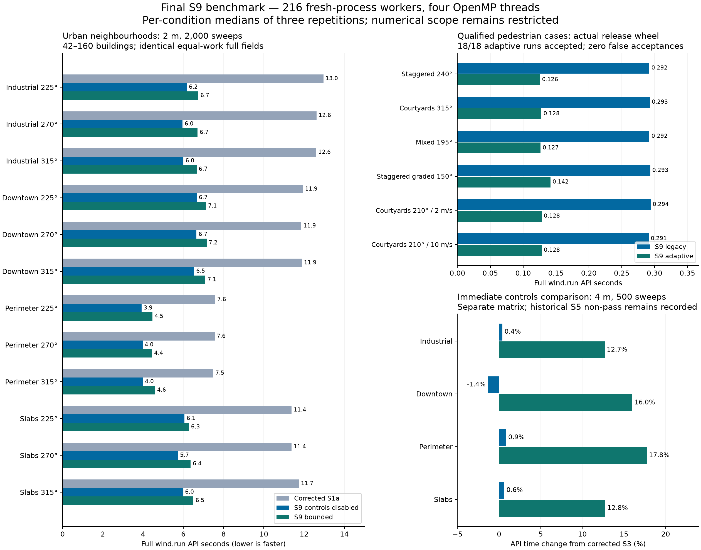

# Final S9 solver benchmark

The frozen S9 solver is compared with corrected S1a (overall architecture) and S3 (immediate controls baseline). Three fresh-process repetitions, four actual OpenMP threads. Reported ratios use per-case/direction medians; no cross-resolution timing extrapolation.

Urban cases use 42–160 buildings. Equal-work field parity is not numerical/physical accuracy qualification. The adaptive comparison is confined to the six previously qualified S7 neighbourhood conditions.



## overall-pilot

36 workers; 24 paired comparisons; all equal-work/grid/full-field checks pass.

| Case / wind FROM | Baseline API s | S9 disabled s | S9 bounded s | Disabled speedup | Bounded speedup | RSS MiB baseline / disabled / bounded |
| --- | ---: | ---: | ---: | ---: | ---: | ---: |
| industrial_residential / 270° | 0.708 | 0.400 | 0.451 | 1.77× | 1.57× | 378 / 336 / 341 |
| mixed_downtown / 270° | 0.690 | 0.377 | 0.420 | 1.83× | 1.64× | 365 / 319 / 331 |
| perimeter_neighbourhood / 270° | 0.486 | 0.296 | 0.345 | 1.64× | 1.41× | 319 / 287 / 299 |
| slab_estate / 270° | 0.641 | 0.372 | 0.420 | 1.72× | 1.53× | 365 / 325 / 330 |

Raw campaign: [20261031T093341Z-bba6ac53](data/final-solver-benchmark/overall-pilot.tar.gz) (complete raw campaign archive)

## overall-core-long

108 workers; 72 paired comparisons; all equal-work/grid/full-field checks pass.

| Case / wind FROM | Baseline API s | S9 disabled s | S9 bounded s | Disabled speedup | Bounded speedup | RSS MiB baseline / disabled / bounded |
| --- | ---: | ---: | ---: | ---: | ---: | ---: |
| industrial_residential / 225° | 12.962 | 6.173 | 6.746 | 2.10× | 1.92× | 960 / 684 / 703 |
| industrial_residential / 270° | 12.618 | 5.961 | 6.710 | 2.12× | 1.88× | 955 / 682 / 699 |
| industrial_residential / 315° | 12.602 | 6.003 | 6.662 | 2.10× | 1.89× | 953 / 681 / 698 |
| mixed_downtown / 225° | 11.946 | 6.667 | 7.125 | 1.79× | 1.68× | 1044 / 733 / 746 |
| mixed_downtown / 270° | 11.866 | 6.655 | 7.159 | 1.78× | 1.66× | 1047 / 734 / 752 |
| mixed_downtown / 315° | 11.892 | 6.536 | 7.097 | 1.82× | 1.68× | 1044 / 732 / 751 |
| perimeter_neighbourhood / 225° | 7.582 | 3.924 | 4.465 | 1.93× | 1.70× | 699 / 517 / 533 |
| perimeter_neighbourhood / 270° | 7.558 | 3.975 | 4.448 | 1.90× | 1.70× | 697 / 520 / 533 |
| perimeter_neighbourhood / 315° | 7.491 | 3.989 | 4.594 | 1.88× | 1.63× | 698 / 521 / 536 |
| slab_estate / 225° | 11.382 | 6.060 | 6.279 | 1.88× | 1.81× | 945 / 678 / 692 |
| slab_estate / 270° | 11.373 | 5.735 | 6.364 | 1.98× | 1.79× | 944 / 675 / 692 |
| slab_estate / 315° | 11.741 | 5.984 | 6.502 | 1.96× | 1.81× | 783 / 686 / 702 |

Raw campaign: [20261031T093521Z-852fd764](data/final-solver-benchmark/overall-core-long.tar.gz) (campaign metadata and fixtures; workers are in the three archives below)

Raw worker archives: [00–05](data/final-solver-benchmark/overall-core-long-runs-00-05.tar.gz), [06–11](data/final-solver-benchmark/overall-core-long-runs-06-11.tar.gz), [12–17](data/final-solver-benchmark/overall-core-long-runs-12-17.tar.gz).

## controls-pilot

36 workers; 24 paired comparisons; all equal-work/grid/full-field checks pass.

| Case / wind FROM | Baseline API s | S9 disabled s | S9 bounded s | Disabled speedup | Bounded speedup | RSS MiB baseline / disabled / bounded |
| --- | ---: | ---: | ---: | ---: | ---: | ---: |
| industrial_residential / 270° | 0.403 | 0.405 | 0.454 | 1.00× | 0.89× | 333 / 332 / 339 |
| mixed_downtown / 270° | 0.379 | 0.374 | 0.440 | 1.01× | 0.86× | 322 / 318 / 328 |
| perimeter_neighbourhood / 270° | 0.294 | 0.296 | 0.346 | 0.99× | 0.85× | 288 / 292 / 296 |
| slab_estate / 270° | 0.366 | 0.368 | 0.413 | 0.99× | 0.89× | 322 / 323 / 332 |

Raw campaign: [20261031T095234Z-90945794](data/final-solver-benchmark/controls-pilot.tar.gz) (complete raw campaign archive)

## Qualified adaptive policy

The actual S9 wheel is imported without instrumentation. Legacy/adaptive worker order alternates by repetition. Fields and diagnostics match the frozen S7 results exactly, including under the currently installed DTCC Core revision. Existing float64 same-grid references assess both pedestrian heights and required receptors; no new scope is qualified.

| Condition | Legacy API s | Adaptive API s | Speedup | Legacy / adaptive sweeps | Max adaptive vector error / Uref |
| --- | ---: | ---: | ---: | ---: | ---: |
| val_staggered_240 | 0.292 | 0.126 | 2.33× | [2000] / [225] | 1.33e-06 |
| val_courtyards_315 | 0.293 | 0.128 | 2.29× | [2000] / [225] | 1.27e-06 |
| val_mixed_195 | 0.292 | 0.127 | 2.31× | [2000] / [225] | 1.13e-06 |
| val_staggered_graded_150 | 0.293 | 0.142 | 2.07× | [2000] / [250] | 1.52e-06 |
| val_courtyards_210_u2 | 0.294 | 0.128 | 2.29× | [2000] / [225] | 1.12e-06 |
| val_courtyards_210_u10 | 0.291 | 0.128 | 2.27× | [2000] / [225] | 1.23e-06 |

All 18 adaptive runs accepted and passed the existing observable target; 0 false acceptances. All 36 adaptive/legacy outputs match their frozen S7 fields/diagnostics.

## Findings

The overall 2 m / 2,000-sweep matrix demonstrates the architecture gain at realistic resolution and longer work, with exact full-field parity. Bounded runs also finish all 2,000 sweeps inside their declared 20 s native budgets. All large urban outputs retain iteration-limit stopping and unassessed accuracy.

The immediate S3 comparison is a separate 4 m / 500-sweep / 270° matrix. Disabled controls are approximately neutral in this current pilot; bounded execution adds monitoring/deadline overhead. This observation does not replace the historical S5 non-pass, its different confirmation matrix or its preserved timing evidence. No universal <=5% regression claim follows.

Peak RSS remains variable across fresh processes. In particular, the long-run slab-estate 315° baseline median is lower than the other slab directions; it is retained and lowers the reported memory-saving range. No outliers were removed.

## Limits and reproduction

Full API time includes extraction, preparation, solve, finalization and NumPy output. Urban pipeline timings additionally include City construction, preview, sampling, hashing and compressed pedestrian-plane output; full-volume velocity/flags are compared via hashes rather than serialized in full. These and timing ranges remain in results.json/raw rows. RSS is process high-water, including imports and transient copies. Timings are local descriptive repetitions, not guarantees.

Legacy convergence remains a multiplier-change diagnostic. Large urban cases remain accuracy-unassessed even when equal-work fields are bitwise identical. Adaptive acceptance is restricted to the recorded ROI/receptors and supported numerical/build envelope; comfort/gust/physical qualification is outside this benchmark.

protocol.json records the finite worker matrix, source identities and current dependency revision. Every campaign preserves fresh fixtures, raw workers, logs and comparison manifests. Installed DTCC Core uses the live footprint-cleaning branch; both sides of every urban comparison use the same dependency revision. The frozen S9 solver sources and prior release evidence are unchanged.

```sh
.venv/bin/python tools/run_urban_benchmarks.py --tier pilot --cache-dir build/solver-control-s9/campaign-cache
.venv/bin/python tools/run_urban_benchmarks.py --tier core --iterations 2000 --solve-seconds 20 --cache-dir build/solver-control-s9/campaign-cache
.venv/bin/python tools/run_urban_benchmarks.py --tier pilot --comparison controls --cache-dir build/solver-control-s9/campaign-cache
.venv/bin/python build/final-solver-benchmark/run_adaptive.py --output build/final-adaptive-repeat
```

## Committed evidence

The [summary](data/final-solver-benchmark/results.json), [protocol](data/final-solver-benchmark/protocol.json) and raw campaign archives above preserve this run. The [final results archive](data/final-solver-benchmark/final-results.tar.gz) contains the original report, scripts, manifest and all 36 adaptive workers with fields and logs. Extract all campaign metadata and worker archives into `build/urban-benchmarks/` and the final results archive into `build/` to restore the original relative layout. The manifest inside the final results archive preserves the original hashes; [publication.json](data/final-solver-benchmark/publication.json) hashes the committed copies and archives. Existing solver release evidence is unchanged.
