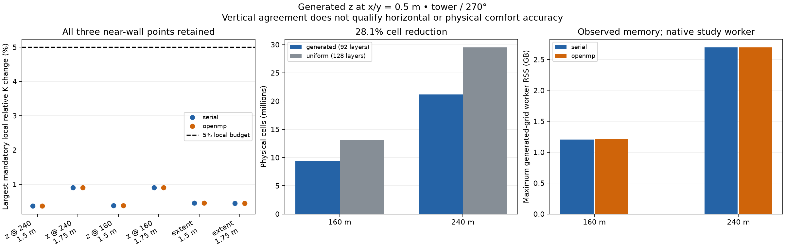

# Bounded generated vertical-grid pilot

## Protocol fixed before measurements

This C2c pilot measures the additional vertical-discretization difference at
fixed x/y=0.5 m. It does not qualify horizontal grid independence or physical
comfort accuracy. The [near-wall findings](near-wall-validation.md), failed
full-region horizontal checks and production parameterizations remain unchanged.

Use the actual public `VerticalGrid.auto(pedestrian_height=1.5)` policy with
all other settings at their current defaults, generated separately for the
160 and 240 m square domains. Keep the tower fixture, roofs 7.9/23.7 m, requested
64 m top, world sensor (5,5), 5 m/s at 10 m and 270-degree wind. Require identical
vertical solver operands across the lateral control. Store planned/effective
faces, solver thicknesses, policy/version, roof representation and preview cost.
The policy generates 92 layers here, rather than the 42 layers frozen from the
old 2 m horizontal preview; do not substitute that older family for this test.

Execute both serial and OpenMP CPU backends with the existing opt-in float64
solver, float32 geometry/output and original centred component sampler. Compare
with each backend's accepted uniform-z=0.5 m joint-study references at the same
extent. Evaluate both 1.5 and 1.75 m at the original fixed physical lattice,
the union of BOTH historical vertical families' frozen critical sets, and all
three mandatory near-wall points (27,21), (21,23), (51,35). No new exclusion rule,
spatial averaging, parameter tuning or threshold relaxation is permitted.

Require the established solve gate: scaled maximum/rms residual <=1e-3/1e-4
at all three checkpoints and maximum/p95 vector change divided by Uref
<=1e-3/5e-4 on both successive N/2N/4N comparisons. Every checkpoint starts
from zero. Start N=4000 for serial/160 and N=8000 for the other three cases;
double N when needed, up to 16000. Save rejected triples and unique checkpoints.
An exhausted failed solve withholds its spatial comparisons; do not silently
increase the cap or reuse a previous family's solution.

Apply unchanged spatial budgets: p95 absolute delta K <0.05, relative peak
change <5%, and each frozen critical/local point <5% relative for reference
K>=0.1, otherwise absolute delta K <0.05. Require no validity transitions and
no invalid critical/local support. Include the generated-grid 160-to-240 m
lateral control. Report the 4 m setback region separately as a diagnostic;
its regional decision excludes the three full-region near-wall checks.
A pilot pass requires all six full-region comparisons per backend, matching
CPU decisions, and CPU field differences within the iterative stability budget.
Even a pass cannot qualify a comfort preset or remove the horizontal failures.

Run at most two workers, one per backend, larger extent first. Keep the
20-million-cell target soft: the generated cases have 9,420,800 and 21,196,800
physical cells, versus 13,107,200 and 29,491,200 in the accepted uniform references.
Use a 40-million allocation ceiling and record array estimates and worker RSS.
Report preview, preparation, solve, residual and sampling costs separately,
including rejected/certification work. One shared-host diagnostic repetition
and historical reference timings cannot establish a speedup; three controlled
repetitions and a cheapest-qualifying-uniform comparison remain later work.

Archive the frozen sources, protocol, reference hashes and executable identities
before any new solve. Reuse only identical checkpoint requests. Provide a
saved-data audit that verifies sources, inputs, atomic checkpoint contents,
assembled runs, stability and all comparison decisions without executing binaries.
No production API, solver or generator change is part of this pilot.

## Reproduction

```sh
# Freeze once, then execute/resume the four cases.
.venv/bin/python tools/run_generated_grid_pilot.py --freeze-only
.venv/bin/python tools/run_generated_grid_pilot.py --resume
.venv/bin/python tools/audit_generated_grid_pilot.py
MPLCONFIGDIR=build/mplconfig .venv/bin/python tools/plot_generated_grid_pilot.py
```

The committed `data/generated-grid-pilot/protocol.md` preserves the exact text
frozen before measurements. The execution driver uses the retained joint-study
worker binaries and verifies their hashes. A fresh experiment with rebuilt
binaries requires a new manifest and provenance review; it cannot silently
resume these historical executions. The saved-data audit requires neither
native binaries nor a build tree, but does require the referenced historical
archives at their repository-relative paths. Its analysis imports the frozen
source snapshots instead of the current working tree's analysis code.

Generated 1.5 m sampling is at the fourth physical cell centre. Sampling at
1.75 m interpolates the fourth and fifth centres. The policy holds layers at
or below 0.5 m through the tallest building's 1.5H roof buffer (35.55 m), then
allows growth toward the default 2 m upper cap. The resulting 28.125% cell
reduction is smaller than estimates based on the older 42-layer grid. It is
not evidence of a corresponding runtime saving or of optimal policy settings.

## Completed results, 2026-10-28

**All four cases pass the common solve gate, and all six full-region
comparisons per backend pass their predeclared spatial budgets.** The six
comparisons are generated-versus-uniform z at each extent and the generated-grid
160-to-240 m lateral comparison, each at both pedestrian heights. All 12
full-region decisions and all 12 setback-region diagnostic decisions agree
between CPU backends. Every critical and mandatory local point remains valid,
with no solid/fluid validity transitions. The summary records `complete=true`,
`vertical_pilot_pass=true` and `comfort_qualified=false`.

The following values use OpenMP results; serial gives the same decisions and
agrees to the precision described below. K is speed divided by Uref=5 m/s.

| Comparison | Height | p95 absolute delta K | Relative peak change | Largest mandatory local change |
| --- | ---: | ---: | ---: | ---: |
| Generated vs uniform, 160 m | 1.5 m | 0.0027953 | 0.293% | 0.374% |
| Generated vs uniform, 160 m | 1.75 m | 0.0016365 | 0.189% | 0.902% |
| Generated vs uniform, 240 m | 1.5 m | 0.0027723 | 0.290% | 0.364% |
| Generated vs uniform, 240 m | 1.75 m | 0.0016656 | 0.192% | 0.902% |
| Generated extent, 160 to 240 m | 1.5 m | 0.0040984 | 0.192% | 0.456% |
| Generated extent, 160 to 240 m | 1.75 m | 0.0041097 | 0.185% | 0.438% |

All frozen critical sets pass; their largest relative change is 0.428% across
these comparisons. The largest mandatory local vertical difference is 0.902%
at (21,23,1.75), and the largest mandatory local lateral difference is 0.456%.
This supports the additional effect of this generated z policy on this fixture
at fixed 0.5 m x/y. The historical horizontal sensitivity remains material.

The spatial budget combines a percentile, a peak and selected local checks.
Elsewhere on the lattice, the largest vertical absolute delta K is 0.04041,
or 0.202 m/s, at (15,29,1.75); at 1.5 m it is 0.03925 at (15,47). The largest
vector difference is 0.05018 Uref, or 0.251 m/s. A pass of the declared speed
metrics therefore does not establish a 5% relative error bound at every point
or equivalent directional accuracy. Preserve these observed locations in the
next predeclared vertical-refinement/centre-alignment study rather than selecting
only the best-performing samples.

### Solve certification and backend agreement

The audit verifies 12 unique independent zero-start checkpoints, with no rejected
budget triples and no increase of the predeclared iteration cap:

| Backend | Extent | Fixed-sweep checkpoints | Common gate | Ten-times tighter residuals at all three checkpoints |
| --- | ---: | --- | --- | --- |
| Serial | 160 m | 4,000 / 8,000 / 16,000 | Pass | No |
| Serial | 240 m | 8,000 / 16,000 / 32,000 | Pass | Yes |
| OpenMP | 160 m | 8,000 / 16,000 / 32,000 | Pass | No |
| OpenMP | 240 m | 8,000 / 16,000 / 32,000 | Pass | No |

Both sampling heights pass residual control at all checkpoints and stability
on both successive comparisons. The tighter result is reported as observed;
it was not substituted for the common acceptance gate. Initial/profile fields,
coordinates, flags and roof representation agree exactly across backends.
Maximum final CPU vector difference divided by Uref is `2.39e-8` (about
`1.20e-7 m/s`), well inside the iterative stability budget.

### Cells, memory and costs

| Extent | Generated cells | Uniform cells | Largest observed generated worker RSS |
| --- | ---: | ---: | ---: |
| 160 m | 9,420,800 | 13,107,200 | 1.207 GB |
| 240 m | 21,196,800 | 29,491,200 | 2.694 GB |

Cell count falls by **28.125%** at either extent. Maximum observed worker RSS
stays below the respective 1.55/3.40 GB process estimates. The 21.20-million-cell
case is deliberately retained above the soft target. These are native study
workers without public full-volume NumPy output copies; public run memory must
include those allocations before extrapolating to a larger city.

Public preview generation was measured once per extent at approximately
0.73/1.42 ms. Native preparation, solve, residual and sampling intervals, total
cell-sweeps and every individual checkpoint are retained in the audit. The
[execution-environment record](data/generated-grid-pilot/execution-environment.json)
contains repeated OS sleep/wake events during the experiment. Native elapsed
intervals include interruptions and cannot support runtime ratios or speedup
claims. Sleep settings were not changed. Controlled repetitions and the
cheapest qualifying uniform-grid comparison remain necessary for a performance
recommendation.



### Audit, packaging and next validation

The focused study suite passes **103 tests**. The full saved-data audit verifies
checkpoint identities/content, source and reference hashes, initial/support
consistency, flags, checkpoint assembly and all final decisions. An isolated
data-only copy reproduces that audit without worker binaries or a build tree.
The source distribution includes the frozen analysis, protocol, raw cases,
checkpoints, figure and provenance, and passes its artifact checks.

This pilot supports continuing C2c; it does not select an automatic comfort
preset. Next, freeze a bounded three-level vertical-refinement and
centre-alignment protocol at the accepted 160 m extent and fixed x/y=0.5 m.
Retain both heights, original critical/local checks and the observed largest-error
locations above. Use the actual generated policy as the baseline and document
whether each refinement changes the generated policy or subdivides its layers;
these answer different questions. Validate float32 faces, roof representation,
resource estimates and solve budgets before launching the new measurements.
Remaining geometry/wind coverage follows a useful refinement result. Cost
repetitions and preset selection follow the appropriate accuracy coverage and
an explicit supported scope. Full three-dimensional and experimental comfort
qualification remain pending.

No production solver, sampler, generator setting or public default changed in
this pilot. The driver has finished; no additional solve is required to reproduce
these archived comparison decisions.

[Manifest](data/generated-grid-pilot/manifest.json),
[frozen protocol](data/generated-grid-pilot/protocol.md),
[summary](data/generated-grid-pilot/summary.json),
[data audit](data/generated-grid-pilot/audit.json),
[figure provenance](data/generated-grid-pilot/figure.json).
