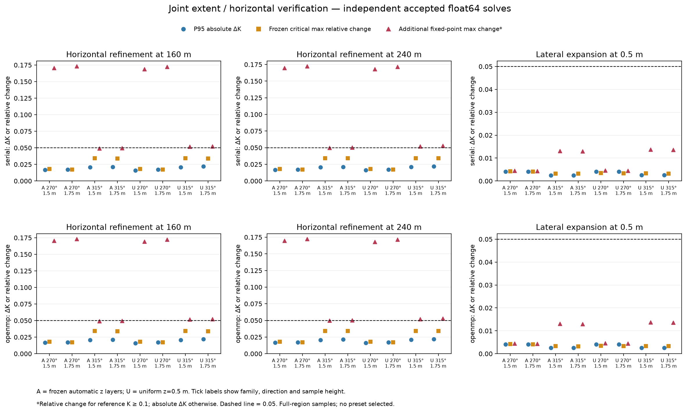

# Joint lateral extent and horizontal resolution verification

This study tests whether the accepted float64 solver supports the combination
of a larger lateral domain and finer horizontal cells. The preceding
[precision and grid-verification study](precision-and-horizontal-verification.md)
tested the two axes separately. Neither numerical study establishes agreement
with experimental pedestrian wind measurements or selects an automatic preset.

## Implementation and frozen comparison contract

`tools/vertical_grid_study.cpp` now accepts two study-only controls:

- `--max-cells COUNT` sets a configurable allocation ceiling. The existing
  default and hard integer/index checks remain in place.
- `--checkpoint` with `--horizontal --float64` executes one independently
  zero-started fixed-sweep solve. The existing three-checkpoint mode retains
  its numerical behavior. A focused native check compares all three checkpoints
  exactly with independently launched single-checkpoint results, including both
  sampled planes.

`tools/run_joint_grid_verification.py` freezes the full matrix, original
critical locations, additional fixed checks, sources, executable, reference
hashes, thresholds and resource configuration in a manifest before measurement.
Each checkpoint is saved atomically with its input and content fingerprints.
Completed failed triples are retained. On budget escalation, matching saved
zero-start checkpoints are reused; no checkpoint continues an earlier solve.
The driver can resume after interruption without rerunning completed checkpoints.
Case records are authoritative; the combined raw archive and summary can be
reconstructed after an interruption during analysis.

The new prerequisite check requires every declared tighter reference to pass
at all three checkpoints, rather than merely finding one successful tighter
case. It also checks matrix completeness, unique IDs, task operands, backend,
precision, zero starts, production flags, frozen coordinates and provenance.
The older studies remain unchanged. Their original worker source is retained
under `data/joint-grid-verification/baseline-sources/` so its historical hash can
still be verified after the worker changes.

For each CPU backend, the study adds eight fine-grid cases:

| Control | Values |
| --- | --- |
| Square lateral extent | 160 m, 240 m |
| Horizontal spacing | 0.5 m; accepted 1 m references reused at both extents |
| Vertical layers | Frozen 42-layer automatic grid; frozen 128-layer uniform-z=0.5 m grid |
| Wind direction | 270°, 315° |
| Sample heights | 1.5 m, 1.75 m |
| World comparison lattice | x,y = 3,5,…,77 m |
| Sensor and reference wind | World (5,5), 5 m/s at 10 m |
| Iteration budgets | Start at N=2,000; double N up to 16,000; certify N,2N,4N from zero |

Geometry, horizontal grid alignment, vertical solver operands, domain top,
production parameterizations and physical normalization scales stay fixed.
The automatic family reuses the layers originally generated at 2 m resolution;
it does not regenerate its z policy when x/y spacing changes. This isolates
horizontal sensitivity. Actual generated-grid refinement remains C2c work.
Horizontal comparisons are 1→0.5 m at each extent; the finer-grid lateral
control is 160→240 m at 0.5 m. The previously accepted 160→240 m comparison at
1 m remains visible as a control. Both CPU backends use their production
ordering; the OpenMP worker uses two threads.
The normalized speed is `K = norm(u,v,w) / 5`, computed after component
interpolation, matching the preceding studies.

Every solve must pass the existing residual and vector-stability gate at both
heights. Spatial comparisons preserve the original P95, global-peak and frozen
critical-location budgets. Additional mandatory checks at (27,21), (21,23) and
(51,35) require relative delta K <5% when the finer/larger reference K ≥0.1;
otherwise absolute delta K <0.05. An unavailable fixed point fails its check.
Full-region scope also requires no solid/fluid transitions. These added checks
were declared before the new fields were measured. Historical aggregate passes
retain their original meaning; the expanded local gate is reported separately.
The 4 m footprint setback remains a supplementary diagnostic region.

## Resource targets and recorded costs

The cell target is 20 million and the allocation ceiling for this run is
40 million. The 29,491,200-cell uniform-z / 240 m / 0.5 m case remains in the
matrix. Targets are soft planning values; they do not justify changing the
accuracy experiment. The user reports successful 40-million-cell tests, and
around 100 million may be feasible on suitable hardware.

Before running, the driver estimates storage using physical and ghost-cell
counts, native array types and the two double-precision solver buffers. The
estimate adds 25% and 64 MiB for other storage; it is not a peak-memory guarantee.
The manifest records the estimate, concurrency and host physical memory. Each
checkpoint records measured peak RSS, preparation, solve, residual evaluation
and sampling time. The audit distinguishes actual unique-checkpoint work from
the selected three-checkpoint certification work. Measurements use one
diagnostic repetition with concurrent workers and do not support benchmark
ratios or a cheapest-preset claim.
The host power log confirms sleep/wake interruptions during the final serial
runs. After wake, all four native serial workers were active at approximately
one core each; their common gap between elapsed and accumulated CPU time
reflects the inactive interval. The observation is recorded in
[`execution-environment.json`](data/joint-grid-verification/execution-environment.json).
Retain the measured timings with this qualification; they are not uninterrupted
benchmark measurements.
The audit also records fixed sweeps and physical-cell count × sweeps for
executed checkpoints and selected certification triples separately. This is a
deterministic work proxy, not an exact operation count. Summed native solve
durations are recorded timer intervals, not accumulated CPU time or the whole
study's elapsed wall time; host sleep can affect their interpretation.

The two future 32,000-sweep serial checkpoints for the largest uniform-z cases
are also scheduled independently in parallel with earlier primary cases. This
uses two supplemental workers, for at most four concurrent serial workers;
the OpenMP primary schedule still uses two two-thread workers. The additional
estimated storage is recorded before execution in `serial/supplemental.json`.
`tools/precompute_joint_checkpoints.py` uses the identical frozen executable,
inputs and study identity. It retains its own checkpoint archive and publishes
completed cache entries with an exclusive hard link, never overwriting an
existing primary entry. If both schedules execute the same budget, both
invocations remain archived and charged. A checkpoint merely copied into the
primary cache is counted once. This changes scheduling, not numerical operands,
zero-start requirements, iteration budgets or acceptance criteria.

## Reproduction and audit

Build the serial and OpenMP `vertical_grid_study` targets and retain the
executables used by each matrix. This checkout saved the previous workers as
`build/joint-grid-verification/bin/legacy-serial` and `legacy-openmp` before
rebuilding; the driver verifies their hashes against the historical archives.
The new workers are frozen as `serial` and `openmp` in the same directory.
Executable paths and hashes are recorded in each manifest. These build outputs
are local artifacts, not source-distribution contents.

Run from the repository root:

```sh
.venv/bin/python tools/run_joint_grid_verification.py \
  --backend serial --executable build/joint-grid-verification/bin/serial \
  --output docs/data/joint-grid-verification/serial
.venv/bin/python tools/run_joint_grid_verification.py \
  --backend openmp --executable build/joint-grid-verification/bin/openmp \
  --output docs/data/joint-grid-verification/openmp
```

Append `--resume` after interruption, or use `--only TASK_ID ...` for a pilot
within the already frozen full matrix. A pilot cannot establish matrix
completeness. `--summarize` reconstructs combined archives from case records.
Changing sources, inputs, the executable or declared resource configuration
requires a new output directory. Checkpoints are never reused across those
changes by filename alone.

```sh
.venv/bin/python tools/audit_joint_grid_verification.py
MPLCONFIGDIR=build/mplconfig .venv/bin/python tools/plot_joint_grid_verification.py
```

The audit recomputes decisions from the raw fields, verifies checkpoint hashes
and zero-start provenance, reconstructs every selected and rejected triple,
checks unchanged initialization across budgets, and compares CPU fields and
decisions. Failed numerical or spatial gates are valid audited findings. The
plot requires both matrices to be complete with accepted solves.
Run the final audit after workers have stopped and the combined summaries have
been reconstructed; an analysis snapshot that lags newly saved case records is
rejected rather than silently accepted.

## Completed results and scope decision

Both CPU matrices and the independent-checkpoint audit are complete locally on
2026-10-27. All 16 new cases pass the solve gate. The archive retains 73 unique
zero-start checkpoint executions and 25 rejected budget triples. Both supplemental
32,000-sweep executions are reused in the primary serial matrix and counted
once; no duplicate supplemental invocation was needed.

Full-region decisions agree between serial and OpenMP at both pedestrian heights:

| Comparison | Planes | Original budget passes | Added local-check passes | Largest P95 absolute delta K |
| --- | ---: | ---: | ---: | ---: |
| 1→0.5 m x/y at 160 m extent | 8 | 8 | 2 | 0.02203 |
| 1→0.5 m x/y at 240 m extent | 8 | 8 | 1 | 0.02201 |
| 160→240 m extent at 0.5 m x/y | 8 | 8 | 8 | 0.00414 |
| 160→240 m extent at 1 m x/y, existing control | 8 | 8 | 8 | 0.00422 |

All 64 full/away-region rows per backend pass the original aggregate/critical budgets.
The expanded full-region gate nevertheless fails 13 of the 16 horizontal
refinement planes. The largest added-point relative change is 17.32%, and the
full-lattice maximum absolute delta K remains about 0.17345 (about 0.87 m/s for
the imposed 5 m/s reference). These are grid changes, not measured physical
prediction errors. P95 and the original frozen fast-point checks do not bound
every near-wall location.

The finer-grid lateral control passes at every fixed check, with full-lattice
maximum absolute delta K below 0.00506. Initialization/profile fields are
identical through that lateral expansion at the inspected support, and all
comparisons have zero solid/fluid transitions on the fixed lattice. The new
domain control therefore does not remove the horizontal near-wall sensitivity.
The largest cases contain 29,491,200 physical cells and reach about 3.72 GB peak
RSS on both backends. Their solver buffers occupy 475,545,600 bytes, against an
estimated 3.70 GB of main arrays and a conservative 4.69 GB process estimate.
They fit the declared 40-million allocation ceiling while exceeding the soft
20-million target. Cell-count planning did not alter the geometry or accuracy
criteria.

Across all eight paired new cases and both heights, the largest final sampled
vector difference between CPU backends divided by Uref is `2.3923e-8`.
Profile/initialized support, axes, z faces, roof representation and final
occupancy flags agree exactly between backends. The audit reconstructs every
selected and rejected triple from its independently archived checkpoints and
recomputes every comparison decision exactly.

| Recorded work/cost | Serial | OpenMP |
| --- | ---: | ---: |
| Accepted new cases | 8 | 8 |
| Unique checkpoint executions | 34 | 39 |
| Rejected budget triples retained | 10 | 15 |
| Executed physical-cell-sweeps | 5.2820e12 | 6.8778e12 |
| Selected certification physical-cell-sweeps | 4.8198e12 | 6.2161e12 |
| Sum of recorded solve intervals, seconds | 53,811.6 | 9,149.5 |
| Peak worker RSS, decimal GB | 3.723 | 3.721 |

The serial timer intervals include the host sleep/wake interruption. These
sums are not CPU time, whole-study elapsed time or comparable benchmark
measurements. The cell-sweep proxies and separately recorded memory, iteration
budgets and checkpoint provenance remain useful resource evidence.



The completed assessment rejects the proposed expanded full-region scope:
accepted solves and lateral stabilization coexist with failed near-wall
horizontal comparisons. The automatic policy remains `prototype_unvalidated`;
C2c and B2 remain gated. The next action is a bounded review of near-wall
initialization, native-corner averaging and the intended sampling observable,
followed by a declared qualification protocol if further refinement or a
narrower supported scope is justified. The 4 m setback remains diagnostic.
No new finer-grid matrix or empirical-physics tuning is started by this stage.

The fixed 64 m top and separately reported prescribed top-band residual retain
the preceding study's convention. These comparisons establish no universal
padding, spacing, domain-height or pointwise physical-accuracy prescription.
Actual generated-grid refinement and experimental mean-speed validation remain
separate requirements.

[Serial raw archive](data/joint-grid-verification/serial/raw.json.gz),
[serial summary](data/joint-grid-verification/serial/summary.json),
[serial manifest](data/joint-grid-verification/serial/manifest.json),
[OpenMP raw archive](data/joint-grid-verification/openmp/raw.json.gz),
[OpenMP summary](data/joint-grid-verification/openmp/summary.json),
[OpenMP manifest](data/joint-grid-verification/openmp/manifest.json),
[combined audit](data/joint-grid-verification/audit.json) and
[figure provenance](data/joint-grid-verification/figure.json).

## Implementation validation

The focused Python verification suites pass 83 tests. The eleven new joint-study
tests cover the fixed matrix and soft target, full tighter-subset enforcement,
incomplete matrices, local failures hidden by aggregate passes, failed-solve
withholding, low-speed/invalid-point checks, corrupted caches, budget escalation
checkpoint reuse, exclusive publication and the audit's accounting for reused
versus duplicate work. Native subprocess checks exercise the configurable
allocation guard and compare the single-checkpoint mode exactly with the
existing triple mode.

Serial/OpenMP Release CTest passes 11/14 checks respectively. Both ASan/UBSan
builds pass the same 11/14 checks; the new Python suite also exercises each
instrumented worker. The native symbol audit passes for both bridge builds.
The study changes no public solver API or numerical kernel.
