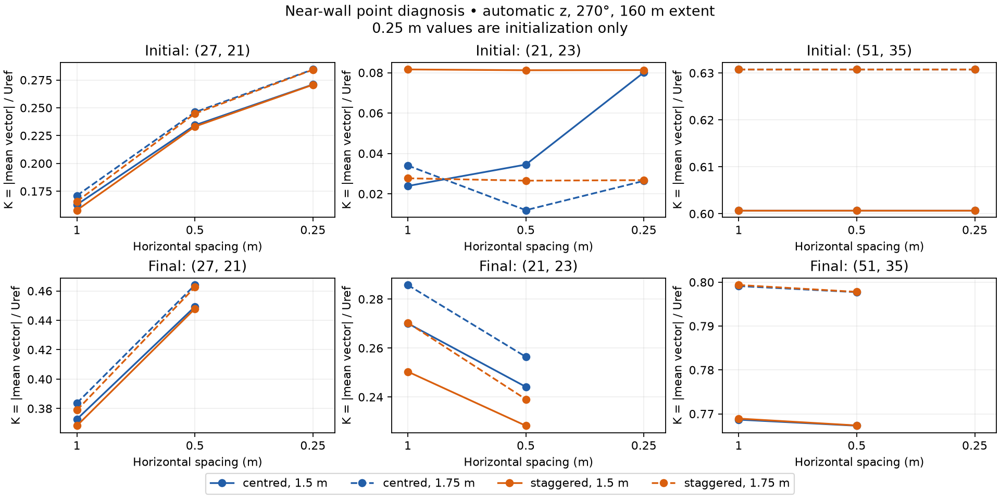
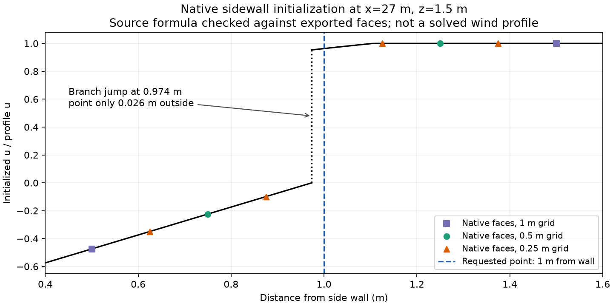

# Bounded near-wall sampling validation

## Protocol fixed before new measurements

The target remains point velocity at 1.5 and 1.75 m above flat ground, with
speed defined as the magnitude of the interpolated mean vector. A spatial
average would be a different observable and is not introduced to reduce an
observed error. Existing full-region failures and original thresholds remain.

This diagnosis retains the tower geometry, 64 m top, production flags, frozen
42/128-layer z families, world sensor (5,5), Uref=5 m/s and three fixed points
(27,21), (21,23), (51,35). Initialization probes compare x/y=1, 0.5, 0.25 m at
160 m extent for both families and winds. Sidewall-off and all-empirical-off
initialization controls use the automatic family and 270 degrees. These are
diagnostics, not alternative production settings or accepted fine references.

Record raw staggered face values, incident-cell flags, centred values and their
coordinates at every contributing point. Compare the existing centred sampler
with direct component interpolation on each component's native staggered grid.
Both require finite positive-weight support, no extrapolation, and a fluid
query cell. Direct sampling permits a solid/fluid boundary face (its imposed
normal velocity is part of the discrete field), rejects faces with no incident
fluid cell, and never replaces missing values or renormalizes weights.

Before field comparisons, test affine and curved manufactured fields, exact
support positions, invalid solid support and a wall-normal profile. A direct
sampler is a diagnostic candidate, not a public API change. Its final-field
test re-executes the accepted 160 m / automatic / 270-degree cases at 1 and
0.5 m using their archived final fixed-sweep budgets. Existing full-plane
outputs and residuals must match the accepted archive before new face data is
used. Existing N/2N/4N certification is reused only after that parity check;
these executions do not certify a new grid or an alternate sampler's iterative
stability. Acceptance of an alternate sampler would require its own stability
and spatial validation at every required case.

Decompose the final vector change into initialization change plus change of
the projection correction. Do not add speed magnitudes or infer causality from
a single component. Report both samplers at all three points and both heights,
including adverse changes. A replacement is not justified merely by reducing
one discrepancy. Preserve the 5% relative / 0.05 absolute low-speed diagnostic
budget and report magnitude differences separately from vector differences.

Use at most two probe workers and one solved diagnostic worker at a time.
The largest initial probe has 52,428,800 physical cells (160 m / 0.25 m /
128 layers); a 60-million allocation guard accommodates this deliberate
overrun of the soft target on this 51.5 GB host. No public output volumes are
allocated. Estimate native arrays and record RSS before extrapolating costs.
No 0.25 m full-solve matrix is authorized by this protocol: decide whether a
selected finer reference is scientifically useful from the completed diagnosis.

The historical study files remain immutable. New diagnostics live in separate
tools and archives. Region-specific summaries must exclude the three 1 m
wall-distance checks from the 4 m setback region; full-region checks remain
mandatory. Neither region is promoted to a validated comfort preset.

## Completed results and decision

Completed locally on 2026-10-27: 36 initialization probes and four solved
diagnostic reruns, covering both CPU backends. All initialization raw faces,
centred values, flags and coordinates agree exactly between backends. The
four solved reruns reproduce their accepted historical final planes to within
`5.0001e-10 m/s` (the archive's decimal serialization precision), with matching
flags and residual diagnostics. At the six fixed diagnostic locations, final
vectors from both reconstruction methods agree exactly across backends.

The independent audit checks 189,000 native component averages and incident-cell
flags. Reconstruction from raw centred patches agrees with the historical
plane sampler within `8.9e-16 m/s`. These checks support the current extraction
and interpolation implementation. They do not establish physical accuracy.

### Does direct staggered sampling fix the failure?

No. At 160 m extent, automatic z and 270-degree wind, the 1-to-0.5 m final
speed changes are:

| Point | Height | Current centred reconstruction | Direct staggered reconstruction |
| --- | ---: | ---: | ---: |
| (27,21) | 1.5 m | 17.04% | 17.78% |
| (27,21) | 1.75 m | 17.32% | 18.09% |
| (21,23) | 1.5 m | 10.62% | 9.68% |
| (21,23) | 1.75 m | 11.44% | 13.07% |
| (51,35) | 1.5 m | 0.180% | 0.204% |
| (51,35) | 1.75 m | 0.174% | 0.197% |

Both methods fail four of six local checks. Direct sampling helps some values
and worsens others. Retain the public sampler; this evidence does not justify
changing its observable or introducing spatial averaging as a remedy.



### What causes the initialization sensitivity?

There are at least two distinct effects. The all-empirical-off control at
(21,23) reproduces the manufactured wall-face filter: at 1 m spacing the
centred reconstruction is 75% of the profile value, rising to 100% at 0.5 m.
Direct reconstruction returns 100% at both spacings. This is a predictable
effect of the centring contract. Production flow at this point also includes
parameterizations and the projection, so removing that filter does not make
the final production field grid independent.

At (27,21,1.75), the production initialized K changes from 0.171042 to
0.246047 to 0.284478 as x/y spacing decreases from 1 to 0.5 to 0.25 m.
Direct reconstruction gives 0.165837, 0.244766 and 0.284231. The finer
initialization discrepancy remains 13.51% / 13.88%, respectively. Disabling
sidewall initialization makes this point's initialized K equal to 0.630759
at all three spacings for both methods. This ablation isolates an initialization
contribution; it is not a proposed production setting.

A subsequent exploratory source check explains the sharp behavior. For the
7.9 m high, 12 m wide block at x=22/y=22, `Sidewall.cpp` gives a recirculation
shell boundary at a wall distance of **0.97366178 m** when x=27 m. Its inner
branch approaches zero velocity; its outer logarithmic branch approaches
**0.953650 times the profile u**. The requested point is only **0.026338 m**
outside that jump. The exported native u faces at all three spacings match
these source branches within `1.42e-8` in u/profile-u. The raw faces therefore
confirm the discontinuity in the implemented initialization, rather than an
error in the downstream interpolation code.



For this specific alignment, an interpolation stencil centred on the requested
wall distance would remain across the jump until spacing is below about
0.05268 m. This is a geometric observation about one initialized component,
**not a recommended mesh spacing or a prediction of the converged solution**.
Establishing whether the empirical branch should be continuous requires a
separate model/formulation review; this study changes no parameterization.

Projection does not erase the effect. At (27,21,1.75), the centred 1-to-0.5 m
initial vector change is `(0.375025, 0, 0) m/s`; the change in the projection
correction is `(0.026266, 0.023639, 0.003679) m/s`, giving a final change of
`(0.401291, 0.023639, 0.003679) m/s`. This exact vector decomposition shows
that the initialized discrepancy remains substantial in the final comparison.
It does not prove that a local initial value alone causes a global solve result.

### What should happen next?

The bounded review is complete. Keep the existing point sampler and retain the
failed full-region horizontal qualification. A full 0.25 m solved matrix is
not the next step: it would further measure a known sharp initialization
transition without establishing a general sampler remedy or physical accuracy.
Selected finer solves remain useful if quantifying local uncertainty later
becomes a specific requirement.

Proceed with a **bounded C2c vertical-discretization pilot**, whose claim is
explicitly limited to the additional effect of replacing uniform z with
generated z at fixed x/y, geometry, boundaries and production physics. Freeze
its inputs and acceptance contract before measuring it. Reuse accepted uniform
0.5 m references at 160/240 m extent, initially for tower/270 degrees at both
pedestrian heights, and generate the actual automatic policy at x/y=0.5 m.
Retain all three near-wall points, original critical locations and the existing
vertical comparison budgets. Report horizontal sensitivity alongside vertical
differences; a vertical pass cannot erase the present horizontal failure.

This permits the feature's accuracy/cost investigation to proceed. Full
three-dimensional comfort qualification and automatic preset promotion remain
gated. There is no qualified 4 m exclusion rule, no experimental mean-speed
validation, and no new public default from this diagnosis. B2 remains pending
the appropriate C2 coverage and an explicit supported-scope decision.

## Resources, reproduction and validation

The largest initialization cases have 52,428,800 physical cells. Maximum
observed worker RSS is **5.74 GB**, below the predeclared 7.23 GB process
estimate. The four solved diagnostic reruns record 569.39 seconds of native
solve intervals in total. They use different accepted budgets and shared-host
execution, so these intervals are diagnostic costs, not backend benchmarks.
The initialization-only 0.25 m cases are never labelled accepted wind solutions.

The worker is isolated from production and the frozen historical study sources.
Build it against an existing Unix Makefiles build of `vertical_grid_study`:

```sh
.venv/bin/python tools/build_near_wall_probe.py build/extension build/near-wall/bin/serial
.venv/bin/python tools/build_near_wall_probe.py build/openmp build/near-wall/bin/openmp
.venv/bin/python tools/run_near_wall_validation.py
.venv/bin/python tools/audit_near_wall_validation.py
.venv/bin/python tools/diagnose_sidewall_transition.py
MPLCONFIGDIR=build/mplconfig .venv/bin/python tools/plot_near_wall_validation.py
```

The driver records the full 40-case matrix, inputs, sources, linked objects,
binary hashes, resource estimates and case results. Identical completed cases
are reusable; changed execution inputs or sources require a new output
directory. `--only TASK_ID ...` runs a pilot inside the frozen matrix.
`--summarize` recomputes saved comparisons without executing native workers.

The data audit imports the snapshotted analysis sources and requires no retained
worker binary. A copy containing only the relevant data, snapshots and audit
script reproduced the complete audit from a new directory with no build tree.
This fixes portability for this new study; historical strict execution audits
retain their original requirements.

`regional_summary_v2` in the new summary separates each region's budget from
the mandatory full-region local checks. All 32 original away-region rows per
backend pass their regional budget; the three 1 m wall-distance points are
reported as full-region checks, not used to fail the 4 m region. Historical
summaries remain unchanged, and their full-region decision remains false.

The ten new manufactured/audit tests pass; the combined focused suite passes
93 tests. Serial and OpenMP release and ASan/UBSan probe builds pass a small
solve/export check, each with 6,750 component/incident-flag checks; instrumented
and release fields agree within the declared `1e-6 m/s` test bound. The original
joint-study audit still reproduces its 64 decisions and failed full-region scope.

[Manifest](data/near-wall-validation/manifest.json),
[frozen protocol](data/near-wall-validation/protocol.md),
[summary](data/near-wall-validation/summary.json),
[data audit](data/near-wall-validation/audit.json),
[sidewall branch check](data/near-wall-validation/sidewall-transition.json),
[instrumented probe check](data/near-wall-validation/instrumented-check.json),
[figure provenance](data/near-wall-validation/figures.json).
