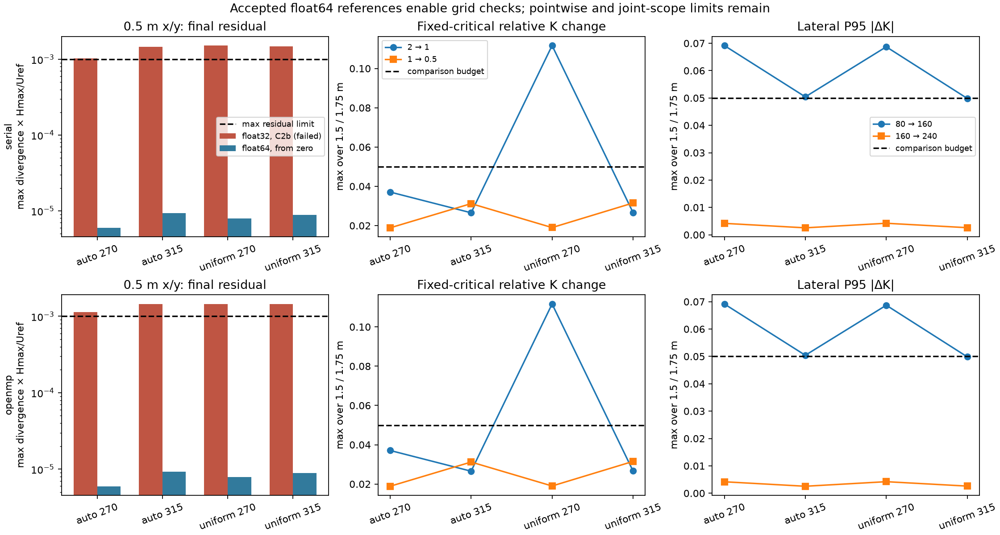

# Opt-in solver precision and lateral/horizontal verification

This milestone adds a selectable float64 CPU solve and tests it from zero,
then uses accepted references to assess lateral extent and horizontal spacing.
The default float32 path remains the original QES CPU implementation. Older
failed float32 archives retain their original acceptance decisions. Numerical
acceptance here does not establish experimental pedestrian-wind accuracy.

Current API examples below use the unified specifications; historical numerical
results retain their original operands and scope. See the [migration table](../README.md#api-migration).

## Arithmetic and API

```python
result = wind.run(city, speed=5, direction=270,
                  bounds=(0,0,0,80,60,64),
                  vertical_grid=wind.VerticalGrid.auto(pedestrian_height=1.5),
                  solver=wind.Solver(precision="float64", tolerance=1e-10,
                                     max_iterations=8000))
sample = result.sample(1.75, method="linear")
```

The independent bridge class `PrecisionSolver` stores the multiplier and RHS
in float64. It widens coefficients, initial faces and layer spacings **before**
RHS arithmetic, diagonal/neighbour sums, SOR updates and velocity corrections.
Completed corrected faces are cast once to float32. Geometry, wall coefficients,
initial parameterized fields, output face storage and public cell-centred arrays
remain float32. Cell centring still uses the original float32 operand order;
vertical and horizontal interpolation still act on vector components.

The frozen precision study used serial lexicographic updates. Current serial
and OpenMP builds both use red/black updates with barriers between colours and before ground mirroring. Both retain
the actual existing relaxation constant `double(1.78f)`, fixed lateral/top
multipliers, ground mirror, correction-loop extents and solid-face zeroing.
There is no change to physical boundary conditions, building models or sampling.
The embedded CPU paths use alpha1 = alpha2 = 1, which the new class also uses.
The QES submodule remains at `e0fb62e9fe5fffc8b4aef8f250f75f929ad27c13`.

`Solver(precision="float32")` is the default and still delegates to
`SolverFactory`; its arrays, arithmetic and stopping rule are unchanged.
`Solver(precision="float64")` has the same multiplier-change stopping rule
and iteration limit, evaluated in double. Tolerances must be finite and at
least epsilon of the selected precision. Float32 tolerances are still narrowed
at the native boundary; float64 tolerances retain the requested double value.
A large tolerance still measures one update before declaring convergence.
Neither mode's convergence flag is a residual or grid-accuracy certificate.

`SolveDiagnostics.precision`, native diagnostics and
`metadata["solver"]["spec"]["precision"]` record the selected mode. Native
`SolverOptions.precision` accepts the same two strings. Changing precision or
tolerance reconstructs the appropriate cached solver; every solve starts from
zero. Only the selected solver workspace is retained. The float64 class uses
two double buffers (16 bytes per native cell, including ghosts), replacing the
legacy three float buffers (12 bytes per native cell). It measures the largest
change during the update, avoiding a third double buffer. No float multiplier
shadow or warm-start field is retained.

Current datasets accept the same versioned Solver payload and shared defaults.
The numerical tables below retain their original study settings. The automatic policy remains `prototype_unvalidated`.

## Acceptance and fixed physical comparison region

Every worker evaluates N, 2N and 4N sweeps, each starting from zero and the same
initial field. A study-only fixed-sweep argument uses the production float64
implementation without changing public stopping rules. The common gate requires:

- All three interior maximum residuals, scaled by Hmax/Uref, at most `1e-3`.
- All three volume-weighted RMS residuals, similarly scaled, at most `1e-4`.
- Both successive pedestrian-vector changes divided by Uref: maximum at most
  `1e-3`, P95 at most `5e-4`, and unchanged valid masks on **both** heights.

The predeclared tighter subset comprises every float64 80 m case at 270 degrees.
It must meet one-tenth of both residual bounds at **all three** checkpoints,
with the same vector/mask requirements. Other cases' tighter results are also
reported; a tight final checkpoint alone is insufficient. Budgets start at
N=1000 and double to at most N=8000 (32,000 final sweeps). Rejected completed
budgets are archived separately. Larger budgets cannot turn a failed earlier
checkpoint into an accepted N/2N/4N triple; the entire triple is rerun from zero.

Uref is 5 m/s at 10 m, roughness 0.1 m, neutral profile, flat ground and unchanged
production parameterizations. The fixed pedestrian lattice is x,y = 3,5,...,77 m,
at 1.5 and 1.75 m. Native centres supporting every positive interpolation weight
are retained, along with both contributing vertical occupancy flags, approach
profile, parameterized/wall-zeroed initial field and all solved checkpoints.
An exact centre ignores zero-weight neighbours; invalid support is never filled.

The fixed critical locations are the original C2b top-ten indices selected from
accepted C2a coarse fields, separately for family, wind, height and region. They
are frozen before new measurements, never replaced by the new pair's peaks.
The exploratory region at least 4 m from footprints also remains fixed.
A comparison passes only when P95 absolute delta K and global-peak relative
change are below 0.05, every fixed critical point remains valid and each critical
relative change is below 0.05 (absolute delta K below 0.05 for reference K<0.1).
K is the magnitude of the sampled mean vector divided by Uref. Maximum local
error, near-tied peaks and pair-local critical diagnostics remain reported even
when those declared budget metrics pass. Passing P95 is not a bound on every
pedestrian point.

As before, prescribed lateral cells and the highest physical layer are
unassessed; the last solved band's uncorrected upper face is reported separately.
The remedy does not fix this top-boundary limitation.

## Study matrix and reproducibility

[Driver](../tools/run_precision_verification.py),
[native worker](../tools/vertical_grid_study.cpp), and
[production float64 solver](../src/cpp/precision_solver.cpp).

The precision matrix contains, per CPU backend:

- Actual C2a automatic and uniform-z=0.5 m layers, x/y=2,1,0.5 m, both 270/315
  degree winds: 12 float64 cases. This includes passing controls and all four
  previously rejected finer horizontal references for that backend.
- Original tower geometry (8/24 m building heights), z=0.5/0.25 m, x/y=2 m,
  both winds: four float64 cases, including both previously failed vertical
  references. Other tower cases retain C2a's 7.9/23.7 m heights.
- Two new float32 controls at x/y=2 m and 270 degrees, one per layer family.

The lateral matrix preserves x/y=1 m and every C2a z operand, using extents
160 and 240 m for both layer families and winds. Domains are centred at (40,40):
[-40,120] and [-80,160] in each horizontal axis. Geometry, sensor world location
(5,5), top=64 m, grid phase, production flags and comparison lattice remain
fixed. It reuses the accepted float64 80 m references for 80-to-160 comparisons
and x/y=2-to-1-to-0.5 m comparisons. Horizontal refinement is at 80 m extent;
lateral refinement is at 1 m spacing. This does not by itself establish a jointly
adequate lateral extent and fine horizontal grid, nor assume 240 m is adequate.

Each backend runs two isolated native workers concurrently. Archives include
source and executable SHA256 fingerprints, immutable C2a reference fingerprints,
precision-reference fingerprints for the subsequent phase, all checkpoint vectors,
residuals, initialization, flags, wall-clock costs and per-process peak RSS.
Concurrent single diagnostic measurements do not support benchmark speedup
claims. Solver workspace bytes are also reported independently of process RSS.
The driver writes the fixed comparison declarations before measurements and
rejects changed sources/configurations when resuming.

```sh
# Run from the repository root, after building both Release study targets.
.venv/bin/python tools/run_precision_verification.py --phase precision --executable build/extension/vertical_grid_study --reference docs/data/auto-grid-controls/serial/raw.json.gz --output docs/data/precision-remedy/serial
.venv/bin/python tools/run_precision_verification.py --phase precision --executable build/openmp/vertical_grid_study --reference docs/data/auto-grid-controls/openmp/raw.json.gz --output docs/data/precision-remedy/openmp
.venv/bin/python tools/run_precision_verification.py --phase verification --executable build/extension/vertical_grid_study --reference docs/data/auto-grid-controls/serial/raw.json.gz --precision-reference docs/data/precision-remedy/serial/raw.json.gz --output docs/data/lateral-horizontal-verification/serial
.venv/bin/python tools/run_precision_verification.py --phase verification --executable build/openmp/vertical_grid_study --reference docs/data/auto-grid-controls/openmp/raw.json.gz --precision-reference docs/data/precision-remedy/openmp/raw.json.gz --output docs/data/lateral-horizontal-verification/openmp
```

Use `--resume` only with the same source/binary/configuration. `--summarize`
recomputes decisions from the archived fields under the same fingerprints.

## Implementation checks

`tests/native/check_precision.cpp` injects divergent u/v/w faces on uniform
0.5/2/4 m and stretched grids. It checks conservative flux removal below
`3e-8 s^-1`, from-zero repeats, prescribed faces, invalid inputs and convergence.
The OpenMP test also requires identical results at two and four threads.
Native/public lifecycle tests exercise precision and tolerance switches, direction
changes, retained array ownership, float32 restoration, finite results and solid
zeroes. The Python checks cover uniform, explicit and automatic grids, both
pedestrian heights and precision provenance. Gate tests reject incomplete,
duplicate, warm-start, wrong-precision and residual/second-height failures.

The complete original float32 reference tests remain in the suite. The separate
existing dataset-registration mismatch remains outside this change and is
excluded by its original test name, `test_explicit_import_registration`.

## From-zero precision results

All 32 float64 final cases pass the common gate, including all eight previously
rejected finer-horizontal and four original 0.25 m vertical tower references
across both backends. The four new float32 controls also pass their original
common gate. Serial has 12 and OpenMP 13 float64 cases meeting the tighter gate
at every checkpoint, including **all eight predeclared cases per backend**.
There are 15 serial and 19 OpenMP completed rejected budget triples in the
precision archives; they are retained, not replaced by the final passing triple.

Final normalized interior maximum residuals for the new 0.5 m x/y references
are below. Serial and OpenMP give the same maxima at the shown precision;
acceptance also requires the earlier residuals, RMS and both-height vector
stability, which are retained in the full summaries.

| Layer family / wind | C2b float32 serial / OpenMP (failed) | Float64 serial and OpenMP |
| --- | --- | --- |
| Automatic / 270° | 1.0243e-3 / 1.1351e-3 | 5.9746e-6 |
| Automatic / 315° | 1.4511e-3 / 1.4504e-3 | 9.3234e-6 |
| Uniform 0.5 m / 270° | 1.5143e-3 / 1.4465e-3 | 7.9107e-6 |
| Uniform 0.5 m / 315° | 1.4827e-3 / 1.4465e-3 | 8.8996e-6 |

The original z=0.25 m tower geometry reaches normalized final maxima
`8.1226e-6` (270°) and `5.1498e-6` (315°) on both backends. Its prescribed top-band
residual remains about `0.2806 s^-1` at 270°. The interior remedy does not remove
that separate boundary limitation. These outcomes establish an effective
from-zero precision remedy for the tested configurations, rather than relying
on the earlier warm-start result.

[Serial precision raw data](data/precision-remedy/serial/raw.json.gz),
[summary](data/precision-remedy/serial/summary.json);
[OpenMP precision raw data](data/precision-remedy/openmp/raw.json.gz),
[summary](data/precision-remedy/openmp/summary.json).

Where a completed earlier triple already passed the common gate but required
more work to meet the declared tighter gate, compare its final pedestrian
vectors with the final tighter result. There are eight such height/case
comparisons on serial and two on OpenMP. Their archived component values are
identical at both heights (the study records ten significant digits). This
quantifies the effect of the stricter residual requirement on the retained
pedestrian samples; it does not assert equality of every unarchived face.

Measured costs are retained separately from residual acceptance. For example,
on the serial 315° / 0.5 m x/y cases at 80 m extent, the automatic grid has 42
physical layers, 17.6 MB of solver buffers and 151.6 MB peak process RSS; the
uniform-z=0.5 m grid has 128 layers, 52.8 MB of buffers and 426.3 MB peak RSS.
Both final checkpoints use 8,000 sweeps, taking 49.8 and 150.0 seconds in these
diagnostic runs. These are one concurrent measurement per case, not a repeated
benchmark or proof that either grid is the cheapest qualifying comfort preset.
The complete precision matrix's float64 final solve times range from about
0.95–308 seconds serial and 0.38–64 seconds OpenMP, at different accepted budgets.
No runtime advantage is claimed against failed float32 references.

## Lateral and horizontal comparison results

The new finer references allow the previously withheld 1-to-0.5 m comparisons.
At 80 m extent, all eight family/wind/height full-region comparisons pass the
declared P95, global-peak and fixed-critical budgets on both backends. P95
absolute delta K is 0.0154–0.0223, and the largest fixed-critical relative change
is 3.153%. The 2-to-1 m comparison still fails the two uniform-z / 270° height
planes, with fixed-critical changes up to 11.17%, despite passing P95 and
nearly unchanged global peaks. Precision has not removed that grid effect.

A passing aggregate/critical budget is not a pointwise error bound. The full
1-to-0.5 m comparisons still have local absolute delta K as large as 0.1735,
near the previously diagnosed wall/sidewall support. Profile, initial field,
flags and contributing-corner audits remain available at (27,21), (21,23) and
(51,35), including the near-wall points excluded by the exploratory 4 m region.
No empirical stage is disabled in these comparisons.

Expanding 80 to 160 m fails all eight full-region family/wind/height comparisons
on both backends. P95 absolute delta K reaches 0.06916 and fixed-critical relative
changes reach 5.596%. The subsequent 160-to-240 m comparisons all pass: P95
changes are 0.00255–0.00422, with fixed-critical changes below 0.431%. This gives
useful evidence for lateral stabilization at **1 m spacing on these fixtures**.
It is not a universal padding prescription.

All 16 larger-domain final workers pass the common solve gate. Ten serial and
12 OpenMP completed earlier budget triples are retained as rejected trials.
Together with the precision matrix, this milestone archives 52 final workers
and 56 rejected completed budget triples. Every checkpoint is a zero start.
The largest cases have 7.37 million physical cells and about 118.9 MB of solver
buffers, with peak RSS below 0.94 GB on this host. Their final 16,000-sweep
checkpoints took up to 679 seconds serial and 138 seconds OpenMP in the concurrent
diagnostic runs; these values are recorded costs, not repeated benchmark ratios.

The profile/initial fields and support validity are identical through both
lateral expansion steps at the inspected points and both heights. Every
cross-grid comparison has zero solid/fluid transitions on the fixed lattice.
The audit confirms all 64 full/away comparison decisions agree between CPU
backends. Across the float64 cases, the largest final cross-backend vector
difference divided by Uref is `4.781e-8`; this compares sampled vectors, not
unarchived faces. The four new float32 controls reproduce all three matching
archived C2a checkpoints exactly in both fields and diagnostics.

The horizontal series above is at 80 m extent, which fails its lateral check.
The lateral series is at 1 m spacing. Therefore this milestone does not yet
certify their combination at finer spacing in the larger domain. Keep the
automatic policy unvalidated and run a declared common-extent finer-x/y check,
plus its finer-grid lateral control, before broad C2c tuning or preset selection.
Preserve the fixed region/critical locations and report large local near-wall
changes even when the budget's P95 and critical metrics pass. Experimental
mean-speed validation remains a separate requirement; no comfort-accuracy
percentage or automatic preset follows from these numerical studies.

[Serial verification raw data](data/lateral-horizontal-verification/serial/raw.json.gz),
[summary](data/lateral-horizontal-verification/serial/summary.json);
[OpenMP verification raw data](data/lateral-horizontal-verification/openmp/raw.json.gz),
[summary](data/lateral-horizontal-verification/openmp/summary.json).



Reproduce this figure with `tools/plot_precision_verification.py`.
`tools/audit_precision_verification.py` checks raw matrices, source/binary/
reference fingerprints, exact decision recomputation, tighter-subset outputs,
float32 parity and CPU agreement; its [audit record](data/precision-remedy/audit.json)
includes source and archive hashes. The summary
keeps full-region and exploratory-away results separately. Audits of initial
fields apply to retained interpolation support on the two planes, not to every
cell of the 3D initial volume.

## Local implementation validation

On this Apple arm64 / Apple Clang host:

- Python: 605 serial tests passed; OpenMP 603 passed and two serial-archive
  reconstruction tests skipped. The pre-existing dataset-registration test is
  explicitly deselected on both runs.
- Release native suites: 11 serial and 14 OpenMP checks passed, including study
  sampler/diagnostics controls and precision injection/lifecycle checks.
- ASan/UBSan: all 11 serial and 14 OpenMP native checks passed. The final
  expanded precision test, including six individual faces of a tall solid
  spanning thread slabs, was also rebuilt and rerun successfully in both
  sanitizer configurations.
- Native symbol audits pass for both builds, including the new bridge object,
  with no termination, console, file-I/O or optional-I/O-library leakage.
- Serial and OpenMP wheels were rebuilt from an extracted source distribution.
  All wheel Python modules and all C++/Python implementation files used for
  those builds match the checkout bytes. Isolated wheel imports verify the
  actual backend and exercise a float64 automatic-grid solve, both sampling
  heights, float32 output storage, translated global coordinates and a preview
  that cannot construct a native wind runner. Wheel license/content checks pass.

The complete raw matrices and decision/provenance audits are part of the source
release; wheel contents retain the Python/native API and required licenses.
The final source package includes the completed numerical archives and audits. Its
implementation bytes match the source used for both wheel builds.
