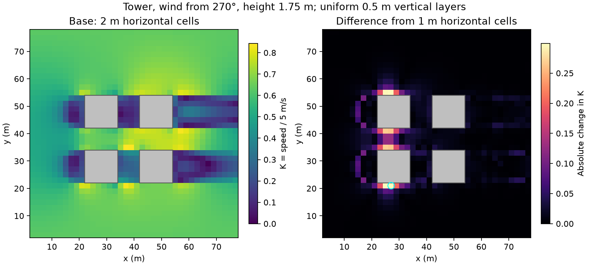

# C2 early domain-height and horizontal-resolution controls

This milestone implements the first C2 validation gate using actual C1
generator outputs. It does not select an automatic preset or establish
experimental accuracy. Production solver arithmetic, stopping rules and grid
policy constants remain unchanged. The original sensitivity/diagnosis archives
are preserved.

## Declared experiment

Use the passage and tower fixtures, winds from 270 and 315 degrees, and both
1.5 and 1.75 m sampling planes. Passage roofs are 12.3 m; the tower is 23.7 m
among three 7.9 m blocks. Footprints and production model flags match the
[earlier synthetic study](vertical-grid-gate.md). These deliberately non-aligned
heights exercise stair-step occupancy. Flat ground, 80 by 80 m horizontal
bounds, 5 m/s at 10 m and roughness 0.1 m remain fixed.

For each geometry/wind, compare two families: the real public
`VerticalGrid.auto(pedestrian_height=1.5)` output and explicit uniform 0.5 m
layers. A shared grid serves both pedestrian planes; the third physical centre
is at or below 1.5 m. The 0.5 m family is a control, not an assumed exact
reference.

| Control | Horizontal resolution | Selected top | Vertical construction |
| --- | --- | --- | --- |
| Base | 2 m | 64 m | Actual automatic output or 128 uniform layers |
| Taller domain | 2 m | 144 m | Preserve every base layer operand; append a constant tail |
| Finer x/y | 1 m | 64 m | Preserve all base vertical layer operands |

144 m exceeds six times the tallest source building height. It tests domain
height, not lateral domain width. The tall control intentionally does not
regenerate the automatic grid: endpoint fitting could otherwise change the
lower layers and confound the comparison. Every effective lower face must
remain bitwise equal to the base. The finer-x/y control also retains the base
z grid to isolate horizontal sensitivity; it is not the policy regenerated
with `resolution=1`.

All cases use the same 1,444 physical horizontal locations, with
`x,y = 3,5,...,77 m`. The 2 m grid samples its native centres. On the 1 m grid,
first sample vertically at each native centre, then interpolate velocity
components bilinearly in x/y; take vector magnitude after interpolation.
Every positive-weight horizontal corner and vertical bracket must be finite
fluid. Exact centres ignore zero-weight neighbours; extrapolation and mask
interpolation are forbidden. Archive native planes before horizontal
collocation. Report common-fluid counts and validity transitions explicitly.

The unchanged common solve gate requires all three zero-start fixed-sweep
checkpoints `N,2N,4N` to meet normalized maximum/RMS residual bounds
`1e-3 / 1e-4`, and both successive velocity-vector changes to meet maximum/P95
bounds `1e-3 / 5e-4` at **both** pedestrian heights, with unchanged masks.
Start at N=1,000, doubling after failure to N=8,000. A second isolated worker
repeats the selected budget. The top-band residual is reported separately;
no additional interior cells are removed. A failed solve withholds the field
comparison rather than relaxing the gate.

Before measurements, retain the plan's proposed P95 absolute K change below
0.05 and peak-speed change below 5%. Also check the ten fastest base
common-fluid points at fixed locations, requiring relative change below 5%
when the comparison K is at least 0.1. Record maximum/vector errors, low-speed
errors, both peak locations and changes in the K>=1 region. These aggregate
checks do not automatically excuse a large error at a particular location;
local errors require interpretation before defining a supported scope.

## Tooling and reproducibility

`tools/vertical_grid_study.cpp` retains its original positional interface and
adds `geometry --layers direction N`. In this mode stdin contains whitespace
separated resolution, layer/height/rectangle counts, followed by thicknesses,
sample heights and rectangle tuples `(x,y,width,length,height)`. It accepts
only the study's 1 or 2 m horizontal spacing, bounds vector sizes and validates
grid/building inputs before flow allocation. No automatic policy is duplicated in C++.
The configurable path reproduces the original path's coordinates, masks,
velocities and residuals exactly on an identical fixture.

`tools/run_auto_grid_controls.py` prepares cities through public preview,
archives requested/effective generator settings, planned/effective faces and
native operands, and verifies worker faces after narrowing back to float32.
Each worker records policy-generation time independently of native
preparation, fixed-budget solve, two-plane sampling and residual diagnostics.
Public Python preview is timed once per geometry/family, outside worker RSS;
policy generation is measured again for each automatic worker. Report native
worker peak RSS separately from planner cost. These exploratory timings are
not optimized time-to-accuracy or release performance claims.

The driver records source/binary hashes, QES revision, compiler, platform,
backend, threads, flags, scales, thresholds, shuffled order and all rejected
budget trials. `raw.json.gz` contains full native samples; `summary.json` can
be regenerated without rerunning the solver. A partial matrix or duplicate
repeat identifiers cannot pass the early gate. Resume requires matching
configuration, source hashes and executable hash.

```sh
cmake --build build/extension --target vertical_grid_study --parallel 8
.venv/bin/python tools/run_auto_grid_controls.py --output build/auto-grid-controls/serial
cmake --build build/openmp --target vertical_grid_study --parallel 8
.venv/bin/python tools/run_auto_grid_controls.py --executable build/openmp/vertical_grid_study --output build/auto-grid-controls/openmp
.venv/bin/python tools/run_auto_grid_controls.py --output build/auto-grid-controls/serial --summarize
.venv/bin/python -m pytest tests/test_auto_grid_controls.py tests/test_vertical_grid_study.py -q
```

Workers run sequentially; run backend matrices sequentially too when comparing
their timings. OpenMP workers force two threads and disable dynamic teams.
Use `--resume` after interruption, or a fresh output directory for new evidence.
The default matrix has 48 final workers per backend (two geometries, two winds,
two grid families, three controls and two repetitions).

## Results and decision

The [serial raw samples](data/auto-grid-controls/serial/raw.json.gz) and
[serial assessment](data/auto-grid-controls/serial/summary.json) contain 48 final
workers and two failed initial-budget trials. All final solves pass the common
residual/stability gate at both heights. All 24 independent repetition pairs
reproduce coordinates, planes, masks and residual diagnostics exactly.

Across the four geometry/wind combinations and both heights:

| Serial family | Largest taller-domain absolute change in K | Largest finer-x/y P95 change in K | Largest finer-x/y point change in K | Largest finer-x/y peak change | Largest fixed-critical relative change |
| --- | ---: | ---: | ---: | ---: | ---: |
| Automatic | 0.000297 | 0.03762 | 0.29885 | 2.48% | 4.50% |
| Uniform 0.5 m | 0.000238 | 0.04002 | 0.29912 | 2.55% | 11.17% |

The [OpenMP raw samples](data/auto-grid-controls/openmp/raw.json.gz) and
[OpenMP assessment](data/auto-grid-controls/openmp/summary.json) contain another
48 accepted final workers and seven failed initial-budget trials. All 24
repetition pairs reproduce fields, masks and diagnostics exactly on this backend
too. Two-thread red-black SOR reproduces the table to the displayed precision
and the same two fixed-critical failures (10.98%/11.17%). Thus **all 96 final
workers pass the solve gate, but the early control budget fails on both CPU
backends**. Binary/source hashes were verified against the archived metadata.

No configuration meets both ten-times tighter residual bounds at its final
checkpoint, on either backend. Do not treat the base-gate passes as validation
of the preset error budget: a successfully tighter-converged subset remains
part of C2. The final prescribed top-band maxima range from approximately
`5.19e-5` to `0.13739 s^-1` across configurations and remain separate from the
interior norms.

All 16 taller-domain comparisons (two families, four geometry/wind cases, two
heights) meet the declared early-control budget. Their small pedestrian effect
does not repair the separately reported top-band residual, prove lateral-domain
independence or certify other geometries. Preserving the lower faces is central
to this interpretation.

All 16 horizontal comparisons meet the proposed P95 and global-peak bounds.
However, **the uniform-fine tower/270-degree comparisons fail the fixed-critical
5% check**: maximum relative changes are **10.98% at 1.5 m** and **11.17% at
1.75 m**. The ten base critical locations remain fixed when inspecting the
control; a global-peak displacement is not used as a lone rejection criterion.
No comparison has a solid/fluid validity transition at the common points:
there are 1,252 fluid passage points and 1,300 fluid tower points. The largest
point discrepancy is approximately **0.299 K at (27,21,1.75) m** in the tower
configuration, about **1.50 m/s** at this reference wind. Both grid families
exhibit that local horizontal sensitivity. The automatic family's aggregate
pass therefore cannot establish horizontal independence.



The plot uses only accepted solves and the common-fluid mask. Gray rectangles
are building footprints; the cyan circle marks the maximum difference. It
shows sensitivity near building faces, not an attribution of error to a
particular parameterization. Reproduce with optional matplotlib:

```sh
MPLCONFIGDIR=build/mpl-cache .venv/bin/python tools/plot_auto_grid_controls.py --input docs/data/auto-grid-controls/serial/raw.json.gz --output build/auto-grid-controls/horizontal-sensitivity.png
```

The automatic base grids have 36 passage layers and 42 tower layers, versus
128 uniform-fine layers. Tall controls have 51/62 automatic layers or 288
uniform-fine layers. The selected height is the fourth automatic centre at
1.5 m; 1.75 m uses component interpolation between the fourth and fifth
centres. Neither cell savings nor these early field comparisons select a
preset. Routine verification overlapped portions of serial acquisition; session
timing interruptions also affected sanitizer runs. Retain the exploratory raw
timings, but make no optimized time-to-accuracy or release performance claim.

**Decision:** do not freeze automatic presets or start B2. This completes the
early-control assessment (C2a), not C2's remaining validation. Investigate
horizontal sensitivity at fixed locations
with unchanged vertical layers before broad policy tuning. Inspect sampling,
occupancy and parameterization transitions, and assess selected larger lateral
bounds if needed. Keep thresholds unchanged and determine a supported scope.
Afterwards, continue the planned vertical-refinement/alignment/shallow-roof,
growth/aspect/buffer/cap, tighter-residual and cheapest-qualifying-uniform cost
studies. Experimental physical-accuracy claims remain separate.

## Implementation checks

`tests/test_auto_grid_controls.py` covers affine component collocation,
opposing vectors, each contributing solid corner, exact-centre zero weights,
extrapolation rejection, preservation of lower faces, actual public generator
provenance, both pedestrian heights, invalid certification records, incomplete
matrices, duplicate repeats and failed-solve withholding. A manufactured peak
failure cannot be hidden by a small percentile. Native integration checks
require exact parity between old/configurable worker modes and reject malformed
stdin. Set `DTCC_QES_STUDY_EXECUTABLE` to test another worker build.

The full serial Python suite passes **556 tests**. Against the explicitly
loaded OpenMP extension, **554 pass and two serial-reference tests skip**.
Both suites deselect the known independent dataset-registration mismatch.
The serial/OpenMP native suites pass **10/13 CTests**, respectively. The new
control test module has **29 tests**; the legacy study-assessment module adds
11 existing tests. There are no changes to the production solver or Python
grid APIs in this milestone.

ASan/UBSan passes all 10 serial CTests. In the OpenMP sanitizer suite, 11
checks pass initially and the one/two-thread checks hit wall-clock timeouts;
both pass on targeted retry without sanitizer findings. The configurable
worker's parity/malformed-input tests also pass against both sanitizer builds.
Both release native symbol audits pass. The timeout history is retained as a
test-execution limitation; no timeout or numerical threshold was increased.

Wheel/sdist license and content checks pass, including the new study tools,
tests, report, plot and both raw-data archives. A serial wheel rebuilt from
the sdist passes an isolated translated-domain smoke test: actual wheel module
paths, automatic preview/run coordinate and metadata parity, both pedestrian
heights, the third-centre requirement and a preview guard forbidding native
flow allocation. This tests artifact integrity, not building-flow accuracy.
Reassessment reproduces both archived raw and summary files byte-for-byte.

```sh
.venv/bin/python -m build --sdist --no-isolation --outdir build/c2-artifacts
# Extract the sdist into build/c2-artifacts/source first.
CMAKE_GENERATOR='Unix Makefiles' .venv/bin/python -m build --wheel --no-isolation --outdir "$PWD/build/c2-artifacts" -Ccmake.define.DTCC_QES_OPENMP=OFF build/c2-artifacts/source/dtcc_qes-0.1.0b1
.venv/bin/python tools/check_artifacts.py build/c2-artifacts
```
