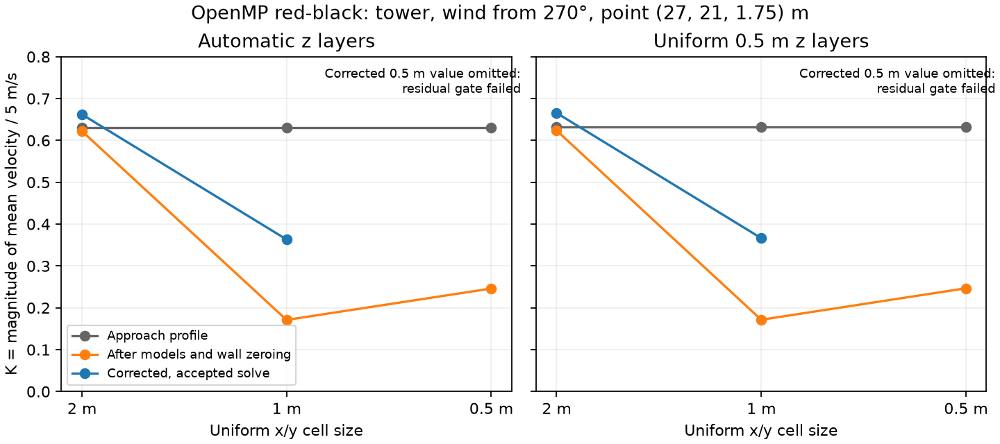

# C2b horizontal-sensitivity assessment

This milestone investigates the tower failure from [C2a](stagec2-controls.md).
It keeps the production solver, empirical models, automatic policy constants
and acceptance thresholds unchanged. Initial-field diagnostics and model
ablations are not experimental validation or alternative comfort presets.

## Experiment fixed before the new comparisons

Reuse the eight accepted tower references per CPU backend from the immutable
C2a archives: two grid families, winds from 270/315 degrees, x/y spacing 2/1 m,
and the same 80 by 80 by 64 m bounds. Source roofs remain 7.9/23.7 m. Preserve
all vertical solver operands and effective faces: 42 automatic layers or 128
uniform 0.5 m layers. Both 1.5 and 1.75 m pedestrian planes are compared at
the original `x,y = 3,5,...,77 m` locations.

| New task per backend | Count | Purpose |
| --- | ---: | --- |
| Initial-only probes at 2/1 m x/y, both families/winds | 8 | Compare neutral profile and fully parameterized initial fields; retain native flags |
| Full solves at 0.5 m x/y, both families/winds | 4 | Third horizontal refinement level with unchanged z |
| Full solves on `(-40,-40)–(120,120) m` lateral bounds at 1 m x/y, uniform-fine family, both winds | 2 | Test boundary influence with fixed world geometry, sensor and sample points |
| Full solves at 2/1 m x/y, uniform-fine tower/270 degrees, sidewall disabled or all five empirical building stages disabled | 4 | Diagnose initial-field and corrected-flow sensitivity; not production alternatives |

Every new full solve uses zero-start `N,2N,4N` fixed-sweep checkpoints, starting
at N=1,000 and doubling to a predeclared N=4,000 ceiling (16,000 final sweeps).
The C2a residual and velocity-stability limits apply at both heights. Retain
every failed budget trial. A stable plane without passing residuals is not an
accepted reference. A failure at this bounded ceiling does not prove that no
larger budget or different solver can succeed.

The original 2 m reference's ten fastest common-fluid locations are frozen
separately for each family/wind/height. They are retained through subsequent
refinement and lateral comparisons instead of reselecting a new top ten.
Keep the P95 absolute K bound 0.05, global-peak relative bound 5%, and fixed
critical relative bound 5% for comparison K>=0.1. At low-speed critical points,
use an absolute K bound of 0.05. Invalid critical points cannot silently disappear
from the decision. Report full-field errors, component/vector errors, fluid
mask changes, the original worst points `(27,21)` and `(51,35) m`, and all their
native interpolation corners and vertical-bracket flags.

Also report a **separate diagnostic region at least 4 m from every footprint**.
This physical exclusion distance is fixed before the finer runs. Its critical
locations are the ten fastest original 2 m reference points in that region.
The full-domain failure remains visible: an away-region pass cannot certify
near-building comfort or replace a full-region result. This region is a scope
probe, not an accepted universal pedestrian setback.

## Implementation and audit

The native worker adds a study-only `--horizontal` stdin protocol:
`resolution origin_x origin_y extent_x extent_y nz nheights nbuildings disabled_mask`,
followed by z thicknesses, sampling heights and world rectangle tuples. It
supports 2, 1, 0.5 and 0.25 m uniform x/y spacing; the declared matrix uses
the first three. Extents must contain whole cells, each extent is bounded to
320 m, and flow allocation is capped at 20 million cells with the native index
checks intact. Sample heights are validated before flow allocation. Empirical
disable bits are rooftop=1, upwind cavity=2, canyon=4, wake=8, sidewall=16.
All production controls use mask zero.

World coordinates are translated to the local QES frame only for geometry
and sensor construction. Returned x/y coordinates and the fixed comparison
region remain in the world frame. The expanded-domain case therefore tests
lateral extent without moving the buildings relative to sample points.
It does not add terrain or adaptive horizontal cells to the public bindings.

The worker archives the approach-profile field before empirical stages, the
parameterized initial field after `Wall::setVelocityZero`, and every corrected checkpoint. Native cell flags
are stored at both contributing vertical centres. It retains only the native
x/y centres that bracket the original comparison lattice, including every
positive-weight interpolation corner. The 1/0.5 m outputs have 76 support
coordinates per axis; this avoids storing complete fine/expanded planes.
Component averaging and interpolation follow the unchanged C2a conventions;
flags are inspected, not interpolated.

`tools/run_horizontal_sensitivity.py` hashes the original reference archive,
new worker binary, driver and numerical helper sources. It verifies backend,
QES revision and z coordinates, archives raw probes/runs/rejected budgets and
supports exact reassessment and guarded resume. `N=0` probes allocate no solver
and have no checkpoints; they never count as accepted wind solutions. A failed
full solve withholds all grid/boundary error comparisons involving that solve.

This is a bounded numerical diagnosis with one new run per configuration and
no performance claims. Backend agreement and fixed-sweep stability are assessed;
release timing repetitions and experimental physical validation remain separate.

```sh
cmake --build build/extension --target vertical_grid_study --parallel 8
cmake --build build/openmp --target vertical_grid_study --parallel 8
.venv/bin/python tools/run_horizontal_sensitivity.py --output build/horizontal-sensitivity/serial
.venv/bin/python tools/run_horizontal_sensitivity.py --executable build/openmp/vertical_grid_study --reference docs/data/auto-grid-controls/openmp/raw.json.gz --output build/horizontal-sensitivity/openmp
.venv/bin/python tools/run_horizontal_sensitivity.py --output build/horizontal-sensitivity/serial --summarize
.venv/bin/python -m pytest tests/test_horizontal_sensitivity.py -q
```

Both backends may run concurrently for this diagnosis because their wall-clock
times are not compared. Use `--resume` only with unchanged source/binary,
reference archive and settings. Initial/final fields and fluid/parameterization
flags are preserved so conclusions can be independently reassessed.

The remaining serial cases were continued with three independent worker
processes using `tools/continue_horizontal_sensitivity.py`. This verifies the
original source, executable and reference fingerprints, records its own source
hash and concurrency in the archive, resumes after completed failed budgets,
and serializes archive writes under a lock. It changes no input, threshold or
checkpoint contract. One interrupted, incomplete worker is excluded; its last
fully completed budget is preserved. To reproduce this continuation:

```sh
.venv/bin/python tools/continue_horizontal_sensitivity.py --output build/horizontal-sensitivity/serial --jobs 3
```

## Results and plan decision

The [OpenMP raw samples](data/horizontal-sensitivity/openmp/raw.json.gz) and
[assessment](data/horizontal-sensitivity/openmp/summary.json) contain all 18
tasks: eight initial-only probes and ten full solves. Six full solves are
accepted (two larger-domain and four ablation controls); all four 0.5 m x/y
references fail the maximum-residual gate. Fifteen completed failed budget
trials are retained. This is a failed scope/acceptance result, not a selected
automatic preset.

The [serial raw samples](data/horizontal-sensitivity/serial/raw.json.gz) and
[assessment](data/horizontal-sensitivity/serial/summary.json) likewise contain
all 18 final tasks: eight probes, six accepted controls and four failed finer
references, with 11 completed rejected budget trials. In total the archives
retain **36 final tasks and 26 rejected budget trials**. Corresponding initial
profile/parameterized fields and flags are bitwise identical across backends
for all 18 configurations. Both backends reach the same comparison decisions;
the numerical examples below use OpenMP data unless stated otherwise.

### Initialization and near-wall sampling

Across the compared horizontal grids, approach-profile speeds at common fluid
points agree exactly. Differences appear after empirical stages and solid-wall
face zeroing, before projection. The sidewall-disabled control isolates a large
contribution at the original maximum-error point. At `(27,21,1.75) m` in the
uniform-fine tower/270-degree case:

| Initial-field control | K at 2 m x/y | K at 1 m x/y |
| --- | ---: | ---: |
| Production settings | 0.623725 | 0.171438 |
| Sidewall disabled | 0.632220 | 0.632220 |
| All five active empirical building stages disabled | 0.632220 | 0.632220 |

The automatic-z family gives the same qualitative result: production initial
K is 0.622284/0.171042/0.246047 at 2/1/0.5 m x/y. The neutral profile is
unchanged through this refinement. At 1 m, the four native interpolation corners
at this point include two ordinary-air (`1`) and two sidewall (`9`) cells;
at 2 m, a single cell has flag `9`. Flags describe QES's native classification;
they are never interpolated or assumed to define an exact continuous boundary.



The figure shows OpenMP data. Unaccepted corrected 0.5 m values are omitted.
The identical initial profiles make an arbitrary change to vertical sampling
an unsupported remedy for the horizontal discrepancy.

Disabling every empirical stage does **not** make the entire initial plane
grid-independent. Its maximum initial difference at 1.75 m is 0.158055 K,
at `(21,23) m`, next to the wall at x=22 m. `applyParametrizations` always ends
with `Wall::setVelocityZero`; geometry and impermeability remain enabled in
these controls. The cell-centred sampling contract averages staggered faces.
At 2 m spacing, x=21 is centred between faces at 20/22 m, one of which is zero
at the wall, giving `0.5*Kprofile`. At 1 m spacing it interpolates the centres
at 20.5/21.5 m, giving `0.75*Kprofile`. With Kprofile=0.632220, the difference
is `0.25*Kprofile=0.158055`. The archived initial fields reproduce these values.
This explains one resolution-dependent filter near walls without finding an
implementation error in bilinear interpolation. Affine manufactured sampling
and old/new worker parity tests also pass.

For production 2-to-1 m refinement, all eight away-region comparisons pass
the proposed aggregate/critical bounds, while two of eight full-region cases
fail. The controls clarify why a percentile pass cannot establish near-wall
accuracy. Sidewall removal reduces the corrected 1.75 m full-field maximum
change from about 0.2991 to 0.1218 K, and its fixed-critical check passes.
Removing all empirical stages still leaves a 5.08% fixed-critical change at
1.5 m. These modified models are diagnostic controls, not accuracy references
for selecting production flags or an instruction to disable sidewalls.

### Lateral-domain sensitivity

The 80-to-160 m lateral-domain controls pass the unchanged solve gate. On the
same physical points and with fixed z layers, OpenMP gives:

| Wind | Height | P95 absolute change in K | Maximum absolute change in K | Largest fixed-critical relative change |
| --- | ---: | ---: | ---: | ---: |
| 270 degrees | 1.5 m | 0.06870 | 0.13927 | 5.15% |
| 270 degrees | 1.75 m | 0.06836 | 0.13898 | 4.94% |
| 315 degrees | 1.5 m | 0.04943 | 0.07964 | 5.56% |
| 315 degrees | 1.75 m | 0.04984 | 0.07994 | 5.39% |

All four fail at least one declared bound. All four away-region comparisons
also fail. The approach and parameterized initial velocities at the sampled
support points match exactly between small and expanded domains, for both
heights and winds. Thus these slice differences cannot be attributed to a
changed initial value at the inspected points or an x/y coordinate error.
This is a slice-level initialization check, not an equality audit of the full
3D initial volume. The result demonstrates lateral-domain sensitivity despite
the small height sensitivity observed in C2a. It does not prove that a 160 m
domain is sufficient, or select a universal padding distance.

### Fine-reference solve failures and supported scope

The 0.5 m x/y grids have 1,075,200 automatic or 3,276,800 uniform-fine cells.
Their three checkpoint budgets are escalated without changing thresholds.
Final 16,000-sweep maximum residuals are:

| z family / wind | Serial normalized maximum | OpenMP normalized maximum | Serial / OpenMP dimensional maximum (s^-1) |
| --- | ---: | ---: | ---: |
| Automatic / 270 degrees | 0.0010243 | 0.0011351 | 0.00021610 / 0.00023947 |
| Automatic / 315 degrees | 0.0014511 | 0.0014504 | 0.00030614 / 0.00030600 |
| Uniform fine / 270 degrees | 0.0015143 | 0.0014465 | 0.00031948 / 0.00030518 |
| Uniform fine / 315 degrees | 0.0014827 | 0.0014465 | 0.00031281 / 0.00030518 |

All exceed the unchanged `1e-3` normalized maximum bound. Final normalized
RMS residuals range from `4.51e-5` to `6.20e-5` (dimensional approximately
`9.52e-6` to `1.31e-5 s^-1`), within the `1e-4` bound. The largest successive
pedestrian vector change in the final three-checkpoint sweeps is below
`2.7e-6 * Uref`, far below `1e-3`. The failures are residual control despite
stable fields, not a license to relax the maximum criterion. Complete budgets,
dimensional diagnostics and separate top-band values remain in the archives.
All eight full-region 1-to-0.5 m comparisons and all eight away-region
comparisons are withheld on each backend. These observations do not establish
the cause of the residual floor or prove that a precision remedy will fix it.

**Decision:** C2b finds no supported automatic-preset scope. The away-region
2-to-1 m passes cannot override failed lateral controls and unaccepted finer
references. Secure accepted finer solves, then establish lateral extent and
horizontal stabilization on a declared physical region before C2c policy
tuning or B2. The previous precision diagnosis supports a remedy candidate,
not a guarantee for these configurations; any opt-in remedy must be tested
from zero on both backends, retain default float32 parity and rerun these
failed references plus the earlier failed 0.25 m vertical tower cases. Keep
all bounds and failed-reference exclusions unchanged. Numerical agreement
with QES remains separate from experimental comfort validation.

## Implementation validation

The full Python suites pass **580 serial tests** and **578 OpenMP tests with
two serial-reference skips**. Both deselect the known independent dataset
registration mismatch. All **10 serial and 13 OpenMP native CTests pass**, as
do the full serial/OpenMP ASan/UBSan suites without retries or changed timeouts.
The changed worker is additionally exercised by **53 tests** against each
sanitizer build (the C2a and C2b test modules). Both native symbol audits pass.

The 24 new tests cover legacy/configurable sample and residual parity, sparse
support, actual initial/profile fields and flags, translated larger bounds,
parameterization disable provenance, malformed headers, the preallocation cell
budget, frozen critical locations, low/invalid masks, incomplete/duplicate
tasks, initial-only exclusion from solve acceptance, failed-reference
withholding, and keeping a full-region failure visible when an away-region
diagnostic passes. No production QES solver, Python API, default or public
sampling contract is changed. Continuation tests verify unchanged acquisition
inputs and restart after completed failed budgets; low-speed critical tests
verify the absolute K criterion rather than a relative-speed shortcut.

Both archived raw and summary files reproduce byte-for-byte under reassessment.
Acquisition source/binary hashes and the continuation source hash were checked
against the files used for this delivery. Every comparison has the same
pass/fail decision on serial and OpenMP. The original C2a archives are preserved.

Wheel/sdist content and license checks include the new tools, tests, report,
plot and raw samples. A serial wheel rebuilt from the sdist passes an isolated
translated-domain smoke test of actual wheel module paths, automatic preview/run
coordinate and metadata parity, both pedestrian heights, the third-centre
requirement and a preview guard forbidding native flow allocation. This is an
artifact-integrity check rather than validation of disturbed building flow.

The optional plot can be reproduced with matplotlib:

```sh
MPLCONFIGDIR=build/mpl-cache .venv/bin/python tools/plot_horizontal_sensitivity.py --input docs/data/horizontal-sensitivity/openmp/raw.json.gz --output build/horizontal-sensitivity/initialization.png
.venv/bin/python -m build --sdist --no-isolation --outdir build/c2b-artifacts
# Extract the sdist into build/c2b-artifacts/source first.
CMAKE_GENERATOR='Unix Makefiles' .venv/bin/python -m build --wheel --no-isolation --outdir "$PWD/build/c2b-artifacts" -Ccmake.define.DTCC_QES_OPENMP=OFF build/c2b-artifacts/source/dtcc_qes-0.1.0b1
.venv/bin/python tools/check_artifacts.py build/c2b-artifacts
```
