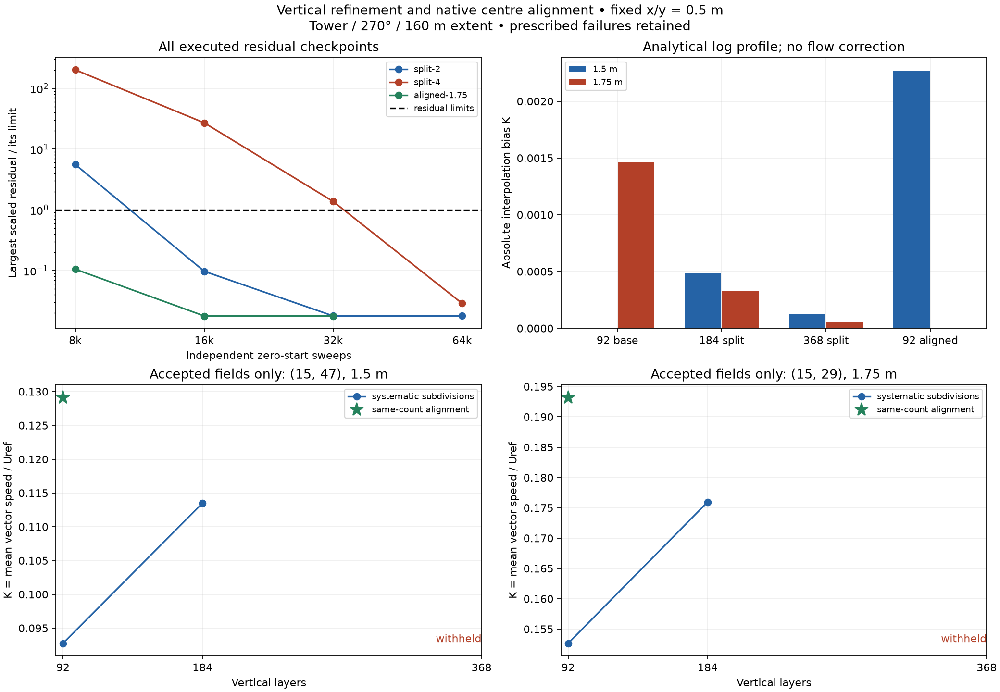

# Bounded vertical refinement and centre alignment

## Protocol frozen before field measurements

This follows the completed [generated-grid pilot](generated-grid-pilot.md).
Measure sensitivity to systematic z refinement and lower-band centre alignment
at fixed x/y=0.5 m, 160 m square extent, tower/270 degrees, requested 64 m top,
original production parameterizations and sensor (5,5), 5 m/s at 10 m. Preserve
both 1.5 and 1.75 m observables, centred component sampling and float64 solver
arithmetic with float32 geometry/output. Existing horizontal failures remain.

The baseline is the accepted actual 92-layer generator output from the pilot.
The three systematic levels are 92, 184 and 368 layers: split EVERY baseline
layer into 1, 2 or 4 equal parts, including the upper tail. These are explicit
study grids derived from one frozen policy. They measure subdivision sensitivity,
not the effects of retuning the generator or changing x/y. Record planned and
native faces, thicknesses, roofs and parent-face accumulation error. Accept
parent-face disagreement <=1e-4 m from float32 accumulation; do not silently
translate the ground or change the requested physical top. Refinement changes
roof voxelization, which must be reported and precludes assuming a smooth
asymptotic order from three levels alone.

Use one additional 92-layer alignment control. Redistribute only the first
eight layers to put the fifth native centre exactly at 1.75 m, preserving every
native face and solver operand above face eight (about 3.49 m). Fit the lower
four layers geometrically with growth <=1.15, followed by four nearly equal
layers and a native rounding correction at the eighth face. Keep fine thickness
<=0.5 m, thin-cell aspect <=8, and support at or above the third physical cell
at both pedestrian heights. The original baseline has 1.5 m at a centre.
Compare analytical logarithmic-profile interpolation on every grid: those
biases isolate interpolation arithmetic. The solved alignment comparison also
changes lower-cell operators and is not a pure interpolation experiment or a
correction to the observed flow. Roof representation is identical for this
control and the baseline.

Use OpenMP with two native threads for the two new refinement levels and the
alignment control. Add a selected serial alignment solve, compared with the
accepted serial baseline and paired OpenMP control. Prior pilot CPU parity is
retained; no new serial validation of the 184/368-layer cases is claimed here.
Full supported-preset decisions require the appropriate later coverage.

Retain the original common lattice, union of both historical families' frozen
critical sets and three near-wall points. Also freeze the observed largest-error
locations (15,47) and (15,29) at BOTH heights before new measurements. Thus five
mandatory locations apply to the full region. In the diagnostic 4 m setback
region, only the two added points belong; the three near-wall points remain
mandatory full-region checks. Record all validity transitions.

Require the established residual/stability gate on three independent zero-start
N/2N/4N checkpoints: scaled max/rms residual <=1e-3/1e-4 at ALL checkpoints;
maximum/p95 vector change divided by Uref <=1e-3/5e-4 on BOTH successive
comparisons, with stable validity. Start N=8000 for each OpenMP case and N=4000
for the selected serial control. Double when necessary, up to N=16000; retain
failed triples and reuse identical already-completed checkpoints. Exhausting
the cap yields a recorded failure and withholds dependent comparisons.

Apply unchanged spatial budgets: p95 absolute delta K <0.05, peak relative
change <5%, each frozen critical and mandatory point <5% relative for reference
K>=0.1 or absolute delta K <0.05 otherwise. Require valid critical/local support
and no validity transitions. Compare base->2, 2->4, base->4, aligned->base and
aligned->4, always using the latter as reference. Report components, vector
changes, low-speed and worst-error locations alongside speed metrics. A
sensitivity-budget pass requires all six full-region subdivision comparisons
(three pairs, two heights); report alignment decisions separately. A pass
establishes these metrics on this fixture, not everywhere-relative 5% accuracy,
a formal convergence order, physical comfort accuracy or a preset.

Use at most two study processes concurrently, with a 20-million soft cell target
and a 40-million allocation ceiling. The refinement cases have 18.84/37.68
million cells, estimated process footprints 3.01/5.94 GB; the 92-layer control
has 9.42 million cells and an estimated 1.55 GB footprint. Maximum simultaneous
estimate for the two refinement workers is 8.95 GB on this 51.5 GB host. Retain
the fine case above the soft target. These worker estimates exclude public
full-volume NumPy output copies. Save memory, unique executed cell-sweeps,
preparation, solve, residual and sampling costs, including rejected work.
Shared-host/sleep-interrupted timing is diagnostic; no speedup claim or policy
choice follows from a single repetition.

Freeze source snapshots, protocol, task matrix, configurations, binary and
reference fingerprints before new fields are available. Keep historical data
immutable; changed source, input or binary requires a new study directory.
Provide manufactured tests, case/request audits and a data-only reproducible
summary. Finish this bounded matrix and review its outcome before expanding
wind/geometry coverage or tuning policy parameters.

## Preflight and execution

The frozen protocol is stored separately under `data/vertical-refinement/`.
All grids pass the public explicit-grid preview and float32 coordinate checks.
The 1.75 m control retains native upper faces and operands exactly; its tiny
float64 endpoint normalization preserves all float32 solver thicknesses and
satisfies the public requested-top guard. It changes lower-cell spacing and
operators, so its solved differences include more than interpolation bias.

| Grid | Layers | Cells | Maximum parent-face error | Low-roof / tower representation error |
| --- | ---: | ---: | ---: | --- |
| Actual generated baseline | 92 | 9,420,800 | 0 | +0.09286 / -0.20714 m |
| Every layer split in two | 184 | 18,841,600 | 0.00003815 m | +0.09286 / +0.04286 m |
| Every layer split in four | 368 | 37,683,200 | 0.00003815 m | -0.03214 / +0.04286 m |
| Lower-band 1.75 m centre | 92 | 9,420,800 | 0 above face eight | +0.09286 / -0.20714 m |

The analytical profile has zero interpolation bias at baseline 1.5 m and
aligned 1.75 m. Its normalized 1.75 m interpolation bias changes from
-0.0014605 on the baseline to -0.0003321 and -0.00005182 on the two refinements.
At 1.5 m, the split grids have biases -0.0004869 and -0.0001215: subdivision
moves that height away from an exact centre while reducing spacing. The
aligned grid's 1.5 m bias is -0.0022711. These are declared analytical diagnostics,
not adjustments to native results or grounds for selecting a policy.

```sh
# Freeze once; resume only after any previous driver has exited.
.venv/bin/python tools/run_vertical_refinement.py --freeze-only
.venv/bin/python tools/run_vertical_refinement.py --resume
.venv/bin/python tools/audit_vertical_refinement.py
MPLCONFIGDIR=build/mplconfig .venv/bin/python tools/plot_vertical_refinement.py
```

The four-case matrix is complete. Each case has passed or exhausted its
predeclared gate. Checkpoint requests are fingerprinted and retained
independently; reproducing the saved comparisons requires no additional solve.

## Exploratory initialization diagnosis

After the accepted base-to-184 comparison failed at the two added locations,
a source-based reconstruction was added. It is explicitly post hoc and changes
no primary acceptance criteria. Its inputs, analysis code and relevant QES
source snapshots are recorded separately in `initialization.json` and
`initialization-sources/`.

At these upstream points, the relevant outer branch in `UpwindCavity.cpp`
multiplies profile u by 0.4 inside an ellipse and leaves it unchanged outside.
The jump is present in the implemented initialized field. The source branch,
native face averaging and the existing component interpolation reproduce all
16 initialized checks across the four grid families, two heights and two
locations within 1.49e-8 in K. No empirical-model adjustment is made.

For the native u face at x=14.5, the ellipse boundaries are approximately
z=1.56797 m at y=46.75 and z=1.73872 m at y=47.25. A contributing vertical
stencil can cross these boundaries as layers subdivide. At (15,47,1.5), the
initialized K is 0.240305, 0.263165 and 0.240256 on the 92/184/368-layer grids:
refinement is non-monotonic because the middle grid's stencil crosses the
branch. The same-count aligned grid gives 0.283297. At 1.75 m, these values are
0.309370, 0.332168, 0.339924 and 0.347721, respectively. These are initialization
diagnostics, not acceptance of the uncertified finest final field.

The accepted 92-to-184 final comparison at (15,47,1.5) has an initial vector
change `(0.114302,0,0)` m/s, a projection-correction change
`(-0.016643,0.009510,-0.041909)` m/s, and a final vector change
`(0.097660,0.009510,-0.041909)` m/s. The unparameterized profile change is only
`(-0.002434,0,0)` m/s. This vector decomposition shows a substantial initialized
contribution; it does not establish sole local causality for a global solve.

The source reconstruction supports interpreting the observed sensitivity as
more than analytical log-profile interpolation bias. It does not determine
which final grid is most accurate, validate the physical branch or justify
smoothing it. Retain the failed local comparisons and obtain an accepted fine
reference before selecting a policy or claiming a refinement trend.

```sh
.venv/bin/python tools/diagnose_vertical_initialization.py --freeze-sources
# Rerun without --freeze-sources when the primary driver has finished.
.venv/bin/python tools/diagnose_vertical_initialization.py
.venv/bin/python tools/diagnose_vertical_initialization.py --audit
```


## Completed assessment, 2026-10-28

**Three new solves pass certification; the finest case exhausts the declared
budget without full certification.** The accepted 92-to-184 comparison and
same-count alignment control both fail the added local speed budgets. Keep
automatic preset selection gated. The archive is complete, while
`sensitivity_budget_pass`, `alignment_budget_pass` and `comfort_qualified`
remain false.

### Solve certification

| Backend / grid | Selected independent checkpoints | Gate | Observed worker peak RSS |
| --- | --- | --- | ---: |
| OpenMP / 184 layers | 16,000 / 32,000 / 64,000 | Pass | 2.397 GB |
| OpenMP / 368 layers | 16,000 / 32,000 / 64,000 | Fail earlier residuals | 4.785 GB |
| OpenMP / aligned 92 layers | 8,000 / 16,000 / 32,000 | Pass | 1.207 GB |
| Serial / aligned 92 layers | 8,000 / 16,000 / 32,000 | Pass | 1.208 GB |

There are 15 unique zero-start executions. Three rejected intermediate triples
are retained (184/368 at initial N=8000, serial control at N=4000), plus the
terminal failed finest-grid triple. Reused checkpoints are charged once. The
serial control's initial rejection is a maximum scaled residual of 0.001119
at 4,000 sweeps, just above 0.001; later residuals and velocity stability pass.
Both final alignment-control fields agree exactly across CPU backends on the
common lattice at both heights, with identical initial fields, flags and support.

The finest selected triple has these scaled residuals:

| Sweeps | Maximum | RMS | Residual gate |
| ---: | ---: | ---: | --- |
| 16,000 | 0.015181 | 0.0027023 | Fail |
| 32,000 | 0.00062259 | 0.00013718 | Fail RMS |
| 64,000 | 0.000028818 | 0.0000019067 | Pass, including ten-times tighter bounds |

Both successive pedestrian-vector stability checks pass, but the common gate
requires residual bounds at all three checkpoints. Thus a good last checkpoint
cannot certify this triple. The decline supports a larger-budget reference
investigation rather than a conclusion of stagnation or an immediate solver
rewrite. Withhold all base-to-finest, middle-to-finest and aligned-to-finest
accuracy comparisons, including the final-field curves in the figure.

### Accepted spatial comparisons

The 92-to-184 comparison passes p95, peak and both historical families' frozen
critical checks. The three original near-wall points also pass, with maximum
relative speed change 1.71%. The two added locations fail at both heights:

| Point | Height | Baseline K | 184-layer K | Absolute speed difference at Uref=5 m/s | Relative difference |
| --- | ---: | ---: | ---: | ---: | ---: |
| (15,47) | 1.5 m | 0.092747 | 0.113488 | 0.10371 m/s | 18.28% |
| (15,29) | 1.5 m | 0.106452 | 0.126595 | 0.10072 m/s | 15.91% |
| (15,47) | 1.75 m | 0.140876 | 0.164269 | 0.11696 m/s | 14.24% |
| (15,29) | 1.75 m | 0.152647 | 0.175953 | 0.11653 m/s | 13.25% |

Every finer reference K in this table is above 0.1, so the predeclared relative
5% budget applies, including where the baseline falls below 0.1. Full-region
p95 absolute delta K is only 0.000884/0.001809 at 1.5/1.75 m, respectively;
small aggregate changes do not cancel the failed fixed-location checks. The
largest lattice delta K at 1.5 m is 0.023404 at (15,31), which remains recorded
alongside the predeclared points. Both added points are 7 m from walls, so the
4 m diagnostic region also fails its mandatory checks. No exclusion rule is
qualified by this result.

The accepted same-count alignment control also passes aggregate/critical and
original near-wall checks, but fails added local comparisons with the baseline.
At (15,29,1.5), relative change is 33.56%; at (15,47,1.75), it is 28.67%.
At (15,47,1.5), the baseline reference K is below 0.1, so the absolute low-speed
budget applies and that individual check passes. Both CPU backends give the
same comparison decisions. These differences show sensitivity, not which grid
is physically more accurate. Exact analytical centre alignment is insufficient
to select a policy in the presence of the initialized branch behavior above.



### Resources and reproduction

The largest case has **37,683,200 cells**, deliberately above the soft target
and below the 40-million allocation guard. Its 4.785 GB observed worker RSS
stays below the 5.94 GB process estimate; the two-refinement-worker concurrent
estimate was 8.95 GB on this 51.5 GB host. Public full-volume output adds owned
C++/NumPy copies and requires additional memory.

Unique executed cell-sweeps total 7.876e12, including rejected work. The accepted
184-layer certification alone uses four times the baseline OpenMP certification
cell-sweeps: twice the cells and twice the selected iteration budgets. This is
a work proxy, not a measured runtime ratio. Cell count by itself is inadequate
for choosing a performance preset. Preparation, solve, residual and sampling
intervals are retained separately. The execution-environment record contains
host sleep/wake interruptions, so elapsed times support no speedup claim.

All **115 focused tests** pass. The complete data audit verifies source/reference
hashes, requests, native threads, roofs, flags, zero-start support consistency,
checkpoint assembly and every decision, including failures. The separate source
diagnosis reproduces its 16 initialized checks and eight accepted-final vector
decompositions. A copy without worker binaries or a build tree reproduces both
audits. The source distribution includes the frozen evidence and passes artifact
checks; its extracted contents reproduce the audits as well.

### Revised next action (superseded by runtime review)

The follow-up was frozen and attempted, then stopped following the user's
clarification that hours-long solves conflict with fast approximate urban-wind
analysis. See [the runtime review](finest-reference.md) and revised plan.
No new accepted finest reference was obtained; all withheld comparisons remain
withheld. The proposal below records the historical decision and must not be
resumed as the current next step.


Close the accepted finest-reference question before expanding geometry/wind
coverage or tuning automatic settings. Freeze one additional OpenMP reference
at **40,000 / 80,000 / 160,000** zero-start sweeps, with identical geometry,
368-layer operands, heights, model flags, reference scales and acceptance bounds.
This budget is a forecast from the observed decay, not guaranteed acceptance.
Retain this stage's failed certification and charge new work separately. If
that bounded triple also fails, review the observed error/cost before any further
expansion; do not loosen a threshold to obtain a pass.

The existing worker's regular triple mode can execute this without a numerical
kernel change: pass base N=40000 and omit `--checkpoint`. Its input guard applies
to base N, and its loop performs N/2N/4N; `PrecisionSolver.solve` clears lambda
and RHS before every call. Save the full triple atomically with its execution
provenance. The single-checkpoint mode's argument guard would reject a separate
160,000-sweep invocation, so the runner must choose the supported triple mode
or explicitly review a study-only range extension rather than silently mixing
modes or identities.

Once a finest reference passes the complete gate, compare all three levels and
the alignment control at the frozen locations. The source-driven non-monotonic
initialized response prevents assuming that the middle grid is the truth or
using an unexamined convergence-order extrapolation. Physical review of the
upwind-cavity branch is a separate model/formulation question; this study does
not justify changing it or replacing the public sampler. Full comfort
qualification and preset promotion remain pending the appropriate evidence and
supported scope.

[Manifest](data/vertical-refinement/manifest.json),
[frozen protocol](data/vertical-refinement/protocol.md),
[summary](data/vertical-refinement/summary.json),
[data audit](data/vertical-refinement/audit.json),
[source reconstruction](data/vertical-refinement/initialization.json),
[figure provenance](data/vertical-refinement/figure.json),
[execution environment](data/vertical-refinement/execution-environment.json).
