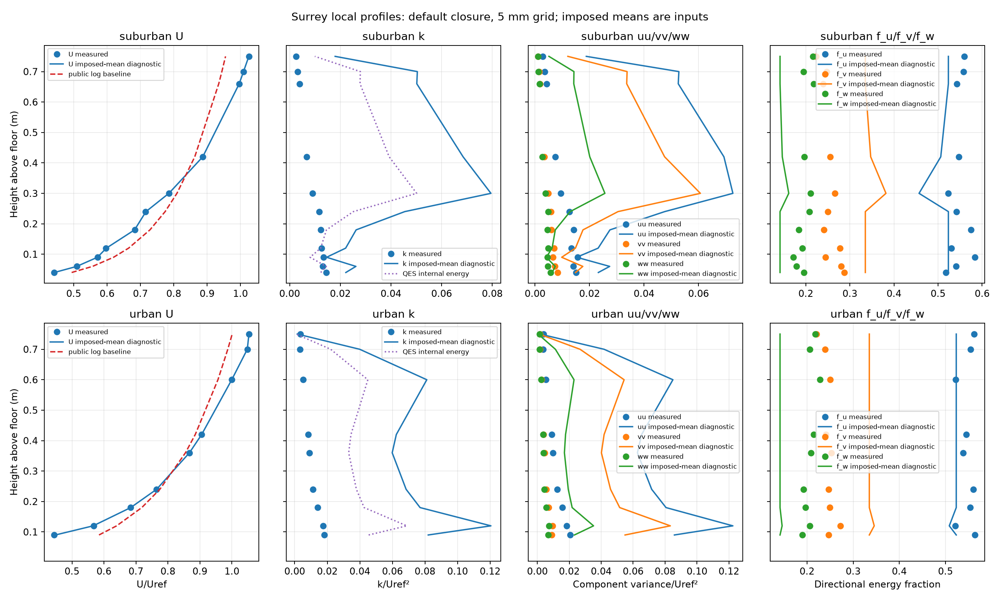

# Surrey background-profile benchmark

> Historical research protocol/results, retained from `54ccb39`. Reproduction
> commands with research-only build paths describe that revision. The portable
> tools and current integration qualification are documented in
> [REFERENCE_INTEGRATION_RESULTS.md](../docs/REFERENCE_INTEGRATION_RESULTS.md).


Built and executed on 2026-11-09 against branch `research/pedestrian-wind-campaign`,
production source at `8f43c5a`. **The benchmark is usable and its first baseline
is complete. The default local turbulence diagnostic substantially overpredicts
the supplied background energy, including when measured horizontal means are
imposed.** This does not qualify a full roughness-transition simulation or
pedestrian predictions.

The [protocol](SURREY_BACKGROUND_PROTOCOL.md),
[settings](specifications/surrey_background_v1.json),
[runner/comparator](surrey_background.py) and
[archived evidence](../docs/data/surrey-background/README.md) define the case.
The source is the summary data accompanying Mishra et al.'s
[Tall Building Clusters in Urban Canopies](https://openresearch.surrey.ac.uk/esploro/outputs/journalArticle/Tall-Building-Clusters-in-Urban-Canopies/991008866202346),
available through [OSF](https://doi.org/10.17605/OSF.IO/5X7WV).

## What was built and run

- 101 hash-pinned observations at 11 roughness-only stations, with stable IDs,
  original/SI coordinates, per-observation reference-speed normalization,
  physical k and directional energy fractions.
- Two public log-profile controls using published parameters, plus eleven
  controls prescribing measured U/V profiles while predicting turbulence.
- Two vertical spacings, 10 and 5 mm: **26 native solves**, with identical
  observation populations for paired comparisons.
- Per-height/station predictions, fixed-population metrics, raw covariance and
  contributor-validity evidence, native column fields, timings and plots.

No production model or coefficients were changed. No cluster/AIJ cases were
launched. The experimental incoming-energy model was not enabled and no
measured variances were supplied to the solver. A fresh isolated native build
and Python package were used; the existing installed extension and previous
research package were preserved.

## First baseline

All 26 runs converged in one iteration and passed the frozen execution guards.
All 404 observation instances (101 per comparison family/grid) had complete
velocity/turbulence support and valid source/interpolated covariances. The
maximum native-centre profile discrepancy was 3.18e-7 m/s; maximum interior
divergence was 9.08e-6 s^-1. Two-grid sensitivity is measured, not a proof of
grid independence.

At the 5 mm spacing:

| Observation group | Points | Public log U/Uref RMSE | Public log physical k: predicted/measured | Imposed-mean physical k: predicted/measured |
| --- | ---: | ---: | ---: | ---: |
| Suburban reference | 11 | 0.05342 | 2.54 | 4.11 |
| Developing Urban | 45 | 0.03877 | 3.88 | 5.64 |
| Developed Urban | 45 | 0.06038 | 3.71 | 6.71 |

Energy ratios compare sums on exactly the stated population; they are not mean
pointwise ratios. Developing Urban comparisons with an equilibrium log profile
are context diagnostics. Prescribed-mean U/Uref RMSE is 0.00069, 0.00089 and
0.00120 respectively; those values describe sampling/interpolation of input
data, not independent mean-flow accuracy.

For the imposed-mean controls, changing 10 to 5 mm changes the aggregate energy
ratios by -0.18%, -0.08% and -0.08%. The paired physical-k/Uref² RMS grid change
over all 101 points is 0.000376, much smaller than the model/observation errors.
This discrepancy is not explained by the tested vertical spacing.

The predicted vertical energy fraction averages 14.38%, 14.15% and 14.21%,
versus measured 19.69%, 20.39% and 20.05%. Absolute vertical variance is also
overpredicted: the smaller vertical fraction does not mean vertical turbulence
is too low in absolute terms. Energy magnitude and directional allocation need
separate assessment.

QES internal energy must remain separate from measured physical k. For the
same imposed-mean populations, internal-energy/measured-k ratios are 2.35,
3.12 and 3.74; half the final covariance trace gives the larger physical ratios
in the table. Comparing only internal `tke` would materially understate the
physical energy discrepancy.

The published displaced log law gives a developed Urban U/Uref RMSE of 0.01301,
compared with 0.06038 for the current public shifted-log profile anchored to the
same published law at 240 mm. This isolates a useful profile-shape limitation:
the public log API has no displacement parameter. The published law itself
was fitted by the authors; this comparison does not constitute independent
validation of that fit.



## Interpretation and next implementation decisions

The benchmark separates covariance validity from physical agreement: every
sample covariance is valid here while background energy is substantially too
large. It also shows that supplying more accurate horizontal means does not
by itself fix this local turbulence diagnostic. The smooth public log controls
overpredict energy too, so the result is not confined to interpolation knots.

The first implementation investigations should address explicit displacement
support for mean profiles and the distinction between internal energy, physical
covariance energy and directional allocation. A background model should also
represent the measured decline of turbulence with height. A single fitted
global multiplier would not resolve these different errors. Keep this baseline
frozen and score each proposed change against both profile families and all
three observation groups.

These controls impose only horizontal mean profiles. They omit measured W,
horizontal gradients and the explicit roughness geometry; therefore they do
not isolate every error in a complete three-dimensional closure. The measured
profile interpolation introduces derivative sensitivity, and the original
measurement covariance/processing uncertainty remains limited. These are local
diagnostics, not predictions of downstream adjustment from a common inlet.

The native planner's 15 m rotation-height requirement is another limitation
for model-scale work. The experiment remains in metre units; a graded numerical
extension reaches 16 m, with all scoring restricted to 40–750 mm. The imposed
upper tail is constant and controls the rotation direction. The extension is
not a reconstruction of the 1.5 m-high tunnel and supplies no pedestrian scale
mapping. A future scale-aware reference choice needs its own investigation.

## Verification and reproduction

The relevant checks pass with warnings treated as errors: **159 passed,
8 skipped**, covering the new benchmark/audit tests and existing profile and
turbulence integration/domain tests. There are no expected failures added.
All files covered by the preceding stress/reference archive checksums remain
unchanged. The new frozen evidence has its own checksums and source snapshots.

Raw output is in `validation/output/surrey-background/baseline-002/`.
`baseline-001` stopped at solver construction because the initially requested
1e-7 tolerance is below float32 epsilon; it launched zero native solves. The
protocol was corrected to 2e-7 before any baseline solve, with no execution or
physical comparison gate relaxed. An earlier import preflight also correctly
rejected the installed extension when editable-import redirection bypassed
the staged package. The successful run verifies both native build identity
and imported Python sources.

To reproduce from the repository root, first build and stage an isolated package:

```sh
cmake -S . -B build/surrey-background/native \
  -DPython_EXECUTABLE="$PWD/.venv/bin/python" \
  -DCMAKE_BUILD_TYPE=Release -DDTCC_QES_OPENMP=ON
cmake --build build/surrey-background/native --target _qes -j 4
.venv/bin/python - <<'PY'
from pathlib import Path
import sys
sys.path.insert(0, 'tools')
from compare_native_builds import stage_package
root = Path.cwd()
native = next((root/'build/surrey-background/native').glob('_qes*.so'))
stage_package(root, native, root/'build/surrey-background/package')
PY
```

The staging helper disables only this package's editable import redirector.
Choose a new output directory; existing benchmark evidence is never overwritten:

```sh
PYTHONPATH=build/surrey-background/package:validation \
OMP_NUM_THREADS=1 OPENBLAS_NUM_THREADS=1 \
MPLCONFIGDIR=/private/tmp/qes-surrey-matplotlib XDG_CACHE_HOME=/private/tmp/qes-surrey-cache \
.venv/bin/python -W error validation/surrey_background.py \
  --output validation/output/surrey-background/reproduction-001 \
  --build-identity build/surrey-background/native/solver-policy-identity.txt

PYTHONPATH=build/surrey-background/package:validation \
OMP_NUM_THREADS=1 OPENBLAS_NUM_THREADS=1 \
.venv/bin/python -W error -m pytest -q \
  validation/tests/test_surrey_background.py validation/tests/test_reference_audit.py \
  tests/test_profile_pipeline.py tests/test_turbulence.py tests/test_turbulence_domain.py
```

The recorded 0.355 s is elapsed run/data-analysis time before rendering plots;
it excludes the native build, tests and plotting. This small homogeneous case
does not measure performance on real urban geometry.
