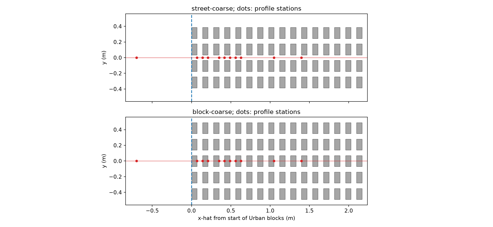
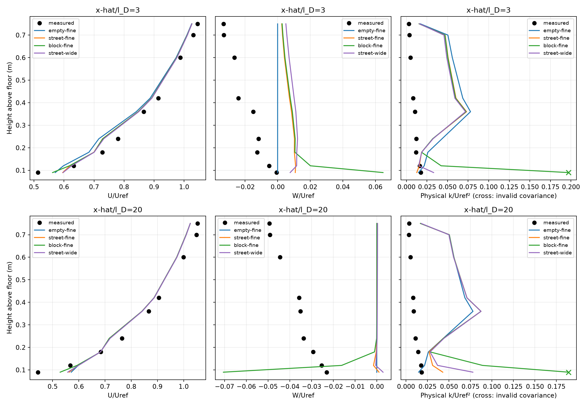

# Surrey roughness-transition geometry benchmark

> Historical research protocol/results, retained from `54ccb39`. Reproduction
> commands with research-only build paths describe that revision. The portable
> tools and current integration qualification are documented in
> [REFERENCE_INTEGRATION_RESULTS.md](../docs/REFERENCE_INTEGRATION_RESULTS.md).


Executed 2026-11-09, starting from `e4e241d` on
`research/pedestrian-wind-campaign`. **All ten planned runs completed and passed
the frozen execution guards. Explicit roughness geometry captures part of the
near-transition vertical-flow response, but gives little developed mean-speed
improvement and does not fix the background turbulence-energy error.**

The [protocol](SURREY_TRANSITION_PROTOCOL.md),
[settings](specifications/surrey_transition_v1.json),
[runner](surrey_transition.py), [analysis](analyse_surrey_transition.py) and
[evidence](../docs/data/surrey-transition/README.md) define the benchmark.
No production physics, coefficients or default settings were changed.

## Reconstruction and controls

The source is the same 101 observations at eleven stations used in the frozen
[background benchmark](SURREY_BACKGROUND_RESULTS.md). The paper's section 3.2
explicitly describes the roughness adjustment without tall-building clusters.
Its Figure 2, geometry dimensions and coordinate conventions support the
regular Urban reconstruction below. See Mishra et al.,
[Tall Building Clusters in Urban Canopies](https://openresearch.surrey.ac.uk/esploro/outputs/journalArticle/Tall-Building-Clusters-in-Urban-Canopies/991008866202346),
and the public [OSF dataset](https://doi.org/10.17605/OSF.IO/5X7WV).

The primary array has 64 explicit 70×140×70 mm blocks, with 70 mm clear gaps.
A shifted array has 80 blocks and places the survey line over block centres.
The primary street-centred interpretation is inferred from the schematic;
the exact roughness-only laboratory phase is not independently confirmed.
Both are sensitivity cases, not competing fits from which to select a winner.
The finite-patch outer-row difference is visible in the plan and assessed by
an additional wider-array case.



Every case uses the same measured Suburban horizontal mean profile as input.
The small upstream roughness and spires are represented through that profile
and ground z0=1.9 mm. Their detailed geometry is not invented from conflicting
or incomplete dimensions. No measured downstream means or variances are inputs.
The absent tall cluster leaves no artificial clearing in the regular array.

Empty, street and shifted-block cases run at 17.5 and 8.75 mm spacing. These
give four/eight cells across the 70 mm block height and gap. Four further coarse
street controls widen the array/domain, extend streamwise boundaries, reduce
the top to 1.5 m for wind only, and disable empirical building models while
retaining solids and mass correction. Projection uses float64 with 1e-10
tolerance; both grids use the identical binary from the background benchmark.
The new empty controls provide comparisons with identical solver/grid settings.

This is QES wind with explicit block solids, empirical building models and
mass correction. The benchmark does not solve a Navier–Stokes internal boundary
layer. It tests how much of the measured transition the current model represents.

## Accuracy and useful physical response

Developed Urban scores use all 45 supplied observations at stations 7,8,9,15,20:

| Case | U/Uref RMSE | W/Uref RMSE | Physical k predicted/measured | Invalid stresses among 45 targets |
| --- | ---: | ---: | ---: | ---: |
| Empty, coarse | 0.05148 | 0.03264 | 4.20 | 0 |
| Street, coarse | 0.05076 | 0.03353 | 4.72 | 0 |
| Shifted block, coarse | 0.04676 | 0.04227 | Incomplete; raw diagonal diagnostic 6.94 | 5 |
| Empty, fine | 0.05198 | 0.03264 | 4.18 | 0 |
| Street, fine | 0.05156 | 0.03365 | 4.37 | 0 |
| Shifted block, fine | 0.04417 | 0.03879 | Incomplete; raw diagonal diagnostic 6.57 | 5 |

Energy ratios compare sums on the fixed population. The street fine case
improves developed U RMSE by only 0.80% against its empty control; developing
U RMSE improves by 4.68%. Its developing/developed k ratios are 4.01/4.37.
The shifted fine case improves developed U RMSE by 15.0%, while worsening W
and failing strict turbulence coverage. This does not justify selecting its
unconfirmed phase or claiming an overall improvement.

Absolute W comparisons include the inlet limitation: the model cannot impose
the measured Suburban vertical mean. The analysis therefore also compares
downstream-minus-upstream changes at exactly shared heights: 90,120,180,240,
420,700,750 mm, giving 70 targets, 35 per downstream group. No upstream values
are interpolated to fill missing 360/600 mm observations. Both source
covariances must be valid for a strict energy-increment score.

For the fine street case, developing ΔW/Uref RMSE falls from 0.01176 to 0.00469
against the empty control, an improvement of **60.1%**. Developed ΔW RMSE is
essentially unchanged, 0.00822 to 0.00827. Developed ΔU RMSE slightly worsens,
0.05692 to 0.05756, and developed Δk/Uref² RMSE increases from 0.00278 to
0.00716. The model captures useful local vertical redistribution, without
capturing the complete adjusted mean/energy profiles. Subtracting upstream W
removes an offset; it does not restore omitted upstream vertical gradients.



## Grid, boundaries and validity

- The street coarse-to-fine U/Uref RMS change is 0.00190 over all 101 points.
  Physical k/Uref² RMS change is 0.00861; its developed aggregate energy ratio
  falls from 4.72 to 4.37. Turbulence remains materially grid sensitive. Two
  grids do not establish convergence.
- Widening the coarse domain changes U/Uref by RMS 0.00265; extending the
  streamwise domain changes it by 0.00035. The finite lateral array deserves
  more attention than the tested streamwise boundaries.
- The 16 m versus 1.5 m wind-only top comparison changes U/Uref by RMS 3.06e-6
  and W/Uref by 1.05e-5 at the measured points. This particular mean-flow
  result is insensitive to the extension. The lower-top run has no turbulence
  calculation and is not a complete tunnel-wall reconstruction. Its
  top-band maximum divergence is 0.00965 s^-1, reported separately from the
  much smaller guarded interior residual.
- Disabling empirical building models changes U/Uref by RMS 0.00375 and
  physical k/Uref² by RMS 0.01048. Geometry plus mass correction already
  produces much of the current mean response; the default empirical models
  do not supply the missing overall roughness adjustment in these controls.
- Both shifted-block grids have invalid stress contributors at **all ten
  downstream 90 mm points**, despite complete fluid/computed sampling support.
  Those points remain in the population and strict scores stay incomplete.
  Street-centre probes are valid, while whole-domain native metadata still
  reports 5,561 invalid stress cells on the coarse street grid and 65,782 on
  the fine grid. Valid survey probes do not establish global covariance validity.

At the ten affected coarse shifted-array points, the interpolated covariance
itself is valid, but its positive-weight sources are not. The strict sampling
rule correctly rejects all ten. At fine spacing, four interpolants are also
invalid. Accepting only the interpolant would conceal source failures.

All runs have exactly the independently reconstructed solid mask. The largest
relative solid-volume error is 1.48e-7. Maximum last-checkpoint receptor change
is 4.48e-8 of Uref; maximum interior divergence times cell spacing/Uref is
1.26e-7. Thus solid rasterization errors or unfinished projection do not explain
the large profile/energy discrepancies in this experiment.

The observed station-8/9/15/20 U variation is also retained with explicit
definitions. Peak-to-peak divided by the mean is 5.18% at 90 mm and 4.40% at
120 mm. The corresponding fine street values are 2.47% and 1.11%. A flat
downstream profile alone is insufficient evidence of correct roughness
adjustment: the empty control is flat too, at the wrong speed. The paper's
approximately 3% statement is not used as a new pass threshold.

## Reference sampling issue exposed by this benchmark

Native friction velocity uses the cell above the first face at or above the
declared reference height. Applying that source-defined lookup to the captured
float32 faces gives:

| Case | Declared reference | Inferred effective sample centre | Friction velocity |
| --- | ---: | ---: | ---: |
| Empty, coarse | 190 mm | 201.25 mm | 0.12087 m/s |
| Empty, fine | 190 mm | 196.88 mm | 0.12045 m/s |
| Street, coarse | 210 mm | 236.25 mm | 0.18215 m/s |
| Street, fine | 210 mm | 214.38 mm | 0.17937 m/s |
| Shifted block, fine | 210 mm | 223.13 mm | 0.18050 m/s |

The effective centres are inferred from captured coordinates and the
[native lookup](../src/qes_core/winds/TURBGeneralData.cpp), accounting for the
[ground ghost layer](../src/qes_core/qes/Domain.cpp). They are not independently
captured native index telemetry. Float32 mean-height accumulation and face
rounding can select different cells even for nominally identical block heights.
The reference/cap response therefore contains a numerical sampling dependence.
Its contribution needs a fixed-mean replay; it is not established as the sole
cause of the energy error.

Adding roughness elements also switches the turbulence reference from the
empty-domain site z0 to morphology-derived z0=7 mm, d=49 mm and zRef=210 mm.
That is part of the current model's geometry response, distinct from the
published Urban z0=5.2 mm. This confound is recorded rather than compensated
by tuning constants or treating all metric changes as wake effects.

## Next implementation focus

1. Prototype grid-stable sampling at the declared turbulence reference height,
   with a frozen-mean comparison isolating friction-velocity/cap effects.
2. Capture positive-weight source gradients and ordered stress-construction
   stages for the shifted-array 90 mm witnesses. Use the existing bounded
   covariance option as a validity control; assess physical energy separately.
3. Test background-energy and mixing-length changes against both this common-
   inlet benchmark and the earlier imposed-profile controls. Their different
   physical questions must remain visible. Do not tune the uncertain array
   phase or use a global energy multiplier to conceal the profile-shape error.

Exact laboratory roughness-only phase and upstream geometry remain qualification
gaps. Neither the numerical success nor the local ΔW improvement qualifies
general pedestrian predictions or a retained-energy campaign.

## Execution, verification and reproduction

The ten native calls take 61.25 s in total; sequential worker wall time is
76.62 s, excluding preparation and analysis. Fine street/block native calls
take 23.85/23.98 s and peak worker RSS is 1.88 GiB. The largest grid has
5,767,168 cells. These are benchmark costs, not speedup claims against the
small background-profile controls.

**167 tests pass and 8 skip**, with warnings treated as errors. Coverage includes
the geometry/inlet/ID/scalar-sampling/increment tests, background/audit tests,
canonical footprints, profile pipeline, parameterizations and turbulence
reference tests. Skips require the archived lexicographic/toolchain identity.
There are no added expected failures or relaxed guards. The previous archives
and native binary remain unchanged.

Use the isolated package built/staged by the
[background reproduction instructions](SURREY_BACKGROUND_RESULTS.md).
No native rebuild or production dependency change is needed for this campaign:

```sh
PYTHONPATH=build/surrey-background/package:validation OMP_NUM_THREADS=4 OPENBLAS_NUM_THREADS=1 \
.venv/bin/python -W error validation/surrey_transition.py \
  --output validation/output/surrey-transition/reproduction-001 \
  --build-identity build/surrey-background/native/solver-policy-identity.txt

PYTHONPATH=build/surrey-background/package:validation OMP_NUM_THREADS=4 OPENBLAS_NUM_THREADS=1 \
MPLCONFIGDIR=/private/tmp/qes-surrey-matplotlib XDG_CACHE_HOME=/private/tmp/qes-surrey-cache \
.venv/bin/python -W error validation/analyse_surrey_transition.py \
  --campaign validation/output/surrey-transition/reproduction-001 \
  --output validation/output/surrey-transition/reproduction-analysis-001
```

Add `--prepare-only` to inventory geometry and grids without solving. Existing
output directories are rejected. The runner pins source/build identity, runs
one bounded subprocess per case, records failures and preserves native captures
before derived analysis. Primary outputs are `campaign-001` and `analysis-003`;
earlier data-only analyses remain under the raw output directory.
