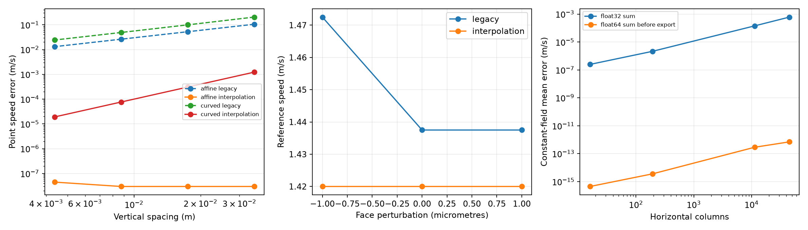
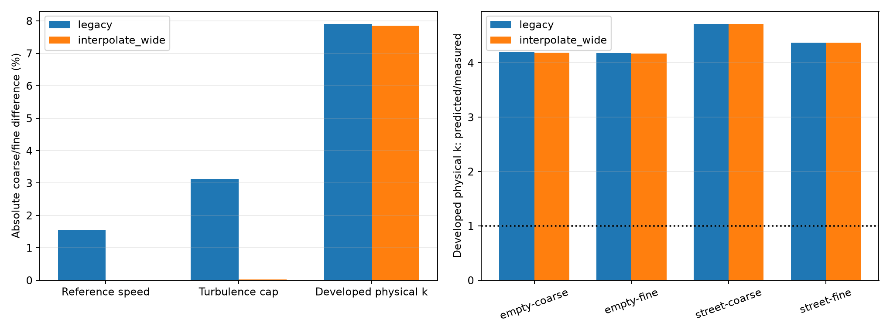

# Grid-dependent turbulence reference: investigation results

> Historical research protocol/results, retained from `54ccb39`. Reproduction
> commands with research-only build paths describe that revision. The portable
> tools and current integration qualification are documented in
> [REFERENCE_INTEGRATION_RESULTS.md](../docs/REFERENCE_INTEGRATION_RESULTS.md).


Executed 2026-11-09, starting from `1fd6d22`. **The reference estimator has a
real numerical defect. Sampling vectors at the declared height and accumulating
their horizontal mean in float64 removes most of its avoidable grid dependence.
It does not explain the large Surrey turbulence-energy error.**

The [protocol](TURBULENCE_REFERENCE_SAMPLING_PROTOCOL.md),
[native diagnostic](../tests/native/reference_sampling_probe.cpp),
[prototype sampler](../tests/native/reference_sampling_candidate.h),
[runner](investigate_reference_sampling.py), [analysis](analyse_reference_sampling.py)
and [frozen evidence](../docs/data/reference-sampling/README.md) provide the
implementation and reproduction inputs. Production reference sampling and
default physics are unchanged; CMake only gains an optional diagnostic target.

## What causes the dependence

`TURBGeneralData::frictionVelocity()` uses `lower_bound` on vertical faces and
samples the cell beginning at that face. For a target inside a cell, that
usually selects the next cell above it. On a uniform grid, the sample centre
can be roughly half to one-and-a-half cell spacings above the declared height.
The logarithmic friction-velocity denominator still uses the declared height.
Thus numerator and denominator describe different elevations. The height
offset biases the estimate upward where speed increases with height.

Float32 face accumulation and mean-building-height accumulation can move a
target across a face by a tiny amount, changing the selected cell. The 64/80
equal-building reference targets are 0.2100000083/0.2100001127 m. Those tiny
differences can create a full-cell sample change. Separately, the horizontal
speed sum and sample counter are floats, introducing a population-dependent
roundoff error.

Four controls isolate these effects: the current lookup/sum, wider summation
alone, centre-based vector interpolation alone, and both changes together.
Interpolation occurs before magnitude in each column; only positive-weight
fluid sources count. No extrapolation or zero-support fallback is invented.
The morphology-derived reference height, z0/d and friction logarithm remain
fixed throughout.

## Manufactured evidence

The native diagnostic runs **48 cases**: affine, curved, turning-vector and
vertical-velocity fields at four spacings, with an interior face perturbed by
-1/0/+1 micrometre. Each case checks that a separate legacy reduction equals
the actual native reference exactly. Additional controls test constant fields,
partial/empty support and below-centre requests.

- At 17.5 mm spacing, the affine legacy point-speed error reaches 0.05250 m/s.
  Interpolation error is below 4.5e-8 m/s across all affine cases.
- Micrometre face motion creates a legacy reference-speed jump exceeding
  0.03 m/s on that grid. The interpolated value changes by less than 1e-6 m/s.
- Curved-field interpolation errors decrease by approximately four when spacing
  halves: 0.001225, 0.0003062, 0.00007656 and 0.00001917 m/s. This is the
  expected second-order behavior for these smooth fields.
- Turning and vertical-flow tests match independent point-speed oracles.
  Scalar speed interpolation would mix different directions incorrectly.
- A constant field with 45,056 columns has a float-sum error of 0.0006082 m/s
  (about 0.0447%). Float64 accumulation error is below 7.1e-13 m/s before the
  existing final float32 scalar export. The final narrowing still has float32
  rounding, without the population-dependent accumulation error.
- A blocked positive-weight source excludes its column; a zero-weight source
  does not invalidate support. Empty support and below-centre queries are
  explicitly unsupported.



## Native Surrey captures and frozen-mean replay

The earlier [geometry benchmark](SURREY_TRANSITION_RESULTS.md) retained probes
and a centreline, not complete horizontal reference planes. Six native mean
reproductions were therefore necessary: empty, street and shifted-block cases
at both grids. The standalone diagnostic uses the exact prepared geometry,
profile, layers and original production numerical sources.

All six reproductions pass admission. Projection iteration counts and native
reference speed/friction/cap metadata agree exactly with the archive. Captured
axes, sampled velocities and actual sampled stresses agree exactly too.
Independent constitutive reconstruction differs by at most 1.49e-8 after
scaling by max(1,abs(stress)), with zero validity disagreements.

Each reproduced field supplies all four reference/cap arms without another
mean solve. The capture includes complete native reference/bracketing planes
and **4,836 source-cell instances** spanning every positive-weight contributor
to the 101 probes in each field. Gradients, mixing length, viscosity, rotation,
geometry and mean velocity remain fixed. Where internal energy is unchanged,
the replay reuses the executed native post-anisotropy tensor exactly and changes
only component clipping; reconstruction roundoff cannot create false changes.

The previous inferred sample heights are now confirmed directly by the native
capture, including 236.25 mm for coarse street, 214.38 mm for fine street and
223.13 mm for fine shifted-block, against approximately 210 mm declared.

For the street cases, absolute coarse/fine gaps become:

| Estimator | Reference speed | Turbulence cap | Developed physical k |
| --- | ---: | ---: | ---: |
| Current lookup and float sum | 1.5539% | 3.1320% | 7.9078% |
| Wider sum only | 1.5517% | 3.1274% | Approximately unchanged |
| Interpolation only | 0.0202% | 0.0403% | Approximately 7.8520% |
| Interpolation and wider sum | **0.0114%** | **0.0227%** | **7.8520%** |

The combined prototype reduces the reference-speed discrepancy by about 137
times. Its remaining difference includes real changes in the reproduced mean
fields and finite interpolation error; two grids cannot establish independence.
The wider sum is useful, while vertical sampling is the dominant defect here.

## Effect on measured turbulence

| Street case | Cap change | Developed physical k, current | Developed physical k, combined prototype |
| --- | ---: | ---: | ---: |
| Coarse | -3.697% | 4.7160 × measured | 4.7136 × measured |
| Fine | -0.658% | 4.3704 × measured | **4.3704 × measured, bitwise unchanged at all probes** |

Only eight of the 804 captured coarse street source tensors change. None of
the 808 fine street source tensors change. The lower cap is inactive at those
fine-grid contributors. Developing physical-k ratios likewise remain around
4.01 on the fine street grid. Changing the scalar reference cannot correct
an uncapped local-energy excess.

Both shifted-block grids retain ten invalid-source probes under all four arms.
Their strict turbulence scores remain incomplete; raw diagonal diagnostics
are kept separately. Reference sampling does not repair those stress failures.
All mean-flow predictions are unchanged by construction. These comparisons
do not assess new dissipation/divergence fields, transport, or whole-domain
candidate covariance validity.

For the present legacy algebraic configuration, source inspection finds
friction velocity entering turbulence construction through the energy/stress
bound. Incoming-energy transport, nonlocal mixing and background mixing are
disabled. The controlled cap replay therefore explains the measured stress
response to this reference change in this configuration, without implying
the same effect for other configurations or datasets.



## Decision and implementation requirements

**Proceed with reference interpolation and float64 horizontal accumulation as
a numerical correction. Do not treat it as the solution to Surrey energy bias.**
Keep the morphology definition fixed initially. An implementation should expose
the declared height, bracketing centre heights/weights, complete fluid-column
count and resulting reference speed/friction/cap. Require actual support at
the declared height; define planning/error behavior for references below the
first centre or with no complete fluid columns. The prototype currently rejects
those cases rather than inventing an extrapolation.

Complex mixed-height geometry still needs support/population tests: changes
in which columns have complete fluid support can remain grid dependent. The
prototype does not establish general physical validity, replace the 15 m rotation
reference, or justify default promotion without integration/regression checks.

The next physics investigation should focus on local energy generation,
mixing-length/gradient sensitivity and the shifted-array 90 mm stress witnesses.
The large uncapped energy and directional-allocation errors persist after this
sampling defect is isolated. Further adjustment of the cap to fit Surrey
would pursue the wrong mechanism.

## Verification and reproduction

**176 tests pass and 8 skip**, with Python warnings treated as errors. The
skips require archived lexicographic/toolchain parity. Tests cover independent
manufactured oracles, second-order refinement, face-crossing continuity,
constant-field reduction, morphology arithmetic and strict source validity,
plus existing profile/turbulence/domain and Surrey checks. No new expected
failures or acceptance thresholds were introduced.

All production numerical source hashes match the original Surrey build. The
only original build-input mismatch is `CMakeLists.txt`, whose change registers
the optional diagnostic executable. The previous staged/installed modules and
background/transition archives are preserved. Frozen recipes and captures allow
future estimator/cap comparisons without reproducing the mean flow again.

From the repository root, using the previously staged Surrey package:

```sh
cmake -S . -B build/reference-sampling/native \
  -DPython_EXECUTABLE="$PWD/.venv/bin/python" -DCMAKE_BUILD_TYPE=Release \
  -DDTCC_QES_OPENMP=ON -DDTCC_QES_BUILD_TESTS=ON
cmake --build build/reference-sampling/native --target reference_sampling_probe -j 4

PYTHONPATH=build/surrey-background/package:validation OMP_NUM_THREADS=4 OPENBLAS_NUM_THREADS=1 \
.venv/bin/python -W error validation/investigate_reference_sampling.py \
  --archive validation/output/surrey-transition/campaign-001 \
  --native build/reference-sampling/native/reference_sampling_probe \
  --output validation/output/reference-sampling/reproduction-001

PYTHONPATH=build/surrey-background/package:validation OMP_NUM_THREADS=4 OPENBLAS_NUM_THREADS=1 \
MPLCONFIGDIR=/private/tmp/qes-surrey-matplotlib XDG_CACHE_HOME=/private/tmp/qes-surrey-cache \
.venv/bin/python -W error validation/analyse_reference_sampling.py \
  --study validation/output/reference-sampling/reproduction-001 \
  --output validation/output/reference-sampling/reproduction-analysis-001
```

If the original raw transition tree is absent, extract `campaign-evidence.tar.gz`
from `docs/data/surrey-transition/` to an unused directory and pass its
`campaign/` subdirectory as `--archive`. Existing output directories are rejected.
The authoritative outputs here are `study-001` and `analysis-001`.
